<!-- Fuente del entregable. Se exporta como Grupo11.pdf (nombre exacto exigido por la consigna). -->

# Laboratorio Integrador · SGBD 2026

**Universidad Tecnológica Nacional — Facultad Regional Resistencia**  
**Ingeniería en Sistemas de Información · Sistemas de Gestión de Bases de Datos (SGBD)**  
**Opción A: MySQL 9.7 + MongoDB 8.0**

## Grupo 11

**Integrantes presentes:**
- Aguirre Egea, Emiliano
- Ghione, Lucas
- Pagno, Agustin
- Sandoval, Lautaro Emanuel

**Distribución del trabajo:** Bloque 1, Aguirre Egea y Ghione · Bloques 2 y 3, Pagno y Sandoval.

**Docentes:** Prof. Ing. A. Fantín · JTP Ing. J.C. Fernández · Aux. Ing. B. Dominguez  
**Fecha:** 17/11/2026

### Entorno de ejecución

| Bloque | Dónde se ejecutó | Versiones |
| :--- | :--- | :--- |
| Bloque 1 (Ej. 1 a 6) | Equipo de un integrante (Pop!_OS 24.04 LTS, base Ubuntu 24.04), instancia de MySQL de laboratorio. Ejecutado el 19/11/2026 | MySQL 9.7.4 |
| Bloque 2 (Ej. 7 y 8) | VM del grupo `LinuxE` (Ubuntu Server 24.04.4 LTS) | MySQL 9.7.2 · MySQL Shell 9.7.1 |
| Bloque 3 (Ej. 9 a 12) | Equipo de un integrante (Pop!_OS 24.04 LTS), instancia de MongoDB de laboratorio, el 19/11/2026. La carga del Ej. 9.2 y la exportación de países del Ej. 10.2 se ejecutaron en la VM `LinuxE` el 17/11 | MongoDB 8.0.38 · `mongosh` 2.14.2 (VM: MongoDB 8.0.34) |

**Convenciones del informe.**
- Ninguna clave aparece en los archivos, comandos ni capturas. Las herramientas la piden por teclado, la leen de una variable de entorno o se reemplaza por `********`.
- **Capturas:** cada captura es una imagen de la terminal generada a partir de la salida registrada de esa ejecución (archivos `salidas_vm/` y `salidas_local/`), sin modificar su contenido. Solo se quitan los separadores (`----`) y el `Bye` que agrega la opción `-vvv` del cliente `mysql`. Las líneas de más de 175 caracteres se recortan con `…`, y las largas se parten en renglones (`↪`).
- Los archivos de cada ejercicio están en las carpetas `bloque1_mysql/`, `bloque2_mysql/` y `bloque3_mongodb/`. Sus salidas completas están en `salidas_local/` y `salidas_vm/`.

---

# Bloque 1: Administración y rendimiento relacional (MySQL 9.7)

## Ejercicio 1: Cuentas de usuario y seguridad granular

**Enunciado**
> **1.1 Administrador de Grupo:** Crear la cuenta de usuario `usr_gXX` (donde XX es el número de grupo) accesible desde cualquier host (`'usr_gXX'@'%'`). Concederle privilegios para administrar las bases del laboratorio sin usar la cuenta súper-usuario.
>
> **1.2 Usuario de Backup:** Crear el usuario local `usr_backup@localhost` asignándole únicamente los privilegios indispensables para efectuar copias de seguridad de `employees`. Justificar en comentarios la necesidad de cada privilegio.

**Decisiones técnicas.**
- **`usr_g11`** recibe `ALL PRIVILEGES ... WITH GRANT OPTION` **solo sobre las bases del laboratorio** (`employees`, `empleados`, `world_x` y `zakila_json`). Además recibe unos pocos privilegios globales administrativos, cada uno justificado por un ejercicio. No tiene acceso a la base de sistema `mysql`, no puede crear usuarios ni apagar el servidor: no es un súper-usuario.
- **`usr_backup`** solo puede **leer** `employees` y hacer lo que `mysqldump` necesita para un respaldo consistente con coordenadas de binlog. No puede escribir ni leer otras bases. No le dimos `LOCK TABLES` porque `--single-transaction` obtiene la foto consistente por MVCC sin bloquear tablas.
- **Claves:** no están en el archivo. Se pasan en variables con `--init-command` y el script arma `CREATE USER` con una sentencia preparada.
- **Activamos `log_bin_trust_function_creators` como administrador.** Con el binlog activo, MySQL exige `SUPER` para crear triggers (lo comprobamos en el Ej. 4: `ERROR 1419`). Preferimos esta variable antes que darle `SUPER`, que es obsoleto y casi ilimitado, a `usr_g11`.

**Código y comandos**

Script `ej01_usuarios.sql` (como administrador del servidor):
```sql
-- =============================================================================
-- LABORATORIO INTEGRADOR SGBD 2026 - GRUPO 11
-- Ejercicio 1 - Cuentas de usuario y seguridad granular (MySQL 9.7)
-- Se ejecuta como administrador del servidor (en la VM: sudo mysql). Las claves NO
-- están en el archivo: llegan en las variables @clave_g11 y @clave_backup.
--   sudo mysql -t -vvv --init-command="SET @clave_g11='...', @clave_backup='...'" < ej01_usuarios.sql
-- =============================================================================

-- -----------------------------------------------------------------------------
-- 1.1 Administrador de grupo: 'usr_g11'@'%' (desde cualquier host)
-- -----------------------------------------------------------------------------
SET @sql = CONCAT("CREATE USER IF NOT EXISTS 'usr_g11'@'%' IDENTIFIED BY ", QUOTE(@clave_g11));
PREPARE st FROM @sql; EXECUTE st; DEALLOCATE PREPARE st;

-- Bases del laboratorio: todos los privilegios y la posibilidad de delegarlos
-- (GRANT OPTION), pero solo sobre estas bases. No recibe privilegios sobre
-- mysql.* ni sobre bases ajenas, por eso no es un súper-usuario.
GRANT ALL PRIVILEGES ON employees.*   TO 'usr_g11'@'%' WITH GRANT OPTION;
GRANT ALL PRIVILEGES ON empleados.*   TO 'usr_g11'@'%' WITH GRANT OPTION;   -- Ej. 2 (aún no existe)
GRANT ALL PRIVILEGES ON world_x.*     TO 'usr_g11'@'%' WITH GRANT OPTION;   -- Ej. 8
GRANT ALL PRIVILEGES ON zakila_json.* TO 'usr_g11'@'%' WITH GRANT OPTION;   -- Ej. 7 y 8

-- Privilegios globales administrativos imprescindibles para el Bloque 1:
--   FILE               -> SELECT ... INTO OUTFILE y LOAD DATA INFILE (Ej. 2)
--   PROCESS            -> ver las transacciones de otras sesiones en innodb_trx / data_locks (Ej. 5)
--   RELOAD             -> FLUSH LOGS y mysqldump --flush-logs (Ej. 6)
--   REPLICATION CLIENT -> SHOW BINARY LOGS / SHOW BINARY LOG STATUS (Ej. 6)
GRANT FILE, PROCESS, RELOAD, REPLICATION CLIENT ON *.* TO 'usr_g11'@'%';
-- PROCESS alcanza para information_schema.innodb_trx, pero performance_schema.data_locks
-- y data_lock_waits (Ej. 5) exigen SELECT sobre performance_schema (solo lectura de métricas).
GRANT SELECT ON performance_schema.* TO 'usr_g11'@'%';

-- Con el binlog activo, MySQL exige SUPER para crear triggers y funciones (ERROR 1419),
-- porque podrían dar resultados distintos al reproducirse en una réplica o en un PITR.
-- En vez de dar SUPER (obsoleto y casi ilimitado) a usr_g11, el administrador declara
-- que confía en quienes ya tienen CREATE ROUTINE / TRIGGER (Ej. 4). La variable está
-- marcada como obsoleta en 9.7 (warning 1287) pero sigue vigente.
SET PERSIST log_bin_trust_function_creators = ON;

-- -----------------------------------------------------------------------------
-- 1.2 Usuario de backup: 'usr_backup'@'localhost' (solo desde la propia VM)
-- -----------------------------------------------------------------------------
SET @sql = CONCAT("CREATE USER IF NOT EXISTS 'usr_backup'@'localhost' IDENTIFIED BY ", QUOTE(@clave_backup));
PREPARE st FROM @sql; EXECUTE st; DEALLOCATE PREPARE st;

-- Sobre employees, solo lo que mysqldump necesita para leer (nunca escribir):
--   SELECT       -> leer las filas de cada tabla
--   SHOW VIEW    -> volcar la definición de las vistas (current_dept_emp, dept_emp_latest_date)
--   TRIGGER      -> volcar los triggers (--triggers; el del Ej. 4.2)
--   EVENT        -> volcar los eventos (--events; el del Ej. 6.2)
-- No se otorga LOCK TABLES: con --single-transaction el volcado es consistente
-- por MVCC sin bloquear tablas.
GRANT SELECT, SHOW VIEW, TRIGGER, EVENT ON employees.* TO 'usr_backup'@'localhost';

-- Globales, porque el respaldo del Ej. 6 usa --flush-logs --source-data=2 --routines:
--   RELOAD             -> FLUSH LOGS y el bloqueo breve (FLUSH TABLES WITH READ LOCK)
--                         que toma --source-data para fijar la posición del binlog
--   REPLICATION CLIENT -> leer archivo y posición del binlog (SHOW BINARY LOG STATUS)
--   PROCESS            -> mysqldump consulta la información de tablespaces
--                         (sin este privilegio habría que agregar --no-tablespaces)
--   SHOW_ROUTINE       -> leer el cuerpo de procedimientos creados por otro usuario (Ej. 4)
GRANT RELOAD, REPLICATION CLIENT, PROCESS ON *.* TO 'usr_backup'@'localhost';
GRANT SHOW_ROUTINE ON *.* TO 'usr_backup'@'localhost';

-- -----------------------------------------------------------------------------
-- Verificación
-- -----------------------------------------------------------------------------
SELECT user, host, plugin, account_locked FROM mysql.user WHERE user IN ('usr_g11', 'usr_backup');
SHOW GRANTS FOR 'usr_g11'@'%';
SHOW GRANTS FOR 'usr_backup'@'localhost';
```

Script de pruebas `ej01_pruebas.sh`:
```bash
#!/bin/bash
# =============================================================================
# LABORATORIO INTEGRADOR SGBD 2026 - GRUPO 11
# Ejercicio 1 - Pruebas de las cuentas: qué puede y qué no puede hacer cada una
# Uso: ./ej01_pruebas.sh      (pide las claves de usr_g11 y usr_backup)
#      MYSQL_CON="-h 127.0.0.1 -P 3306" para cambiar el destino de usr_g11
# =============================================================================
set -uo pipefail
CON_G11=${MYSQL_CON:--h 127.0.0.1}
CON_BK=${MYSQL_CON_BACKUP:-}            # usr_backup es @localhost: por socket
read -rsp "Clave de usr_g11: " PG; echo
read -rsp "Clave de usr_backup: " PB; echo
g11() { MYSQL_PWD="$PG" mysql $CON_G11 -u usr_g11 -t -e "$1" 2>&1; }
bk()  { MYSQL_PWD="$PB" mysql $CON_BK -u usr_backup -t -e "$1" 2>&1; }

echo "=== usr_g11: conectado desde un host remoto (@'%') ==="
g11 "SELECT CURRENT_USER() AS cuenta, USER() AS conectado_como"
echo "--- PERMITIDO: crear y borrar una tabla en una base del laboratorio"
g11 "CREATE TABLE employees.prueba_g11 (id INT PRIMARY KEY); DROP TABLE employees.prueba_g11; SELECT 'DDL en employees: OK' AS resultado"
echo "--- RECHAZADO: leer la base de sistema mysql (no es súper-usuario)"
g11 "SELECT user, host FROM mysql.user"
echo "--- RECHAZADO: crear usuarios"
g11 "CREATE USER 'intruso'@'%' IDENTIFIED BY 'x'"
echo "--- RECHAZADO: apagar el servidor"
g11 "SHUTDOWN"

echo; echo "=== usr_backup: solo lectura y respaldo de employees ==="
bk "SELECT CURRENT_USER() AS cuenta"
echo "--- PERMITIDO: leer employees"
bk "SELECT COUNT(*) AS empleados FROM employees.employees"
echo "--- RECHAZADO: modificar employees"
bk "UPDATE employees.salaries SET salary = 0 WHERE emp_no = 10001"
echo "--- RECHAZADO: leer otra base"
bk "SELECT COUNT(*) FROM world_x.city"
echo "--- PERMITIDO: respaldo completo de employees con mysqldump"
MYSQL_PWD="$PB" mysqldump $CON_BK -u usr_backup --single-transaction --flush-logs --source-data=2 \
  --set-gtid-purged=OFF --skip-masking-policies --routines --triggers --events --databases employees > /tmp/prueba_backup_employees.sql
echo "mysqldump terminó con código $? · tamaño: $(du -h /tmp/prueba_backup_employees.sql | cut -f1)"
grep -m1 "CHANGE REPLICATION SOURCE TO" /tmp/prueba_backup_employees.sql
rm -f /tmp/prueba_backup_employees.sql
```

**Evidencias**

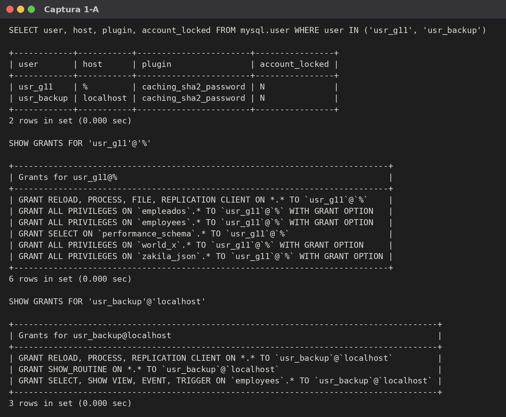

*Captura 1-A: creación de las cuentas y sus privilegios.*

Las dos cuentas usan `caching_sha2_password`, el método por defecto de MySQL 9.7. `usr_g11` tiene todo sobre las cuatro bases del laboratorio, cuatro privilegios globales concretos (`RELOAD`, `PROCESS`, `FILE`, `REPLICATION CLIENT`) y lectura de `performance_schema`. `usr_backup` tiene lectura sobre `employees` y los privilegios globales que pide `mysqldump`.

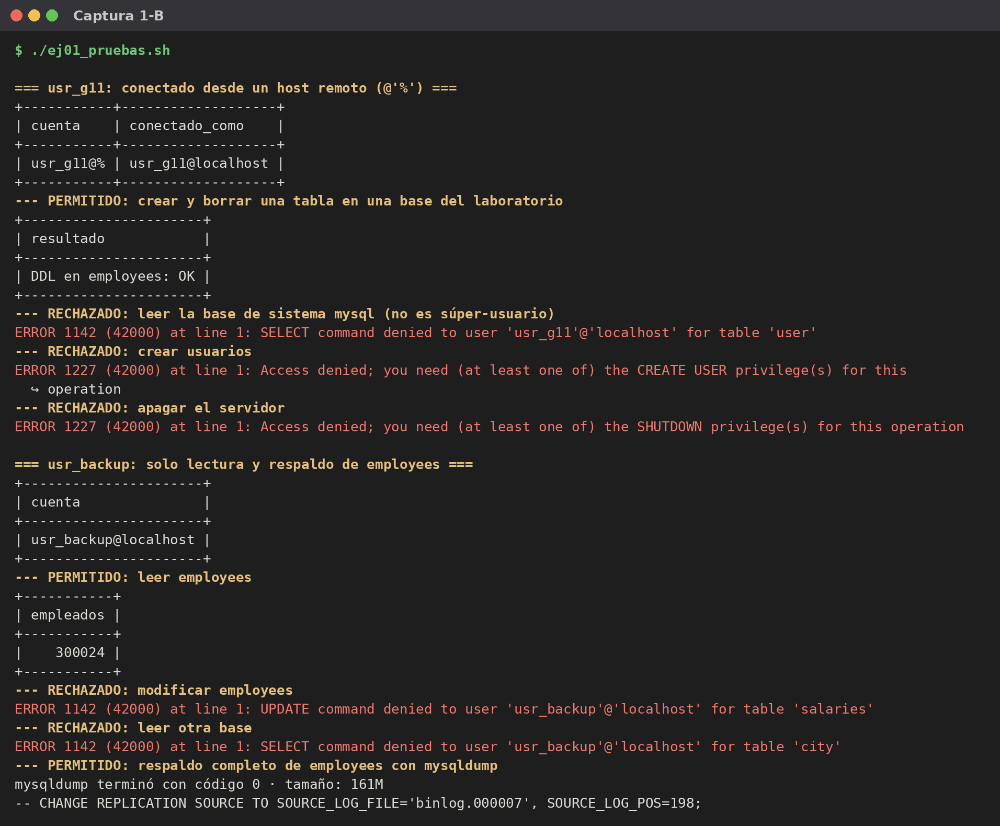

*Captura 1-B: pruebas de lo permitido y lo rechazado.*

- **`usr_g11`** crea y borra tablas en `employees`, pero el servidor le rechaza leer `mysql.user`, crear usuarios y apagar el servidor (`ERROR 1142` y `ERROR 1227`).
- **`usr_backup`** lee `employees`, pero no puede modificarla ni leer `world_x`. Aun así, hace el respaldo completo con `mysqldump`, que termina con código 0 y registra las coordenadas del binlog que usa el Ej. 6.

**Nota aclaratoria.**
- `mysqldump` 9.7 intenta volcar las *masking policies* (función nueva de la serie 9) y, sin permiso sobre `mysql.column_masking_policy`, muestra un error aunque el respaldo termina bien. Como `employees` no tiene políticas de enmascaramiento, usamos `--skip-masking-policies` en vez de darle más privilegios a `usr_backup`.
- `GRANT SELECT ON performance_schema.*` a `usr_g11` surgió en el Ej. 5: `PROCESS` alcanza para `information_schema.innodb_trx`, pero no para `performance_schema.data_locks`.

---

## Ejercicio 2: Almacenamiento, exportación e importación masiva

**Enunciado**
> **2.1 Exportación a Texto Delimitado:** Exportar las tablas `employees`, `salaries` y `titles` de la base `employees` a archivos planos delimitados (`mysqldump --tab` o `SELECT INTO OUTFILE`).
>
> **2.2 Definición del Esquema Traducido:** Crear la base `empleados` y definir las tablas `empleados`, `salarios` y `cargos` traduciendo los nombres de atributos al castellano, manteniendo integridad referencial.
>
> **2.3 Carga Masiva:** Importar masivamente los datos desde los archivos delimitados hacia las nuevas tablas mediante `LOAD DATA INFILE` o `mysqlimport`. Registrar tiempo y filas procesadas.

**Decisiones técnicas.**
- **Exportamos con `SELECT ... INTO OUTFILE`** en formato CSV, en vez de `mysqldump --tab`. Con `--tab` el servidor escribe los datos en `secure_file_priv` (en Ubuntu, `/var/lib/mysql-files/`), pero el cliente tiene que escribir los `.sql` en la misma carpeta, que pertenece al usuario `mysql`.
- **El servidor solo lee y escribe archivos dentro de `secure_file_priv`.** Por eso el script consulta esa ruta al servidor. `LOAD DATA` no acepta la ruta en una variable, así que el script la arma en el texto de la sentencia.
- **Traducción:** `emp_no` → `nro_empleado`, `salary` → `salario`, `title` → `cargo`, `from_date`/`to_date` → `desde`/`hasta`, etc. Mantuvimos las claves primarias del original y agregamos las claves foráneas `salarios → empleados` y `cargos → empleados`.
- **Orden de carga:** primero la tabla padre (`empleados`) y después las hijas. No desactivamos `foreign_key_checks`: la integridad se verifica durante la carga.

**Código y comandos**

Script `ej02_carga_masiva.sh`:
```bash
#!/bin/bash
# =============================================================================
# LABORATORIO INTEGRADOR SGBD 2026 - GRUPO 11
# Ejercicio 2 - Exportación a texto delimitado, esquema traducido y carga masiva
# Uso: ./ej02_carga_masiva.sh   (pide la clave de usr_g11)
#      MYSQL_CON="-h 127.0.0.1 -P 3306" para cambiar el destino
# El servidor solo lee y escribe archivos en secure_file_priv (en Ubuntu:
# /var/lib/mysql-files/). LOAD DATA no acepta la ruta en una variable, por eso
# este script la obtiene del servidor y arma las sentencias.
# =============================================================================
set -uo pipefail
CON=${MYSQL_CON:--h 127.0.0.1}
read -rsp "Clave de usr_g11: " P; echo
export MYSQL_PWD="$P"
sql() { mysql $CON -u usr_g11 -t -vvv "$@"; }

DIR=$(mysql $CON -u usr_g11 -N -B -e "SELECT @@secure_file_priv")
echo "secure_file_priv = $DIR"
[ -n "$DIR" ] && [ "$DIR" != "NULL" ] || { echo "El servidor no permite archivos (secure_file_priv vacío o NULL)"; exit 1; }
# INTO OUTFILE falla si el archivo ya existe: se usa un sufijo con la fecha
SUF=$(date +%Y%m%d_%H%M%S)
F_EMP="${DIR}employees_${SUF}.csv"; F_SAL="${DIR}salaries_${SUF}.csv"; F_TIT="${DIR}titles_${SUF}.csv"
CSV="FIELDS TERMINATED BY ',' OPTIONALLY ENCLOSED BY '\"' LINES TERMINATED BY '\n'"

echo; echo "=== 2.1 Exportación a texto delimitado (CSV) con SELECT ... INTO OUTFILE"
sql <<SQL
SELECT * FROM employees.employees INTO OUTFILE '$F_EMP' $CSV;
SELECT * FROM employees.salaries  INTO OUTFILE '$F_SAL' $CSV;
SELECT * FROM employees.titles    INTO OUTFILE '$F_TIT' $CSV;
SQL

echo; echo "=== 2.2 Base empleados con nombres en castellano e integridad referencial"
sql <<'SQL'
DROP DATABASE IF EXISTS empleados;
CREATE DATABASE empleados CHARACTER SET utf8mb4;
USE empleados;
CREATE TABLE empleados (
  nro_empleado     INT          NOT NULL,
  fecha_nacimiento DATE         NOT NULL,
  nombre           VARCHAR(14)  NOT NULL,
  apellido         VARCHAR(16)  NOT NULL,
  genero           ENUM('M','F') NOT NULL,
  fecha_ingreso    DATE         NOT NULL,
  PRIMARY KEY (nro_empleado)
) ENGINE=InnoDB;
CREATE TABLE salarios (
  nro_empleado INT  NOT NULL,
  salario      INT  NOT NULL,
  desde        DATE NOT NULL,
  hasta        DATE NOT NULL,
  PRIMARY KEY (nro_empleado, desde),
  CONSTRAINT fk_salarios_empleados FOREIGN KEY (nro_empleado)
    REFERENCES empleados (nro_empleado) ON DELETE CASCADE
) ENGINE=InnoDB;
CREATE TABLE cargos (
  nro_empleado INT         NOT NULL,
  cargo        VARCHAR(50) NOT NULL,
  desde        DATE        NOT NULL,
  hasta        DATE,
  PRIMARY KEY (nro_empleado, cargo, desde),
  CONSTRAINT fk_cargos_empleados FOREIGN KEY (nro_empleado)
    REFERENCES empleados (nro_empleado) ON DELETE CASCADE
) ENGINE=InnoDB;
SHOW TABLES;
SQL

echo; echo "=== 2.3 Carga masiva con LOAD DATA INFILE (primero la tabla padre)"
sql <<SQL
USE empleados;
SET @t0 := NOW(6);
LOAD DATA INFILE '$F_EMP' INTO TABLE empleados $CSV
  (nro_empleado, fecha_nacimiento, nombre, apellido, genero, fecha_ingreso);
LOAD DATA INFILE '$F_SAL' INTO TABLE salarios  $CSV (nro_empleado, salario, desde, hasta);
LOAD DATA INFILE '$F_TIT' INTO TABLE cargos    $CSV (nro_empleado, cargo, desde, hasta);
SELECT ROUND(TIMESTAMPDIFF(MICROSECOND, @t0, NOW(6)) / 1000000, 2) AS segundos_carga_total;
SQL

echo; echo "=== Verificación: filas en origen y destino, e integridad referencial"
sql <<'SQL'
SELECT 'empleados' AS tabla, (SELECT COUNT(*) FROM employees.employees) AS origen, (SELECT COUNT(*) FROM empleados.empleados) AS destino
UNION ALL SELECT 'salarios', (SELECT COUNT(*) FROM employees.salaries), (SELECT COUNT(*) FROM empleados.salarios)
UNION ALL SELECT 'cargos',   (SELECT COUNT(*) FROM employees.titles),   (SELECT COUNT(*) FROM empleados.cargos);
SELECT COUNT(*) AS salarios_sin_empleado FROM empleados.salarios s
  LEFT JOIN empleados.empleados e ON e.nro_empleado = s.nro_empleado WHERE e.nro_empleado IS NULL;
SELECT e.nro_empleado, e.nombre, e.apellido, c.cargo, s.salario
FROM empleados.empleados e
JOIN empleados.cargos c   ON c.nro_empleado = e.nro_empleado AND c.hasta = '9999-01-01'
JOIN empleados.salarios s ON s.nro_empleado = e.nro_empleado AND s.hasta = '9999-01-01'
ORDER BY e.nro_empleado LIMIT 3;
-- La integridad referencial rechaza un salario de un empleado inexistente
INSERT INTO empleados.salarios VALUES (999999, 1000, '2026-01-01', '9999-01-01');
SQL
```

**Evidencias**

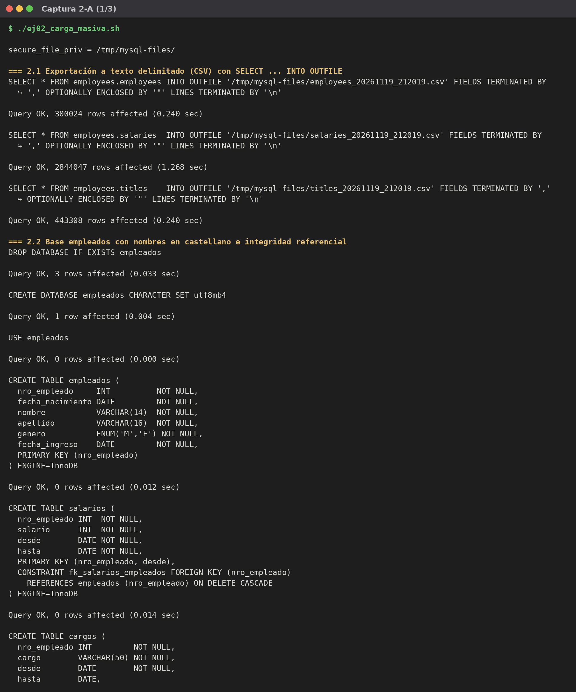

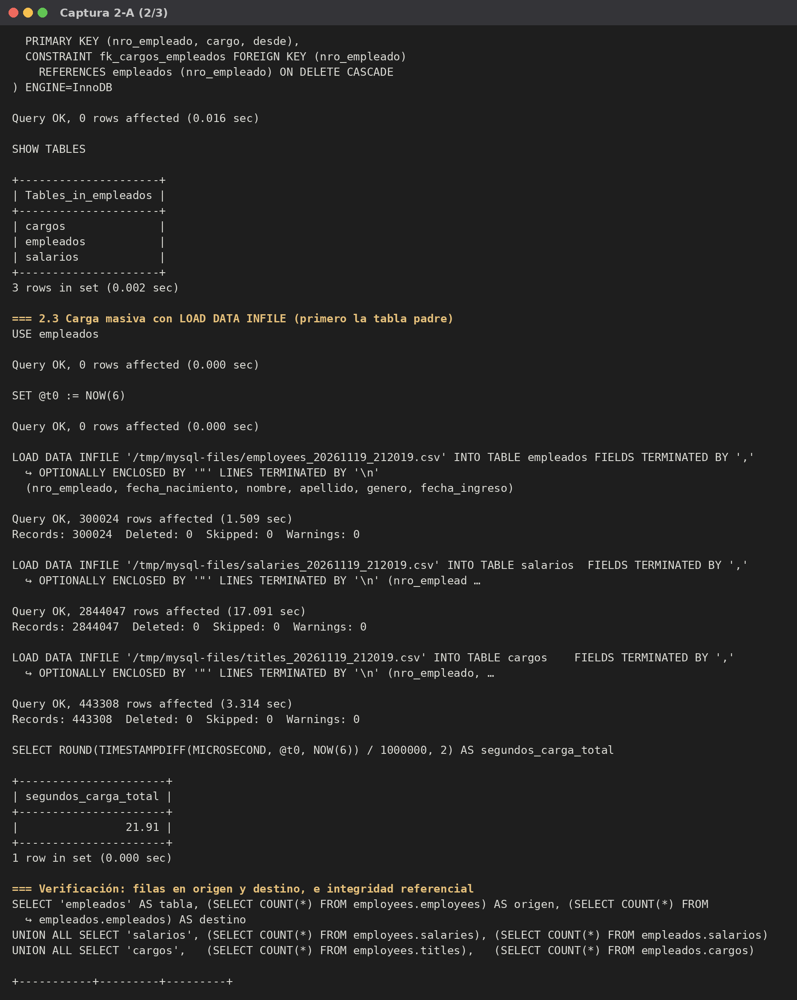

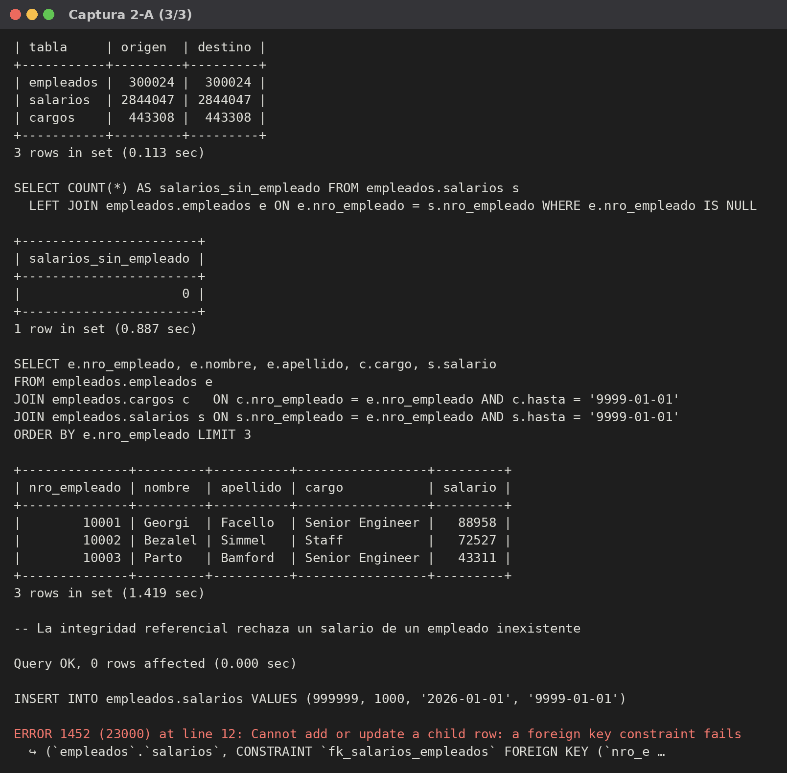

*Captura 2-A: exportación, creación del esquema y carga masiva con tiempos.*

| Tabla | Filas exportadas | Tiempo exportación | Filas importadas | Tiempo `LOAD DATA` |
| :--- | ---: | ---: | ---: | ---: |
| `employees` → `empleados` | 300.024 | 0,24 s | 300.024 | 1,51 s |
| `salaries` → `salarios` | 2.844.047 | 1,27 s | 2.844.047 | 17,09 s |
| `titles` → `cargos` | 443.308 | 0,24 s | 443.308 | 3,31 s |
| **Total** | **3.587.379** | **1,75 s** | **3.587.379** | **21,91 s** |

Todas las filas llegaron sin advertencias (`Skipped: 0, Warnings: 0`), los recuentos de origen y destino coinciden y no quedaron salarios sin empleado. La clave foránea rechaza un salario de un empleado inexistente (`ERROR 1452`). La carga es unas 12 veces más lenta que la exportación, porque escribe y verifica la clave primaria y la foránea de cada fila.

---

## Ejercicio 3: Optimización SQL y planes de ejecución (EXPLAIN ANALYZE)

**Enunciado**
> - **3.a Consulta 1 (Histórico):** Listar la información personal completa de los empleados junto con su historial de salarios.
> - **3.b Consulta 2 (Búsqueda por Apellido):** Filtrar empleados cuyo apellido comience con "Gut" (`last_name LIKE 'Gut%'`) o sea igual a "González" (`last_name = 'González'`), ordenando alfabéticamente.
> - **3.c Consulta 3 (Rangos y Vigencia):** Filtrar sueldos en un rango específico vigentes a la fecha actual (`to_date = '9999-01-01'`).
> - **3.d Consulta 4 (Combinación con CTE):** Combinar las condiciones anteriores mediante CTEs (`WITH ... AS`) o subconsultas.
> - **3.e Índices B-Tree:** Crear índices B-Tree en `employees(last_name)` y `salaries(salary)`. Re-ejecutar consultas con `EXPLAIN ANALYZE` y comparar métricas (filas, tiempo ms, costo) antes y después.
> - **3.f Búsqueda de Cargos:** Consultar la tabla `titles` para "Engineer" comparando `LIKE 'Engineer%'` versus `= 'Engineer'`. Evaluar uso de índices.
> - **3.g Resumen Comparativo:** Consolidar métricas en una tabla y redactar informe sintético de rendimiento (máx. 15 renglones).

**Decisiones técnicas.**
- **Mismas consultas antes y después.** El mismo archivo `ej03_consultas.sql` se ejecuta antes y después de `ej03_indices.sql`, sin ningún otro cambio. La primera ejecución en frío se descarta (`ej03_1_antes_frio.txt`) y se compara la segunda contra la posterior a los índices.
- **3.c:** usamos el rango de sueldos 100.000 a 110.000, que tiene 10.611 sueldos vigentes. Es un rango selectivo, donde un índice puede aportar.
- **3.d:** combina el filtro por apellido de 3.b con sueldos vigentes en un rango más amplio (60.000 a 110.000) mediante dos CTE.
- **3.f:** `titles` solo tiene la clave primaria `(emp_no, title, from_date)`, que no sirve para buscar por cargo. Para evaluar el uso de índices creamos además `idx_titles_title`, y agregamos `LIKE '%Engineer'` como contraste (comodín al inicio).
- **`ANALYZE TABLE`** después de crear los índices, para que el optimizador use estadísticas actualizadas.

**Código y comandos**

Script `ej03_consultas.sql`:
```sql
-- =============================================================================
-- LABORATORIO INTEGRADOR SGBD 2026 - GRUPO 11
-- Ejercicio 3 - Consultas con EXPLAIN ANALYZE (se ejecuta ANTES y DESPUÉS de
-- ej03_indices.sql, sin cambiar nada más, para comparar los planes)
--   mysql -h 127.0.0.1 -u usr_g11 -p -vvv -r employees < ej03_consultas.sql
-- EXPLAIN ANALYZE ejecuta la consulta y muestra, por cada nodo del plan, el costo
-- estimado, las filas estimadas y el tiempo y las filas reales.
-- =============================================================================
USE employees;
SELECT VERSION() AS motor, @@explain_format AS formato_explain;
SELECT INDEX_NAME, TABLE_NAME, COLUMN_NAME FROM information_schema.STATISTICS
WHERE TABLE_SCHEMA = 'employees' AND TABLE_NAME IN ('employees','salaries','titles') AND INDEX_NAME <> 'PRIMARY'
ORDER BY TABLE_NAME, INDEX_NAME;

-- 3.a Consulta 1 (Histórico): datos personales + historial completo de salarios
SELECT COUNT(*) AS filas_3a FROM employees e JOIN salaries s ON s.emp_no = e.emp_no;
EXPLAIN ANALYZE
SELECT e.emp_no, e.birth_date, e.first_name, e.last_name, e.gender, e.hire_date,
       s.salary, s.from_date, s.to_date
FROM employees e
JOIN salaries s ON s.emp_no = e.emp_no
ORDER BY e.emp_no, s.from_date;

-- 3.b Consulta 2 (Búsqueda por apellido), ordenada alfabéticamente
SELECT last_name, COUNT(*) AS empleados FROM employees
WHERE last_name LIKE 'Gut%' OR last_name = 'González' GROUP BY last_name;
EXPLAIN ANALYZE
SELECT emp_no, first_name, last_name, hire_date
FROM employees
WHERE last_name LIKE 'Gut%' OR last_name = 'González'
ORDER BY last_name, first_name;

-- 3.c Consulta 3 (Rangos y vigencia): sueldos vigentes entre 100.000 y 110.000
SELECT COUNT(*) AS filas_3c FROM salaries WHERE salary BETWEEN 100000 AND 110000 AND to_date = '9999-01-01';
EXPLAIN ANALYZE
SELECT emp_no, salary, from_date
FROM salaries
WHERE salary BETWEEN 100000 AND 110000
  AND to_date = '9999-01-01';

-- 3.d Consulta 4 (Combinación con CTE): empleados de 3.b con sueldo vigente
--     en un rango amplio (60.000 a 110.000), con su cargo vigente
EXPLAIN ANALYZE
WITH emp_apellido AS (
  SELECT emp_no, first_name, last_name
  FROM employees
  WHERE last_name LIKE 'Gut%' OR last_name = 'González'
),
sueldo_vigente AS (
  SELECT emp_no, salary
  FROM salaries
  WHERE salary BETWEEN 60000 AND 110000 AND to_date = '9999-01-01'
)
SELECT a.emp_no, a.first_name, a.last_name, v.salary
FROM emp_apellido a
JOIN sueldo_vigente v ON v.emp_no = a.emp_no
ORDER BY a.last_name, a.first_name;

WITH emp_apellido AS (
  SELECT emp_no, first_name, last_name FROM employees
  WHERE last_name LIKE 'Gut%' OR last_name = 'González'),
sueldo_vigente AS (
  SELECT emp_no, salary FROM salaries
  WHERE salary BETWEEN 60000 AND 110000 AND to_date = '9999-01-01')
SELECT COUNT(*) AS filas_3d, MIN(v.salary) AS sueldo_min, MAX(v.salary) AS sueldo_max
FROM emp_apellido a JOIN sueldo_vigente v ON v.emp_no = a.emp_no;

-- 3.f Búsqueda de cargos: LIKE 'Engineer%' frente a = 'Engineer' (y un LIKE con
--     comodín al inicio, que nunca puede usar un índice B-Tree)
SELECT 'LIKE Engineer%' AS condicion, COUNT(*) AS filas FROM titles WHERE title LIKE 'Engineer%'
UNION ALL SELECT '= Engineer', COUNT(*) FROM titles WHERE title = 'Engineer'
UNION ALL SELECT 'LIKE %Engineer', COUNT(*) FROM titles WHERE title LIKE '%Engineer';
EXPLAIN ANALYZE SELECT emp_no, from_date FROM titles WHERE title LIKE 'Engineer%';
EXPLAIN ANALYZE SELECT emp_no, from_date FROM titles WHERE title = 'Engineer';
EXPLAIN ANALYZE SELECT emp_no, from_date FROM titles WHERE title LIKE '%Engineer';
```

Script `ej03_indices.sql`:
```sql
-- =============================================================================
-- LABORATORIO INTEGRADOR SGBD 2026 - GRUPO 11
-- Ejercicio 3.e - Índices B-Tree (y el índice que evalúa 3.f)
--   mysql -h 127.0.0.1 -u usr_g11 -p -t -vvv employees < ej03_indices.sql
-- =============================================================================
USE employees;

-- 3.e Índices pedidos por la consigna
CREATE INDEX idx_employees_last_name ON employees (last_name);   -- 3.b y 3.d
CREATE INDEX idx_salaries_salary     ON salaries (salary);       -- 3.c y 3.d

-- 3.f titles solo tiene la PK (emp_no, title, from_date): title no es la primera
--     columna, así que ninguna búsqueda por cargo puede usarla. Se agrega un índice
--     por title para evaluar LIKE 'Engineer%' frente a = 'Engineer'.
CREATE INDEX idx_titles_title        ON titles (title);

-- Estadísticas actualizadas para que el optimizador conozca los índices nuevos
ANALYZE TABLE employees, salaries, titles;

SELECT TABLE_NAME, INDEX_NAME, COLUMN_NAME, CARDINALITY, INDEX_TYPE
FROM information_schema.STATISTICS
WHERE TABLE_SCHEMA = 'employees' AND INDEX_NAME LIKE 'idx\_%'
ORDER BY TABLE_NAME, INDEX_NAME;
```

Ejecución:
```bash
mysql -h 127.0.0.1 -u usr_g11 -p --skip-comments -vvv -r employees < ej03_consultas.sql   # antes (2 veces)
mysql -h 127.0.0.1 -u usr_g11 -p --skip-comments -t -vvv employees < ej03_indices.sql
mysql -h 127.0.0.1 -u usr_g11 -p --skip-comments -vvv -r employees < ej03_consultas.sql   # después
```

**Evidencias**

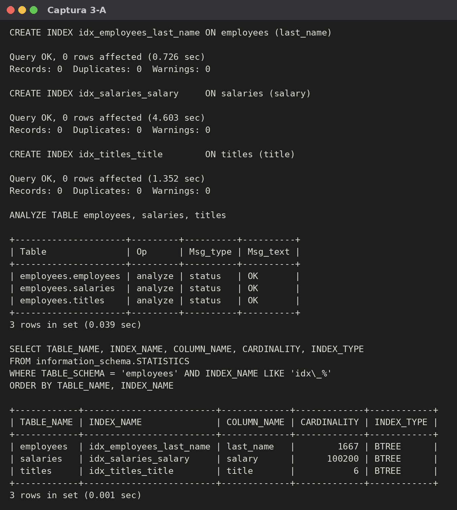

*Captura 3-A: índices creados.*

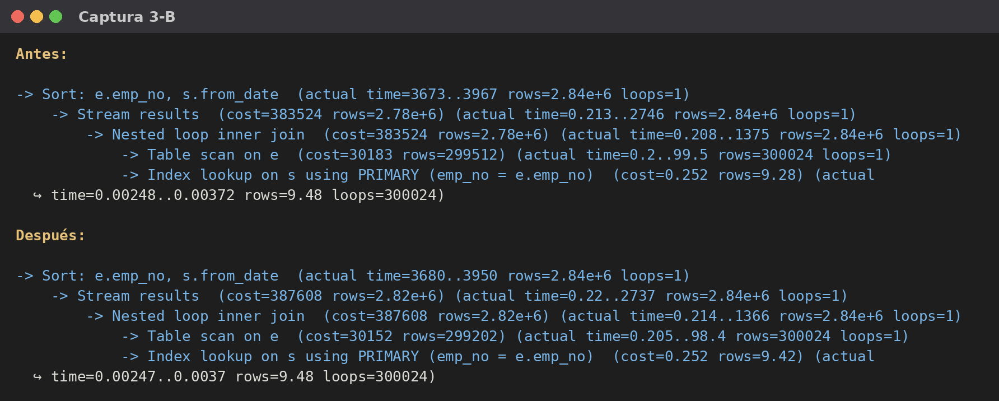

*Captura 3-B: 3.a antes y después (no cambia).*

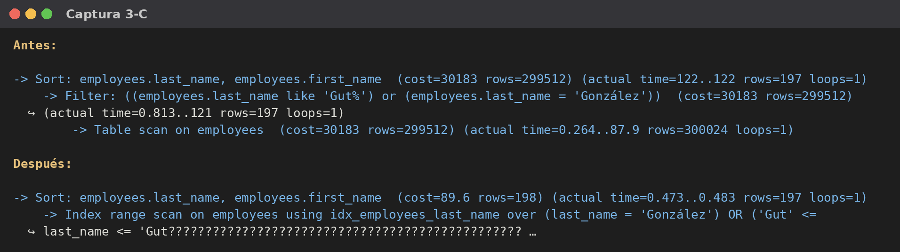

*Captura 3-C: 3.b antes y después.*

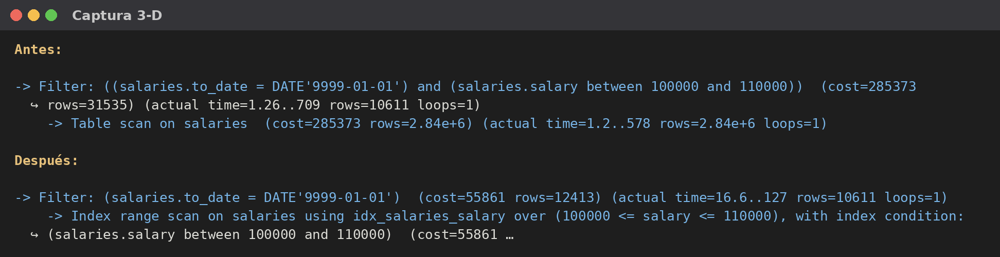

*Captura 3-D: 3.c antes y después.*

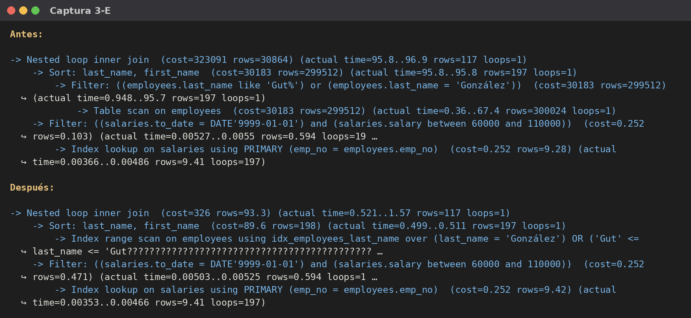

*Captura 3-E: 3.d antes y después.*

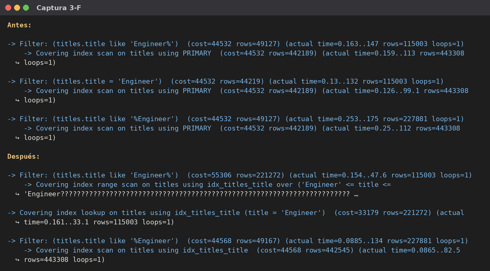

*Captura 3-F: 3.f antes y después (LIKE 'Engineer%', = 'Engineer', LIKE '%Engineer').*

**3.g Resumen comparativo** (tiempo y filas reales del nodo superior; costo estimado por el optimizador):

| Consulta | Filas devueltas | Acceso antes | Acceso después | Filas leídas antes → después | Tiempo antes → después | Costo antes → después |
| :--- | ---: | :--- | :--- | :--- | :--- | :--- |
| 3.a Histórico | 2.844.047 | Recorrido de `employees` + PK de `salaries` | Igual | 300.024 + 2,84 M → igual | 3.967 → 3.950 ms | 383.524 → 387.608 |
| 3.b Apellido | 197 | Recorrido completo | Rango en `idx_employees_last_name` | 300.024 → 197 | 122 → 0,48 ms | 30.183 → 89,6 |
| 3.c Rango vigente | 10.611 | Recorrido completo | Rango en `idx_salaries_salary` | 2,84 M → 62.989 | 709 → 127 ms | 285.373 → 55.861 |
| 3.d CTE | 117 | Recorrido de `employees` | Rango en `idx_employees_last_name` | 300.024 → 197 | 96,9 → 1,57 ms | 323.091 → 326 |
| 3.f `LIKE 'Engineer%'` | 115.003 | Recorrido de la PK | Rango en `idx_titles_title` | 443.308 → 115.003 | 147 → 47,6 ms | 44.532 → 55.306 |
| 3.f `= 'Engineer'` | 115.003 | Recorrido de la PK | Búsqueda en `idx_titles_title` | 443.308 → 115.003 | 132 → 33,1 ms | 44.532 → 33.179 |
| 3.f `LIKE '%Engineer'` | 227.881 | Recorrido de la PK | Recorrido completo del índice | 443.308 → 443.308 | 175 → 134 ms | 44.532 → 44.568 |

**Informe de rendimiento.**
1. Los índices B-Tree sirven cuando el filtro es **selectivo**: 3.b pasó de 122 ms a 0,48 ms (250 veces menos), porque leyó 197 entradas en vez de 300.024 filas.
2. En 3.c el índice por `salary` redujo las filas leídas de 2,84 millones a 62.989 y el tiempo de 709 a 127 ms. `to_date` se sigue filtrando después, fila por fila.
3. 3.d hereda la mejora de 3.b: el CTE arranca por el filtro de apellido y une cada empleado con su sueldo por la clave primaria (de 96,9 a 1,57 ms).
4. 3.a no cambia: devuelve las 2,84 M filas, no tiene filtro que indexar, y el costo está en el ordenamiento final.
5. En `titles`, `LIKE 'Engineer%'` usa el índice como **rango**, porque el prefijo es fijo. `= 'Engineer'` hace una búsqueda exacta y es la más rápida (33 ms). `LIKE '%Engineer'` no puede buscar por índice: recorre el índice completo, y solo es más rápida porque el índice es más chico que la tabla.
6. Los índices tienen un costo: hay que mantenerlos en cada `INSERT`, `UPDATE` y `DELETE`, y ocupan espacio (crear `idx_salaries_salary` sobre 2,84 M filas tardó 4,6 s).
7. El costo estimado de 3.f `LIKE` subió (de 44.532 a 55.306) aunque el tiempo bajó. Es una estimación del optimizador, no un tiempo, y por eso lo medimos con `EXPLAIN ANALYZE`.

**Nota aclaratoria.**
- La base `employees` **no tiene ningún apellido "González"** (ni con tilde ni sin ella). La condición `= 'González'` no devuelve filas, y los 197 resultados son todos "Guting".
- En MySQL 9.7, `EXPLAIN` muestra por defecto el formato árbol (`explain_format = TREE`). Para la tabla clásica hay que usar `EXPLAIN FORMAT=TRADITIONAL`.
- En el cliente `mysql` 9.7, la opción `--comments` viene activada y reenvía al servidor cada línea de comentario del script. Con `-vvv` eso ensucia la salida, por eso usamos `--skip-comments`.

---

## Ejercicio 4: Programabilidad en el SGBD (procedimientos y triggers)

**Enunciado**
> **4.1 Verificación de Gerentes:** Procedimiento almacenado que verifique si un `dept_manager` administra actualmente un departamento. Retornar los empleados asignados y su antigüedad en años.
>
> **4.2 Trigger de Asignación de Cargo:** `TRIGGER` sobre `dept_manager` que al dar de alta un administrador actualice en `dept_emp` y `titles` su cargo a 'Manager'.
>
> **4.3 Estructura de Ayuda Escolar:** Diseñar la tabla `asignaciones_familiares` asociada a `employees` y un procedimiento para calcular el beneficio económico de empleados beneficiarios.

**Decisiones técnicas.**
- **4.1:** "Administra actualmente" quiere decir una fila de `dept_manager` con `to_date = '9999-01-01'`. Si el empleado es gerente vigente, el procedimiento devuelve dos resultados: un resumen del departamento y la lista de empleados asignados hoy, con su antigüedad en años (`TIMESTAMPDIFF(YEAR, hire_date, CURDATE())`). Si no lo es, informa si nunca fue gerente o hasta cuándo lo fue. El parámetro `p_limite` evita listar miles de filas (Marketing tiene 14.842 empleados asignados).
- **4.2:** `dept_emp` no tiene una columna de cargo: el cargo vive en `titles`. Por eso el trigger hace dos cosas:
  - En **`titles`**, cierra el cargo vigente y abre `'Manager'` desde la fecha del alta.
  - En **`dept_emp`**, asigna al empleado al departamento que pasa a administrar.

  Usamos `ON DUPLICATE KEY UPDATE` para no fallar si la fila ya existe. MySQL no permite que un trigger modifique su propia tabla, así que cerrar al gerente anterior en `dept_manager` queda fuera del trigger.
- **4.3:** separamos los montos por nivel en una tabla de parámetros (`ayuda_escolar_montos`), para cambiarlos sin tocar el código. Las reglas del beneficio son un supuesto del grupo, basado en la Ayuda Escolar Anual:
  - un pago por hijo y ciclo lectivo, según el nivel educativo;
  - solo si se presentó el certificado;
  - solo si el sueldo vigente no supera un tope, que se recibe como parámetro.

**Código y comandos**

Script `ej04_programabilidad.sql` (estructura, objetos y pruebas):
```sql
-- =============================================================================
-- LABORATORIO INTEGRADOR SGBD 2026 - GRUPO 11
-- Ejercicio 4 - Programabilidad: procedimientos y trigger sobre employees
--   mysql -h 127.0.0.1 -u usr_g11 -p --commands --skip-comments -t -vvv employees < ej04_programabilidad.sql
-- (--commands: en el cliente de MySQL 9.7 DELIMITER es un comando del cliente
--  y viene desactivado por defecto cuando se lee un archivo)
-- =============================================================================
USE employees;

DROP PROCEDURE IF EXISTS sp_verificar_gerente;
DROP PROCEDURE IF EXISTS sp_calcular_ayuda_escolar;
DROP TRIGGER   IF EXISTS trg_dept_manager_alta;
DROP TABLE     IF EXISTS asignaciones_familiares;
DROP TABLE     IF EXISTS ayuda_escolar_montos;

DELIMITER //

-- -----------------------------------------------------------------------------
-- 4.1 Verificación de gerentes
--   Si p_emp_no administra HOY un departamento (dept_manager.to_date = 9999-01-01)
--   devuelve: 1) un resumen y 2) los empleados asignados hoy a ese departamento
--   con su antigüedad en años (los p_limite de mayor antigüedad).
--   Si no es gerente vigente, lo informa (y si lo fue, dice hasta cuándo).
-- -----------------------------------------------------------------------------
CREATE PROCEDURE sp_verificar_gerente(IN p_emp_no INT, IN p_limite INT)
BEGIN
  DECLARE v_dept CHAR(4);
  DECLARE v_hasta DATE;

  SELECT dept_no INTO v_dept FROM dept_manager
  WHERE emp_no = p_emp_no AND to_date = '9999-01-01' LIMIT 1;

  IF v_dept IS NULL THEN
    SELECT MAX(to_date) INTO v_hasta FROM dept_manager WHERE emp_no = p_emp_no;
    SELECT p_emp_no AS emp_no,
           CASE WHEN v_hasta IS NULL THEN 'NO es ni fue gerente'
                ELSE CONCAT('NO es gerente vigente (lo fue hasta ', v_hasta, ')') END AS resultado;
  ELSE
    SELECT p_emp_no AS gerente, CONCAT(g.first_name, ' ', g.last_name) AS nombre,
           d.dept_no, d.dept_name AS departamento,
           COUNT(*) AS empleados_asignados,
           ROUND(AVG(TIMESTAMPDIFF(YEAR, e.hire_date, CURDATE())), 1) AS antiguedad_promedio
    FROM dept_emp de
    JOIN employees e   ON e.emp_no = de.emp_no
    JOIN departments d ON d.dept_no = de.dept_no
    JOIN employees g   ON g.emp_no = p_emp_no
    WHERE de.dept_no = v_dept AND de.to_date = '9999-01-01'
    GROUP BY d.dept_no, d.dept_name, g.first_name, g.last_name;

    SELECT e.emp_no, e.first_name, e.last_name, e.hire_date,
           TIMESTAMPDIFF(YEAR, e.hire_date, CURDATE()) AS antiguedad_anios
    FROM dept_emp de
    JOIN employees e ON e.emp_no = de.emp_no
    WHERE de.dept_no = v_dept AND de.to_date = '9999-01-01'
    ORDER BY e.hire_date, e.emp_no
    LIMIT p_limite;
  END IF;
END //

-- -----------------------------------------------------------------------------
-- 4.2 Trigger de asignación de cargo
--   Al dar de alta un gerente vigente en dept_manager:
--   - titles: cierra el cargo vigente y abre 'Manager' desde la fecha del alta
--   - dept_emp: lo asigna al departamento que pasa a administrar (cierra la
--     asignación vigente en otro departamento). dept_emp no tiene columna de
--     cargo: el "cargo" del empleado vive en titles.
--   MySQL no permite que un trigger modifique su propia tabla (dept_manager),
--   por eso cerrar al gerente anterior queda fuera del trigger.
-- -----------------------------------------------------------------------------
CREATE TRIGGER trg_dept_manager_alta
AFTER INSERT ON dept_manager
FOR EACH ROW
BEGIN
  IF NEW.to_date = '9999-01-01' THEN
    UPDATE titles SET to_date = NEW.from_date
    WHERE emp_no = NEW.emp_no AND to_date = '9999-01-01' AND title <> 'Manager';
    INSERT INTO titles (emp_no, title, from_date, to_date)
    VALUES (NEW.emp_no, 'Manager', NEW.from_date, '9999-01-01')
    ON DUPLICATE KEY UPDATE to_date = '9999-01-01';

    UPDATE dept_emp SET to_date = NEW.from_date
    WHERE emp_no = NEW.emp_no AND to_date = '9999-01-01' AND dept_no <> NEW.dept_no;
    INSERT INTO dept_emp (emp_no, dept_no, from_date, to_date)
    VALUES (NEW.emp_no, NEW.dept_no, NEW.from_date, '9999-01-01')
    ON DUPLICATE KEY UPDATE to_date = '9999-01-01';
  END IF;
END //

DELIMITER ;

-- -----------------------------------------------------------------------------
-- 4.3 Ayuda escolar: estructura y cálculo del beneficio
--   Reglas (supuestos del grupo, inspirados en la Ayuda Escolar Anual):
--   - un pago por hijo y ciclo lectivo, según el nivel educativo
--   - solo si se presentó el certificado de escolaridad
--   - solo si el sueldo vigente del empleado no supera el tope (parámetro)
-- -----------------------------------------------------------------------------
CREATE TABLE ayuda_escolar_montos (
  nivel ENUM('INICIAL','PRIMARIO','SECUNDARIO') NOT NULL PRIMARY KEY,
  monto DECIMAL(10,2) NOT NULL CHECK (monto > 0)
) ENGINE=InnoDB;

CREATE TABLE asignaciones_familiares (
  asignacion_id   INT AUTO_INCREMENT PRIMARY KEY,
  emp_no          INT NOT NULL,
  hijo_nombre     VARCHAR(40) NOT NULL,
  hijo_nacimiento DATE NOT NULL,
  nivel           ENUM('INICIAL','PRIMARIO','SECUNDARIO') NOT NULL,
  ciclo_lectivo   YEAR NOT NULL,
  certificado     BOOLEAN NOT NULL DEFAULT FALSE,
  CONSTRAINT fk_asignaciones_employees FOREIGN KEY (emp_no) REFERENCES employees (emp_no) ON DELETE CASCADE,
  CONSTRAINT fk_asignaciones_nivel     FOREIGN KEY (nivel)  REFERENCES ayuda_escolar_montos (nivel),
  CONSTRAINT uq_hijo_ciclo UNIQUE (emp_no, hijo_nombre, ciclo_lectivo)
) ENGINE=InnoDB;

DELIMITER //
CREATE PROCEDURE sp_calcular_ayuda_escolar(IN p_ciclo YEAR, IN p_tope INT)
BEGIN
  SELECT a.emp_no, CONCAT(e.first_name, ' ', e.last_name) AS empleado, s.salary AS sueldo_vigente,
         COUNT(*) AS hijos_beneficiarios, SUM(m.monto) AS beneficio_total
  FROM asignaciones_familiares a
  JOIN employees e            ON e.emp_no = a.emp_no
  JOIN salaries s             ON s.emp_no = a.emp_no AND s.to_date = '9999-01-01'
  JOIN ayuda_escolar_montos m ON m.nivel = a.nivel
  WHERE a.ciclo_lectivo = p_ciclo AND a.certificado AND s.salary <= p_tope
  GROUP BY a.emp_no, e.first_name, e.last_name, s.salary
  ORDER BY a.emp_no;

  SELECT COUNT(DISTINCT a.emp_no) AS empleados_beneficiarios, COUNT(*) AS hijos,
         COALESCE(SUM(m.monto), 0) AS total_a_pagar
  FROM asignaciones_familiares a
  JOIN salaries s             ON s.emp_no = a.emp_no AND s.to_date = '9999-01-01'
  JOIN ayuda_escolar_montos m ON m.nivel = a.nivel
  WHERE a.ciclo_lectivo = p_ciclo AND a.certificado AND s.salary <= p_tope;
END //
DELIMITER ;

-- =============================================================================
-- PRUEBAS
-- =============================================================================
-- 4.1 Caso válido: gerente vigente de Marketing (d001)
CALL sp_verificar_gerente(110039, 5);
-- 4.1 Caso inválido: fue gerente de d001 pero ya no lo es
CALL sp_verificar_gerente(110022, 5);
-- 4.1 Caso inválido: nunca fue gerente
CALL sp_verificar_gerente(10001, 5);

-- 4.2 Antes del alta: 10002 es 'Staff' en Sales (d007)
SELECT emp_no, title, from_date, to_date FROM titles   WHERE emp_no = 10002 ORDER BY from_date;
SELECT emp_no, dept_no, from_date, to_date FROM dept_emp WHERE emp_no = 10002 ORDER BY from_date;
-- Alta de 10002 como gerente de Human Resources (d003) -> se dispara el trigger
INSERT INTO dept_manager (emp_no, dept_no, from_date, to_date) VALUES (10002, 'd003', '2026-11-17', '9999-01-01');
-- Después: cargo 'Manager' vigente y asignado a d003
SELECT emp_no, title, from_date, to_date FROM titles   WHERE emp_no = 10002 ORDER BY from_date;
SELECT emp_no, dept_no, from_date, to_date FROM dept_emp WHERE emp_no = 10002 ORDER BY from_date;
-- El procedimiento 4.1 ya lo reconoce como gerente vigente
CALL sp_verificar_gerente(10002, 3);

-- 4.3 Datos de prueba (ciclo 2026) y cálculo con tope de $60.000
INSERT INTO ayuda_escolar_montos VALUES ('INICIAL', 15000), ('PRIMARIO', 20000), ('SECUNDARIO', 25000);
INSERT INTO asignaciones_familiares (emp_no, hijo_nombre, hijo_nacimiento, nivel, ciclo_lectivo, certificado) VALUES
  (10003, 'Lucía Bamford',     '2015-03-10', 'PRIMARIO',   2026, TRUE),   -- sueldo 43.311: cobra
  (10003, 'Tomás Bamford',     '2011-07-22', 'SECUNDARIO', 2026, TRUE),   -- sueldo 43.311: cobra
  (10006, 'Sofía Preusig',     '2021-01-05', 'INICIAL',    2026, TRUE),   -- sueldo 59.755: cobra (cerca del tope)
  (10012, 'Mateo Bridgland',   '2016-09-30', 'PRIMARIO',   2026, FALSE),  -- sin certificado: no cobra
  (10001, 'Valentina Facello', '2014-05-18', 'PRIMARIO',   2026, TRUE);   -- sueldo 88.958 > tope: no cobra
CALL sp_calcular_ayuda_escolar(2026, 60000);
-- Caso límite: tope igual al sueldo de 10006 (59.755) -> sigue cobrando (<=)
CALL sp_calcular_ayuda_escolar(2026, 59755);
-- Caso límite: tope un peso menor -> 10006 queda afuera
CALL sp_calcular_ayuda_escolar(2026, 59754);
-- Caso inválido: un hijo de un empleado inexistente (integridad referencial)
INSERT INTO asignaciones_familiares (emp_no, hijo_nombre, hijo_nacimiento, nivel, ciclo_lectivo, certificado)
VALUES (999999, 'Sin Empleado', '2015-01-01', 'PRIMARIO', 2026, TRUE);
```

```bash
mysql -h 127.0.0.1 -u usr_g11 -p --commands --skip-comments -t -vvv employees < ej04_programabilidad.sql
```

**Evidencias**

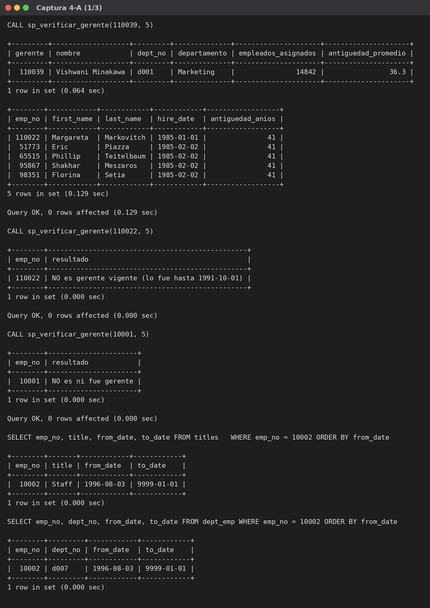

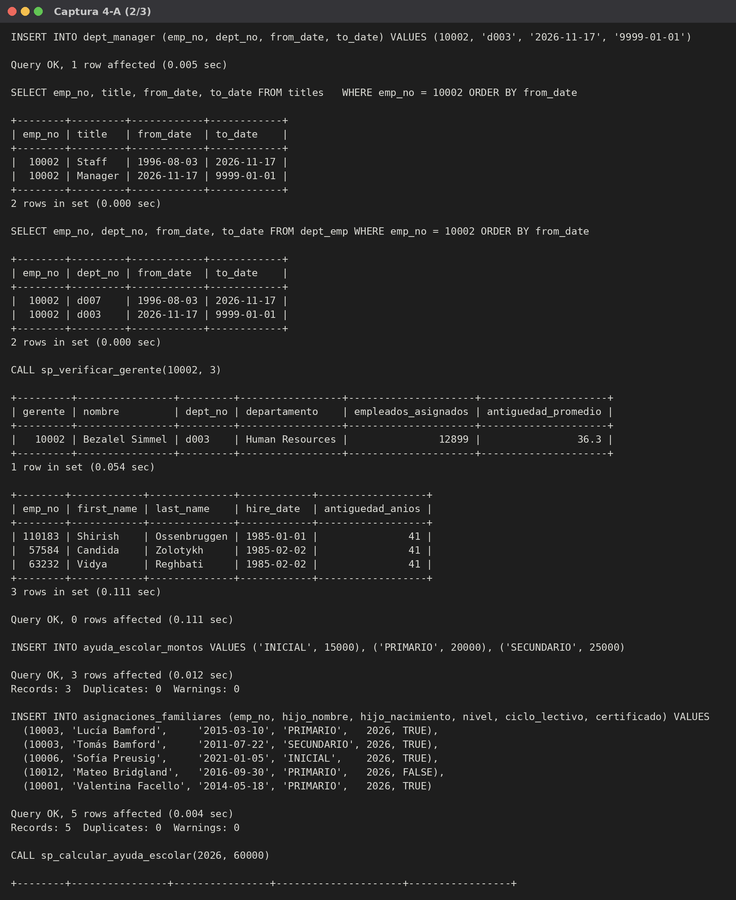

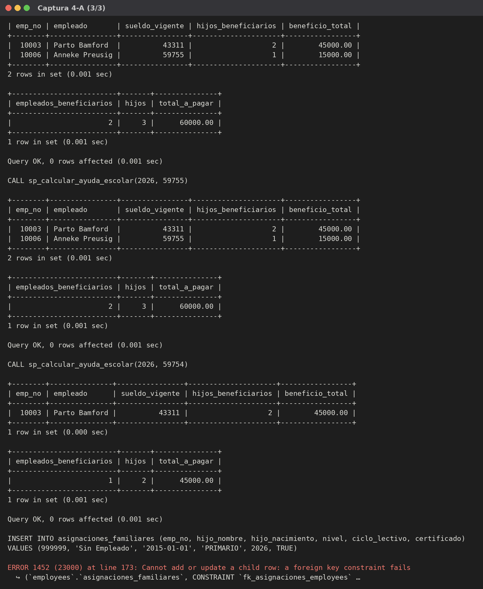

*Captura 4-A: pruebas del procedimiento 4.1, del trigger 4.2 y del cálculo 4.3.*

**Pruebas realizadas.**

| Prueba | Caso | Resultado |
| :--- | :--- | :--- |
| 4.1 `sp_verificar_gerente(110039, 5)` | Válido | Gerente vigente de Marketing: 14.842 empleados, 36,3 años de antigüedad promedio, y los 5 más antiguos |
| 4.1 `sp_verificar_gerente(110022, 5)` | Inválido | "NO es gerente vigente (lo fue hasta 1991-10-01)" |
| 4.1 `sp_verificar_gerente(10001, 5)` | Inválido | "NO es ni fue gerente" |
| 4.2 Alta de 10002 como gerente de `d003` | Válido | En `titles`, `Staff` se cierra el 2026-11-17 y se abre `Manager`. En `dept_emp`, sale de `d007` y entra en `d003`. El 4.1 ya lo reconoce como gerente |
| 4.3 Cálculo con tope $60.000 | Válido | Cobran 10003 (2 hijos, $45.000) y 10006 (1 hijo, $15.000). No cobran 10012 (sin certificado) ni 10001 (sueldo mayor al tope) |
| 4.3 Tope = $59.755 (sueldo de 10006) | Límite | 10006 sigue cobrando (`<=`) |
| 4.3 Tope = $59.754 | Límite | 10006 queda afuera: total $45.000 |
| 4.3 Hijo de un empleado inexistente | Inválido | Rechazado por la clave foránea (`ERROR 1452`) |

**Nota aclaratoria.**
- **Crear el trigger con el binlog activo dio `ERROR 1419`.** MySQL exige `SUPER` para crear triggers en ese caso, porque podrían dar otro resultado al reproducirse en un PITR o una réplica. Lo resolvimos con `log_bin_trust_function_creators` (Ej. 1) y no con `SUPER`.
- **`DELIMITER` es un comando del cliente.** En el cliente `mysql` 9.7, la opción `--commands` viene desactivada cuando se lee un script, así que sin ella `DELIMITER` (y también `source` y `\G`) da error de sintaxis.
- Los datos de `employees` terminan en 2002, así que la antigüedad hasta hoy da alrededor de 36 a 41 años.

---

## Ejercicio 5: Concurrencia y bloqueos (locking)

**Enunciado**
> **5.1 Simulación de Bloqueo:** En Sesión 1, incrementar sueldos en `salaries` en una transacción abierta.  
> **5.2 Retención:** En Sesión 2, modificar los mismos registros para forzar espera de bloqueo.  
> **5.3 Diagnóstico:** Consultar `performance_schema.data_locks` e `information_schema.innodb_trx`.  
> **5.4 Resolución:** Interrumpir la sesión bloqueada.

**Decisiones técnicas.**
- **Sesión 1:** aumenta un 10 % los sueldos vigentes de los empleados 10001 a 10010 y deja la transacción abierta. **Sesión 2:** intenta sumar $500 al sueldo vigente de 10005, que ya está bloqueado.
- **El diagnóstico se hace desde una tercera conexión:**
  - `innodb_trx` muestra el estado de cada transacción (`RUNNING` o `LOCK WAIT`).
  - `data_locks` muestra qué bloqueo tiene cada una (`GRANTED` o `WAITING`).
  - `data_lock_waits` relaciona quién espera a quién.
- **Resolución pedida:** se interrumpe la **sesión bloqueada** con `KILL <hilo>`, tomando el hilo de `innodb_trx`. La Sesión 1 termina con `ROLLBACK`, así que los sueldos no cambian.
- En el laboratorio, cada sesión se ejecuta en su propia terminal. El script `ej05_bloqueos.sh` reproduce la misma secuencia de forma automática, para que la evidencia sea repetible.

**Código y comandos**

Script `ej05_bloqueos.sh` (el SQL de cada sesión está en las variables `S1` y `S2`):
```bash
#!/bin/bash
# =============================================================================
# LABORATORIO INTEGRADOR SGBD 2026 - GRUPO 11
# Ejercicio 5 - Concurrencia y bloqueos sobre employees.salaries
# Reproduce las dos sesiones en paralelo (en el laboratorio se hacen en dos
# terminales: el SQL de cada sesión es el que figura abajo).
# Uso: ./ej05_bloqueos.sh       (pide la clave de usr_g11)
#      MYSQL_CON="-h 127.0.0.1 -P 3306" para cambiar el destino
# =============================================================================
set -uo pipefail
CON=${MYSQL_CON:--h 127.0.0.1}
read -rsp "Clave de usr_g11: " P; echo
export MYSQL_PWD="$P"
m() { mysql $CON -u usr_g11 --skip-comments -t employees "$@"; }
TMP=$(mktemp -d)

S1="SELECT CONNECTION_ID() AS hilo_sesion1;
START TRANSACTION;
UPDATE salaries SET salary = ROUND(salary * 1.10)
WHERE emp_no BETWEEN 10001 AND 10010 AND to_date = '9999-01-01';
SELECT ROW_COUNT() AS sueldos_incrementados_sin_confirmar;
SELECT SLEEP(15) AS transaccion_abierta_15s;
ROLLBACK;
SELECT emp_no, salary FROM salaries WHERE emp_no = 10005 AND to_date = '9999-01-01';"

S2="SELECT CONNECTION_ID() AS hilo_sesion2;
UPDATE salaries SET salary = salary + 500
WHERE emp_no = 10005 AND to_date = '9999-01-01';"

echo "=== 5.1 SESIÓN 1 (transacción abierta, sin COMMIT):"; echo "$S1"; echo
m -e "$S1" > "$TMP/s1.txt" 2>&1 &
sleep 2
echo "=== 5.2 SESIÓN 2 (modifica un registro ya bloqueado por la Sesión 1):"; echo "$S2"; echo
m -e "$S2" > "$TMP/s2.txt" 2>&1 &
sleep 3

echo "=== 5.3 DIAGNÓSTICO (tercera conexión, mientras la Sesión 2 espera)"
m -e "SELECT trx_id, trx_mysql_thread_id AS hilo, trx_state AS estado, trx_started AS inicio,
              trx_wait_started AS espera_desde, trx_rows_locked AS filas_bloqueadas,
              LEFT(trx_query, 70) AS sentencia
       FROM information_schema.innodb_trx ORDER BY trx_started"
m -e "SELECT ENGINE_TRANSACTION_ID AS trx, THREAD_ID, OBJECT_NAME AS tabla, INDEX_NAME AS indice,
              LOCK_TYPE, LOCK_MODE, LOCK_STATUS, LOCK_DATA
       FROM performance_schema.data_locks
       WHERE OBJECT_NAME = 'salaries' AND (LOCK_STATUS = 'WAITING' OR LOCK_DATA LIKE '10005,%' OR LOCK_TYPE = 'TABLE')
       ORDER BY ENGINE_TRANSACTION_ID, LOCK_TYPE DESC"
m -e "SELECT REQUESTING_ENGINE_TRANSACTION_ID AS trx_que_espera, BLOCKING_ENGINE_TRANSACTION_ID AS trx_que_bloquea
       FROM performance_schema.data_lock_waits"

BLOQUEADA=$(mysql $CON -u usr_g11 -N -B -e "SELECT trx_mysql_thread_id FROM information_schema.innodb_trx WHERE trx_state = 'LOCK WAIT' LIMIT 1")
echo "=== 5.4 RESOLUCIÓN: se interrumpe la sesión bloqueada (hilo $BLOQUEADA)"
echo "KILL $BLOQUEADA;"
m -e "KILL $BLOQUEADA"
sleep 1
m -e "SELECT COUNT(*) AS transacciones_esperando FROM information_schema.innodb_trx WHERE trx_state = 'LOCK WAIT'"

wait
echo; echo "=== Salida de la SESIÓN 2 (interrumpida)"; cat "$TMP/s2.txt"
echo; echo "=== Salida de la SESIÓN 1 (termina con ROLLBACK: los sueldos no cambian)"; cat "$TMP/s1.txt"
rm -rf "$TMP"
```

**Evidencias**

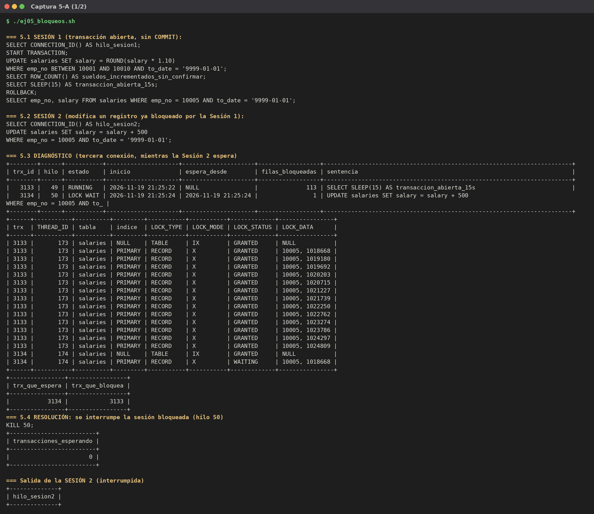

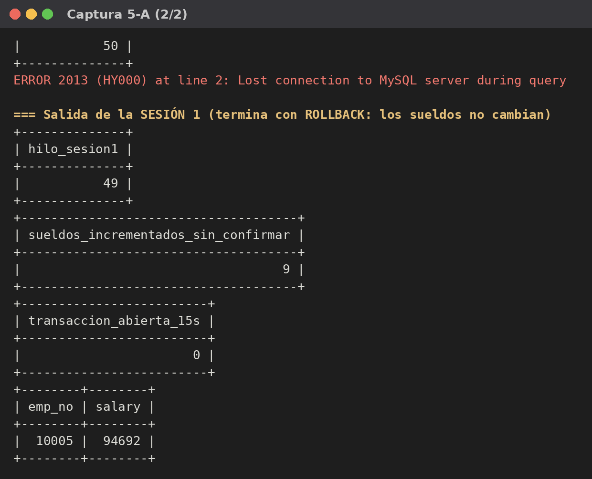

*Captura 5-A: sesiones, diagnóstico y resolución.*

**Lectura del diagnóstico.**
- **`innodb_trx`:** la transacción del hilo 49 (Sesión 1) está en `RUNNING`, con 113 filas bloqueadas. La del hilo 50 (Sesión 2) está en `LOCK WAIT`, esperando desde que ejecutó su `UPDATE`.
- **`data_locks`:** la Sesión 1 tiene bloqueos `X` (exclusivos) **concedidos** sobre la clave primaria de `salaries` (`10005, …`). La Sesión 2 pide un bloqueo `X` sobre **el mismo registro** y figura en `WAITING`. `data_lock_waits` lo confirma: la transacción 3134 espera a la 3133.
- **Resolución:** `KILL 50` corta la sesión bloqueada (`ERROR 2013 Lost connection`) y no quedan transacciones esperando. La Sesión 1 termina con `ROLLBACK`, y el sueldo de 10005 sigue en 94.692.

**Nota aclaratoria.**
- La Sesión 1 bloquea 113 registros aunque actualiza 9 sueldos. En `REPEATABLE READ`, InnoDB bloquea **todos los registros que recorre** en el rango de la clave primaria (`emp_no BETWEEN 10001 AND 10010`), incluidos los sueldos históricos que no cumplen `to_date = '9999-01-01'`.
- En `LOCK_DATA`, la segunda parte de la clave (`from_date`) aparece en el formato interno de InnoDB, no como fecha.

---

## Ejercicio 6: Respaldo y recuperación a un punto en el tiempo (PITR)

**Enunciado**
> **6.1 Binary Logs:** Verificar activación en MySQL 9.7 (`SHOW BINARY LOGS;`).  
> **6.2 Evento:** Evento MySQL para `FLUSH LOGS;` cada 10 min.  
> **6.3 Respaldo Base:** Backup con `mysqldump --single-transaction --flush-logs --source-data=2`.  
> **6.4 Transacciones Intermedias:** 5 modificaciones identificables.  
> **6.5 Pérdida:** Simular eliminación accidental de tabla crítica.  
> **6.6 PITR:** Restaurar dump base y procesar logs con `mysqlbinlog`.

**Decisiones técnicas.**
- **6.2:** un evento en `employees` ejecuta `FLUSH LOGS` cada 10 minutos. El dueño del evento es `usr_g11`, que tiene `RELOAD`. Así cada binlog cubre como máximo 10 minutos: se puede archivar fuera del servidor y acota la pérdida si se pierde el disco.
- **6.3:** el backup lo hace **`usr_backup`**, con los privilegios del Ej. 1.2. `--flush-logs` empieza un binlog nuevo y `--source-data=2` anota en el archivo el binlog y la posición exactos del momento del backup: ahí empieza la reaplicación.
- **GTID:** en este MySQL 9.7, `gtid_mode` está **activado**, y eso cambia el procedimiento clásico.
  - Un dump con `GTID_PURGED` no se puede restaurar en el mismo servidor (`ERROR 3546`).
  - Si se reaplica el binlog sin `--skip-gtids`, el servidor **descarta en silencio** las transacciones que ya ejecutó, y se pierden las operaciones válidas sin ningún mensaje de error.

  Por eso usamos `--set-gtid-purged=OFF` al respaldar y `mysqlbinlog --skip-gtids` al recuperar. Lo probamos con GTID activado y desactivado, y funciona en los dos casos.
- **6.4:** cinco modificaciones identificables, cada una en su propia transacción:
  - un departamento `d010`;
  - el empleado 500001;
  - su cargo y su sueldo;
  - el aumento del sueldo vigente de 10001.

  Antes del incidente guardamos un **estado objetivo**: recuentos y valores que la recuperación tiene que reproducir.
- **6.5:** el incidente es `DROP TABLE titles`. Elegimos `titles` porque no tiene tablas hijas. `departments` no se puede borrar mientras `dept_emp` la referencie.
- **6.6:** el punto de corte es **el inicio de la transacción del `DROP`**, es decir, el evento `Gtid` que la precede. Se reaplica desde la posición del backup hasta ese punto, sin incluirlo.
  - Inspeccionar el binlog con `SHOW BINLOG EVENTS` requiere `REPLICATION SLAVE`, y no se lo dimos a `usr_g11`, porque permitiría leer todos los cambios del servidor. Esa parte la hace el administrador, que es quien restaura.
  - Si no se encuentra el punto, el script se detiene **antes** de restaurar.

**Código y comandos**

Script `ej06_pitr.sh`:
```bash
#!/bin/bash
# =============================================================================
# LABORATORIO INTEGRADOR SGBD 2026 - GRUPO 11
# Ejercicio 6 - Binary logs, evento de rotación, backup base y PITR
# Uso: ./ej06_pitr.sh     (pide las claves de usr_g11 y usr_backup)
#   MYSQL_CON="-h 127.0.0.1 -P 3306"   destino para usr_g11
#   MYSQL_CON_BACKUP=""                usr_backup es @localhost (socket)
#   ROOT="sudo mysql"                  administrador para restaurar
#   BINLOG="sudo mysqlbinlog"          lector de binlogs (los archivos son de mysql)
#
# Nota sobre GTID (comprobado en MySQL 9.7): con gtid_mode=ON, un dump con
# GTID_PURGED falla al restaurarse en el mismo servidor (ERROR 3546) y, si el
# binlog se reaplica sin --skip-gtids, el servidor descarta en silencio las
# transacciones que ya ejecutó (se pierden las operaciones válidas). Por eso:
# mysqldump --set-gtid-purged=OFF y mysqlbinlog --skip-gtids (sirve con GTID ON y OFF).
# =============================================================================
set -uo pipefail
CON=${MYSQL_CON:--h 127.0.0.1}
CON_BK=${MYSQL_CON_BACKUP:-}
ROOT=${ROOT:-sudo mysql}
BINLOG=${BINLOG:-sudo mysqlbinlog}
BACKUP=${BACKUP_FILE:-$HOME/backup_employees_pitr.sql}
read -rsp "Clave de usr_g11: " PG; echo
read -rsp "Clave de usr_backup: " PB; echo
g11()  { MYSQL_PWD="$PG" mysql $CON -u usr_g11 --skip-comments -t employees "$@" 2>&1; }
g11n() { MYSQL_PWD="$PG" mysql $CON -u usr_g11 -N -B employees "$@" 2>&1; }
estado() {   # huella de lo que tocan las operaciones válidas y el incidente
  g11 -e "SELECT (SELECT COUNT(*) FROM departments) AS departamentos,
                 (SELECT COUNT(*) FROM employees)   AS empleados,
                 (SELECT COUNT(*) FROM titles)      AS cargos,
                 (SELECT salary FROM salaries WHERE emp_no = 10001 AND to_date = '9999-01-01') AS sueldo_10001,
                 (SELECT COUNT(*) FROM titles WHERE emp_no = 500001) AS cargos_500001"
}

echo "=== 6.1 Binary logs activos"
g11 -e "SELECT @@log_bin AS log_bin, @@log_bin_basename AS ubicacion, @@binlog_format AS formato,
               @@gtid_mode AS gtid_mode, @@binlog_expire_logs_seconds / 86400 AS retencion_dias"
g11 -e "SHOW BINARY LOGS"

echo; echo "=== 6.2 Evento que rota el binlog cada 10 minutos"
g11 -e "SELECT @@event_scheduler AS event_scheduler"
g11 -e "CREATE EVENT IF NOT EXISTS ev_rotar_binlog
          ON SCHEDULE EVERY 10 MINUTE
          COMMENT 'Lab G11 Ej 6.2: cierra el binlog actual cada 10 minutos'
          DO FLUSH LOGS"
g11 -e "SELECT EVENT_NAME, DEFINER, INTERVAL_VALUE, INTERVAL_FIELD, STATUS, LAST_EXECUTED
        FROM information_schema.EVENTS WHERE EVENT_SCHEMA = 'employees'"

echo; echo "=== 6.3 Backup base con usr_backup"
echo "\$ mysqldump -u usr_backup -p --single-transaction --flush-logs --source-data=2 --set-gtid-purged=OFF --skip-masking-policies --routines --triggers --events --databases employees > $BACKUP"
MYSQL_PWD="$PB" mysqldump $CON_BK -u usr_backup --single-transaction --flush-logs --source-data=2 \
  --set-gtid-purged=OFF --skip-masking-policies --routines --triggers --events --databases employees > "$BACKUP"
echo "código de salida: $? · tamaño: $(du -h "$BACKUP" | cut -f1)"
COORD=$(grep -m1 "CHANGE REPLICATION SOURCE TO" "$BACKUP"); echo "$COORD"
INI_FILE=$(echo "$COORD" | grep -o "SOURCE_LOG_FILE='[^']*'" | cut -d"'" -f2)
INI_POS=$(echo "$COORD" | grep -o "SOURCE_LOG_POS=[0-9]*" | cut -d= -f2)
echo "Estado en el momento del backup:"; estado

echo; echo "=== 6.4 Cinco modificaciones identificables posteriores al backup"
g11 -vvv -e "INSERT INTO departments VALUES ('d010', 'PITR Ciberseguridad')"
g11 -vvv -e "INSERT INTO employees VALUES (500001, '1995-05-05', 'Lautaro', 'Pitr', 'M', '2026-11-17')"
g11 -vvv -e "INSERT INTO titles VALUES (500001, 'Engineer', '2026-11-17', '9999-01-01')"
g11 -vvv -e "INSERT INTO salaries VALUES (500001, 70000, '2026-11-17', '9999-01-01')"
g11 -vvv -e "UPDATE salaries SET salary = salary + 1111 WHERE emp_no = 10001 AND to_date = '9999-01-01'"
echo "Estado OBJETIVO de la recuperación:"; estado | tee /tmp/ej06_objetivo.txt

echo; echo "=== 6.5 Incidente: borrado accidental de la tabla crítica titles"
g11 -vvv -e "DROP TABLE titles"
g11 -e "SELECT COUNT(*) FROM titles"

echo; echo "=== 6.6 PITR"
echo "--- Coordenadas de inicio (del backup): $INI_FILE posición $INI_POS"
echo "--- Búsqueda del DROP en los binlogs posteriores al backup (como administrador:"
echo "    SHOW BINLOG EVENTS exige REPLICATION SLAVE, que usr_g11 no tiene a propósito)"
FIN_FILE=""; FIN_POS=""; ARCHIVOS=()
for f in $(g11n -e "SHOW BINARY LOGS" | awk '{print $1}'); do
  [[ "$f" < "$INI_FILE" ]] && continue
  ARCHIVOS+=("$f")
  POS=$($ROOT -N -B -e "SHOW BINLOG EVENTS IN '$f'" | awk -F'\t' '
        $3 ~ /Gtid$/ {inicio = $2}                       # Gtid o Anonymous_Gtid: empieza una transacción
        $3 == "Query" && $6 ~ /DROP TABLE `titles`/ {print inicio; exit}')
  if [ -n "$POS" ]; then FIN_FILE="$f"; FIN_POS="$POS"; break; fi
done
echo "Archivos a reaplicar: ${ARCHIVOS[*]}"
if [ -z "$FIN_POS" ]; then
  echo "No se encontró el DROP en los binlogs: NO se restaura nada (revisar a mano con SHOW BINLOG EVENTS)."; exit 1
fi
echo "El DROP empieza en $FIN_FILE posición $FIN_POS (se corta justo antes)"
$ROOT -t -e "SHOW BINLOG EVENTS IN '$FIN_FILE'" | grep -E "Pos|Gtid|Query|Write_rows|Update_rows|Xid" | tail -12
DIR=$(dirname "$(g11n -e "SELECT @@log_bin_basename")")
RUTAS=(); for f in "${ARCHIVOS[@]}"; do RUTAS+=("$DIR/$f"); done

echo; echo "--- Paso 1: restaurar el backup base"
echo "\$ $ROOT < $BACKUP"
$ROOT < "$BACKUP" && echo "restaurado"
echo "--- Paso 2: reaplicar el binlog desde el backup hasta justo antes del DROP"
echo "\$ $BINLOG --skip-gtids --start-position=$INI_POS --stop-position=$FIN_POS ${ARCHIVOS[*]} | $ROOT"
$BINLOG --skip-gtids --start-position="$INI_POS" --stop-position="$FIN_POS" "${RUTAS[@]}" | $ROOT && echo "binlog reaplicado"

echo; echo "--- Validación: estado recuperado frente al objetivo"
estado | tee /tmp/ej06_recuperado.txt
if diff -q /tmp/ej06_objetivo.txt /tmp/ej06_recuperado.txt >/dev/null; then
  echo "RECUPERACIÓN EXACTA: coincide con el estado previo al incidente (las 5 modificaciones están y titles existe)"
else
  echo "DIFERENCIAS con el estado objetivo:"; diff /tmp/ej06_objetivo.txt /tmp/ej06_recuperado.txt
fi
g11 -e "SELECT e.emp_no, e.first_name, e.last_name, t.title, s.salary
        FROM employees e JOIN titles t USING (emp_no) JOIN salaries s USING (emp_no) WHERE e.emp_no = 500001"
rm -f /tmp/ej06_objetivo.txt /tmp/ej06_recuperado.txt
```

**Evidencias**

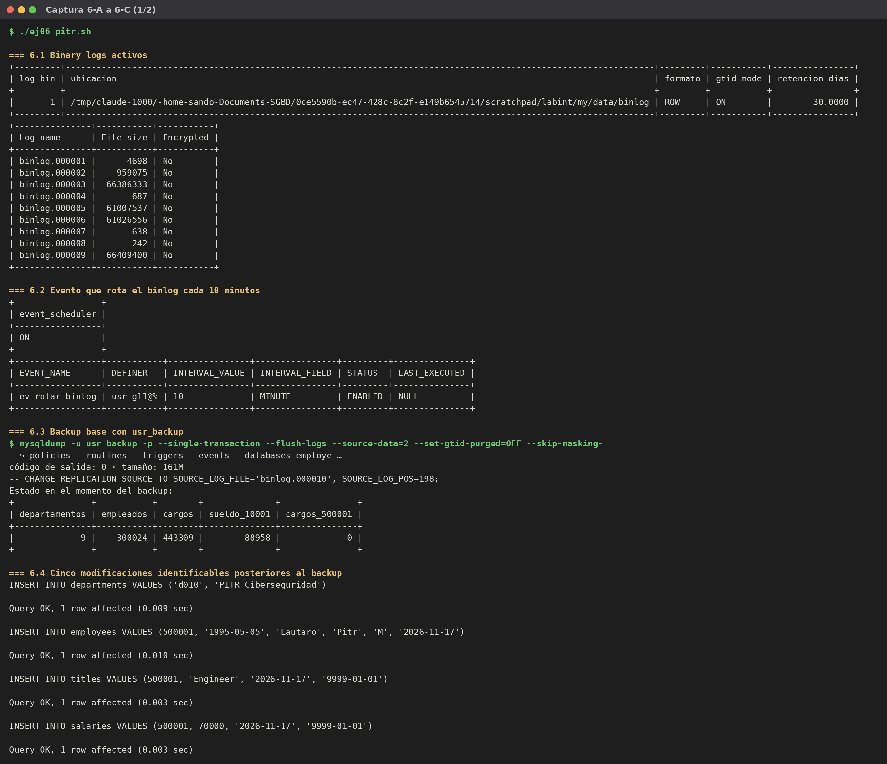

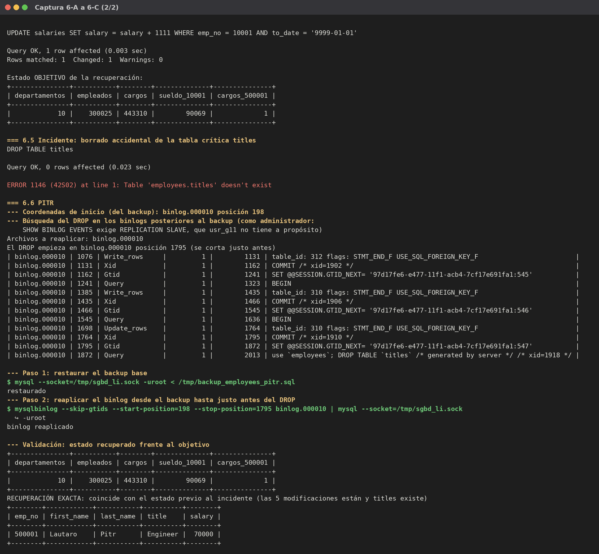

*Captura 6-A a 6-C: binlogs activos, evento y backup base · modificaciones, incidente y punto de corte en el binlog · restauración, reaplicación y validación.*

**Resultado.**

| Momento | Departamentos | Empleados | Cargos | Sueldo de 10001 | Cargos de 500001 |
| :--- | ---: | ---: | ---: | ---: | ---: |
| Backup base | 9 | 300.024 | 443.309 | 88.958 | 0 |
| Después de las 5 modificaciones (objetivo) | 10 | 300.025 | 443.310 | 90.069 | 1 |
| Después del `DROP TABLE titles` | 10 | 300.025 | *tabla inexistente* | 90.069 | — |
| **Después del PITR** | **10** | **300.025** | **443.310** | **90.069** | **1** |

La recuperación es **exacta**:
- se restauró el backup base (binlog `binlog.000010`, posición 198);
- se reaplicó el binlog hasta la posición 1795, donde empieza la transacción del `DROP` (el `Gtid` de la línea 1795; el `DROP` es la línea 1872);
- el resultado coincide con el estado objetivo, con las cinco modificaciones y la tabla `titles` completa.

**Nota aclaratoria.**
- En MySQL 9.7, `SHOW MASTER STATUS` ya no existe (error de sintaxis). La posición actual se consulta con `SHOW BINARY LOG STATUS`.
- La ruta de los binlogs se obtiene con `SELECT @@log_bin_basename`. En una instalación estándar de Ubuntu es `/var/lib/mysql/binlog`.
- Si el evento rota el binlog entre el backup y el incidente, hay que reaplicar varios archivos. El script los recorre en orden y `mysqlbinlog` aplica `--start-position` al primero y `--stop-position` al último.

---

# Bloque 2: Datos semiestructurados en MySQL 9.7 (JSON)

## Ejercicio 7: Importación de documentos JSON

**Enunciado**
> Cargar `customers.json`, `films.json` y `stores.json` mediante `mysqlsh` (`util.importJson`) en tablas con columnas de tipo nativo JSON.

**Decisiones técnicas.**
- **Una tabla por colección**, con el documento completo en la columna `doc` de tipo **`JSON`** nativo. La clave primaria `id` es una **columna generada** a partir de `doc->>'$._id'`: el motor impide documentos repetidos y se puede hacer `JOIN` por `id` sin extraer la ruta cada vez.
- **`util.importJson`** necesita una sesión **X Protocol** (puerto 33060). Los archivos son JSON Lines (un documento por línea), un formato que acepta directamente.
- **MySQL Shell no venía instalado** en la VM: lo instalamos desde el repositorio oficial de MySQL (`sudo apt install mysql-shell`, versión 9.7.1).

**Código y comandos**

Script `ej07_0_base_y_permisos.sql` (como administrador):
```sql
-- =============================================================================
-- LABORATORIO INTEGRADOR SGBD 2026 - GRUPO 11
-- Ejercicio 7 (preparación) - Base para los documentos JSON de Sakila
-- Ejecutar como administrador (root):  sudo mysql -t < ej07_0_base_y_permisos.sql
-- =============================================================================

CREATE DATABASE IF NOT EXISTS zakila_json CHARACTER SET utf8mb4 COLLATE utf8mb4_0900_ai_ci;

-- usr_g11 (Ejercicio 1.1) administra las bases del laboratorio: se le suma la nueva
GRANT ALL PRIVILEGES ON zakila_json.* TO 'usr_g11'@'%' WITH GRANT OPTION;

SHOW GRANTS FOR 'usr_g11'@'%';
```

Script `ej07_1_tablas_json.sql`:
```sql
-- =============================================================================
-- LABORATORIO INTEGRADOR SGBD 2026 - GRUPO 11
-- Ejercicio 7 - Tablas con columna de tipo nativo JSON
-- Ejecutar como usr_g11:  mysql -t -h 127.0.0.1 -u usr_g11 < ej07_1_tablas_json.sql
-- Cada documento completo va en la columna doc (JSON). La clave primaria es una
-- columna generada a partir de doc->>'$._id', así el motor garantiza que no se
-- repitan documentos y se puede hacer JOIN por id sin extraer la ruta cada vez.
-- =============================================================================
USE zakila_json;

DROP TABLE IF EXISTS customers, films, stores;

CREATE TABLE customers (
  doc JSON NOT NULL,
  id  INT GENERATED ALWAYS AS (doc->>'$._id') STORED NOT NULL PRIMARY KEY
) ENGINE = InnoDB;

CREATE TABLE films (
  doc JSON NOT NULL,
  id  INT GENERATED ALWAYS AS (doc->>'$._id') STORED NOT NULL PRIMARY KEY
) ENGINE = InnoDB;

CREATE TABLE stores (
  doc JSON NOT NULL,
  id  INT GENERATED ALWAYS AS (doc->>'$._id') STORED NOT NULL PRIMARY KEY
) ENGINE = InnoDB;

SELECT TABLE_NAME, COLUMN_NAME, DATA_TYPE, COLUMN_KEY, EXTRA
FROM information_schema.COLUMNS
WHERE TABLE_SCHEMA = 'zakila_json'
ORDER BY TABLE_NAME, ORDINAL_POSITION;
```

Script `ej07_2_importar.js` (MySQL Shell):
```javascript
// =============================================================================
// LABORATORIO INTEGRADOR SGBD 2026 - GRUPO 11
// Ejercicio 7 - Importación de documentos JSON con util.importJson (MySQL Shell)
// util.importJson requiere una sesión X Protocol (puerto 33060):
//   mysqlsh --mysqlx -u usr_g11 -h 127.0.0.1 -P 33060 --file ej07_2_importar.js
// Los archivos son JSON Lines (un documento por línea), formato que importJson
// acepta directamente. Cada documento se guarda en la columna JSON "doc".
// =============================================================================

const carpeta = os.getenv("DATOS") || os.getenv("HOME") + "/lab_integrador_g11/datos";

for (const tabla of ["customers", "films", "stores"]) {
  print(`\n=== ${tabla}.json -> zakila_json.${tabla}(doc)\n`);
  util.importJson(`${carpeta}/${tabla}.json`, {
    schema: "zakila_json",
    table: tabla,
    tableColumn: "doc"
  });
}
```

Script `ej07_3_verificar.sql`:
```sql
-- =============================================================================
-- LABORATORIO INTEGRADOR SGBD 2026 - GRUPO 11
-- Ejercicio 7 - Verificación de la carga
--   mysql -t -h 127.0.0.1 -u usr_g11 < ej07_3_verificar.sql
-- =============================================================================
USE zakila_json;

-- Filas por tabla (esperado: 599 / 1000 / 2)
SELECT 'customers' AS tabla, COUNT(*) AS filas FROM customers
UNION ALL SELECT 'films', COUNT(*) FROM films
UNION ALL SELECT 'stores', COUNT(*) FROM stores;

-- El tipo de la columna es JSON nativo y cada valor es un objeto válido
SELECT TABLE_NAME, COLUMN_NAME, DATA_TYPE
FROM information_schema.COLUMNS
WHERE TABLE_SCHEMA = 'zakila_json' AND COLUMN_NAME = 'doc';
SELECT JSON_TYPE(doc) AS tipo, COUNT(*) AS documentos FROM customers GROUP BY tipo;

-- Arreglos anidados: alquileres por cliente (esperado: 16044 en total, 12 a 46)
SELECT COUNT(*) AS clientes, SUM(JSON_LENGTH(doc, '$.Rentals')) AS alquileres,
       MIN(JSON_LENGTH(doc, '$.Rentals')) AS min_alq, MAX(JSON_LENGTH(doc, '$.Rentals')) AS max_alq
FROM customers;
SELECT id, doc->>'$.City' AS ciudad, doc->>'$.Country' AS pais,
       JSON_LENGTH(doc, '$.Inventory') AS items_inventario
FROM stores;

-- Muestra: un cliente y una película con extracción de rutas JSON
SELECT id, doc->>'$."First Name"' AS nombre, doc->>'$."Last Name"' AS apellido,
       doc->>'$.Country' AS pais, doc->>'$.Rentals[0]."Film Title"' AS primer_alquiler
FROM customers WHERE id = 1;
SELECT id, doc->>'$.Title' AS titulo, doc->>'$.Category' AS categoria,
       JSON_LENGTH(doc, '$.Actors') AS actores
FROM films WHERE id = 1;
```

**Evidencias**

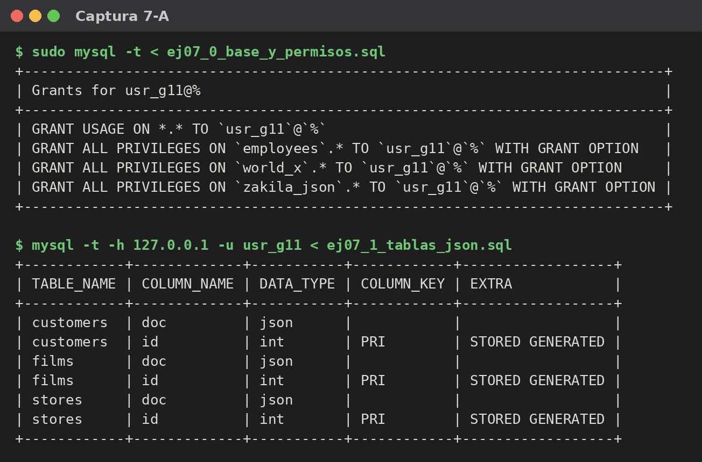

*Captura 7-A: base, permisos y tablas con columna JSON.*

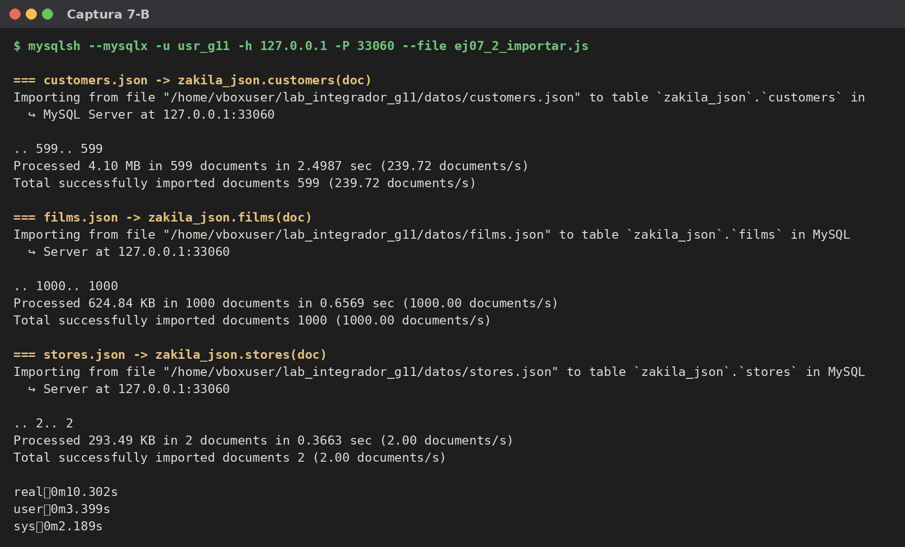

*Captura 7-B: importación con util.importJson.*

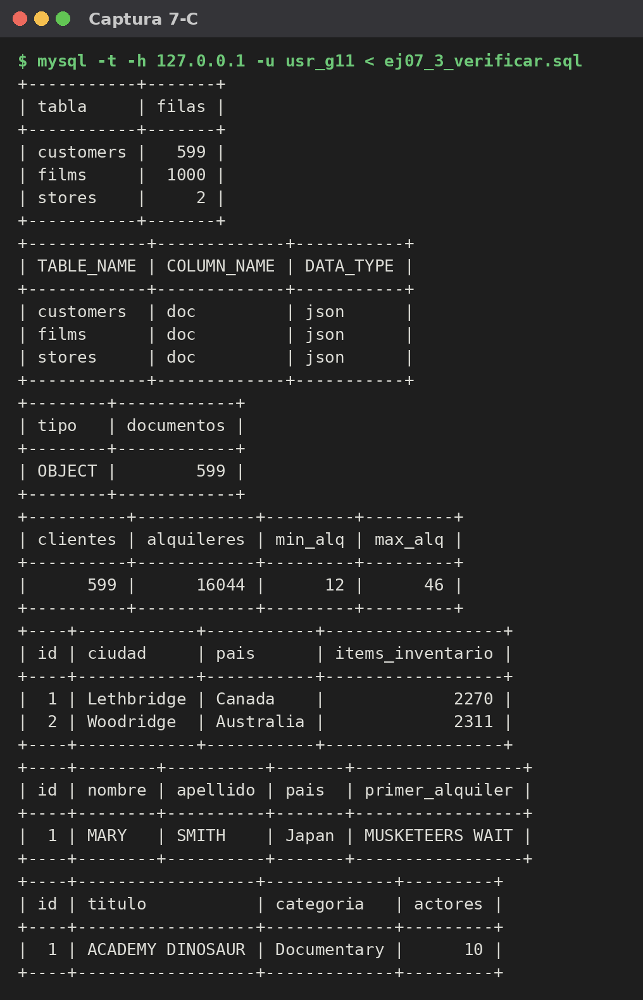

*Captura 7-C: verificación de la carga.*

Se importaron los 1601 documentos (599 / 1000 / 2) y todos son objetos JSON válidos. Los arreglos anidados llegaron completos: 16.044 alquileres en los clientes y 2270 / 2311 ítems de inventario por tienda. Las rutas con espacios se acceden entre comillas (`$."First Name"`).

---

## Ejercicio 8: Consultas, JSON Schema y cruce multimodelo

**Enunciado**
> **8.1 Actualización Documental:** Modificar los documentos JSON añadiendo `"ClienteVIP": "SÍ"` a clientes con 40 o más alquileres mediante `JSON_SET()`.
>
> **8.2 Restricción de Esquema:** Definir un CHECK constraint con `JSON_SCHEMA_VALID()`. Documentar 2 inserciones válidas y 2 invalidadas.
>
> **8.3 Cruce Multimodelo:** Consulta que integre la columna JSON de clientes con la tabla relacional `countryinfo` de `world_x`, identificando el Top 10 de películas más alquiladas en América del Sur.
>
> **8.4 Exportación a JSON:** Exportar la tabla relacional `city` a un archivo JSON con formato `{"Ciudad": "Resistencia", "CodP": "ARG"}`.

**Decisiones técnicas.**
- **8.1:** la condición usa `JSON_LENGTH(doc, '$.Rentals') >= 40`. `JSON_SET` agrega la clave si no existe y la reemplaza si existe, así que la actualización se puede repetir sin efectos raros. Verificamos que no quedara ningún cliente marcado por error.
- **8.2:** el esquema exige `_id` entero, nombre, apellido y país de texto no vacío, y `Rentals` como arreglo. `ClienteVIP` es opcional, pero solo admite `"SÍ"` o `"NO"`. Antes de crear la restricción comprobamos que los 599 documentos existentes la cumplieran. Para explicar cada rechazo usamos `JSON_SCHEMA_VALIDATION_REPORT()`, que indica qué regla falló.
- **8.3:** "América del Sur" sale de `countryinfo`, en `geography.Continent`. El cruce es por nombre de país: `customers.Country` con `countryinfo.Name`. `JSON_TABLE` convierte el arreglo `Rentals` en filas, una por alquiler. Hay un empate de 13 películas con 6 alquileres en el corte del puesto 10, que desempatamos alfabéticamente y mostramos aparte.
- **8.4:** `JSON_OBJECT()` reordena las claves (`{"CodP": …, "Ciudad": …}`), así que no respeta el formato pedido. Armamos cada documento con `CONCAT` + `JSON_QUOTE`, que también escapa comillas y acentos. La salida es JSON Lines, el formato que usa `mongoimport` en el Ej. 10.2.

**Código y comandos**

Script `ej08_1_cliente_vip.sql`:
```sql
-- =============================================================================
-- LABORATORIO INTEGRADOR SGBD 2026 - GRUPO 11
-- Ejercicio 8.1 - Actualización documental con JSON_SET()
-- Agregar "ClienteVIP": "SÍ" a los clientes con 40 o más alquileres
--   mysql -t -h 127.0.0.1 -u usr_g11 < ej08_1_cliente_vip.sql
-- =============================================================================
USE zakila_json;
SET NAMES utf8mb4;

-- 1. ANTES: clientes que cumplen la condición (cantidad de elementos de $.Rentals)
SELECT id, doc->>'$."First Name"' AS nombre, doc->>'$."Last Name"' AS apellido,
       JSON_LENGTH(doc, '$.Rentals') AS alquileres,
       JSON_CONTAINS_PATH(doc, 'one', '$.ClienteVIP') AS tiene_vip
FROM customers
WHERE JSON_LENGTH(doc, '$.Rentals') >= 40
ORDER BY alquileres DESC, id;

-- 2. Actualización: JSON_SET agrega la clave si no existe (o la reemplaza si existe)
START TRANSACTION;
UPDATE customers
SET doc = JSON_SET(doc, '$.ClienteVIP', 'SÍ')
WHERE JSON_LENGTH(doc, '$.Rentals') >= 40;
SELECT ROW_COUNT() AS filas_actualizadas;
COMMIT;

-- 3. DESPUÉS: clientes marcados como VIP (deben ser exactamente los mismos)
SELECT id, doc->>'$."First Name"' AS nombre, doc->>'$."Last Name"' AS apellido,
       JSON_LENGTH(doc, '$.Rentals') AS alquileres, doc->>'$.ClienteVIP' AS ClienteVIP
FROM customers
WHERE doc->>'$.ClienteVIP' = 'SÍ'
ORDER BY alquileres DESC, id;

-- 4. Control: ningún cliente con menos de 40 alquileres quedó marcado
SELECT SUM(JSON_LENGTH(doc, '$.Rentals') >= 40) AS con_40_o_mas,
       SUM(JSON_CONTAINS_PATH(doc, 'one', '$.ClienteVIP')) AS marcados_vip,
       SUM(JSON_CONTAINS_PATH(doc, 'one', '$.ClienteVIP') AND JSON_LENGTH(doc, '$.Rentals') < 40) AS marcados_por_error
FROM customers;

-- 5. La clave quedó dentro del documento (claves de primer nivel de un cliente VIP)
SELECT id, JSON_KEYS(doc) AS claves FROM customers
WHERE doc->>'$.ClienteVIP' = 'SÍ' ORDER BY id LIMIT 1;
```

Script `ej08_2_check_json_schema.sql`:
```sql
-- =============================================================================
-- LABORATORIO INTEGRADOR SGBD 2026 - GRUPO 11
-- Ejercicio 8.2 - Restricción de esquema: CHECK con JSON_SCHEMA_VALID()
--   mysql -t -vvv --force -h 127.0.0.1 -u usr_g11 < ej08_2_check_json_schema.sql
-- (--force: continúa después de los dos INSERT que el motor debe rechazar)
-- =============================================================================
USE zakila_json;
SET NAMES utf8mb4;

-- Esquema (JSON Schema draft 4, el que implementa MySQL):
--   _id entero; First Name, Last Name y Country texto no vacío; Rentals arreglo;
--   ClienteVIP es opcional, pero si aparece solo puede valer "SÍ" o "NO".
SET @esquema = '{
  "type": "object",
  "required": ["_id", "First Name", "Last Name", "Country", "Rentals"],
  "properties": {
    "_id":          { "type": "integer" },
    "First Name":   { "type": "string", "minLength": 1 },
    "Last Name":    { "type": "string", "minLength": 1 },
    "Country":      { "type": "string", "minLength": 1 },
    "Rentals":      { "type": "array" },
    "ClienteVIP":   { "type": "string", "enum": ["SÍ", "NO"] }
  }
}';

-- 1. Antes de crear la restricción: los 599 documentos existentes deben cumplirla,
--    porque MySQL valida todas las filas al agregar un CHECK
SELECT COUNT(*) AS documentos,
       SUM(JSON_SCHEMA_VALID(@esquema, doc)) AS validos,
       SUM(NOT JSON_SCHEMA_VALID(@esquema, doc)) AS invalidos
FROM customers;

-- 2. Restricción (el CHECK no admite variables: el esquema va escrito literal,
--    idéntico a @esquema)
ALTER TABLE customers ADD CONSTRAINT chk_customers_esquema CHECK (JSON_SCHEMA_VALID('{
  "type": "object",
  "required": ["_id", "First Name", "Last Name", "Country", "Rentals"],
  "properties": {
    "_id":          { "type": "integer" },
    "First Name":   { "type": "string", "minLength": 1 },
    "Last Name":    { "type": "string", "minLength": 1 },
    "Country":      { "type": "string", "minLength": 1 },
    "Rentals":      { "type": "array" },
    "ClienteVIP":   { "type": "string", "enum": ["SÍ", "NO"] }
  }
}', doc));

SELECT CONSTRAINT_NAME, ENFORCED FROM information_schema.TABLE_CONSTRAINTS
WHERE TABLE_SCHEMA = 'zakila_json' AND TABLE_NAME = 'customers' AND CONSTRAINT_TYPE = 'CHECK';

-- 3. Inserción VÁLIDA 1: cliente nuevo sin ClienteVIP (la clave es opcional)
INSERT INTO customers (doc) VALUES ('{"_id": 9001, "First Name": "LUCIA", "Last Name": "BENITEZ",
  "Country": "Argentina", "City": "Resistencia", "Rentals": []}');

-- 4. Inserción VÁLIDA 2: cliente con ClienteVIP = "NO" (valor permitido por el enum)
INSERT INTO customers (doc) VALUES ('{"_id": 9002, "First Name": "MARTIN", "Last Name": "ACOSTA",
  "Country": "Paraguay", "Rentals": [], "ClienteVIP": "NO"}');

-- 5. Inserción INVÁLIDA 1: falta "Last Name" (campo requerido)
INSERT INTO customers (doc) VALUES ('{"_id": 9003, "First Name": "SIN",
  "Country": "Chile", "Rentals": []}');

-- 6. Inserción INVÁLIDA 2: ClienteVIP con un valor fuera del enum
INSERT INTO customers (doc) VALUES ('{"_id": 9004, "First Name": "ANA", "Last Name": "ROJAS",
  "Country": "Uruguay", "Rentals": [], "ClienteVIP": "TAL VEZ"}');

-- 7. Motivo de cada rechazo según el validador (regla que falló y dónde)
SELECT r.id,
       JSON_UNQUOTE(JSON_EXTRACT(r.rep, '$.valid'))                   AS valido,
       JSON_UNQUOTE(JSON_EXTRACT(r.rep, '$."schema-failed-keyword"')) AS regla_fallida,
       JSON_UNQUOTE(JSON_EXTRACT(r.rep, '$."document-location"'))     AS ubicacion_en_doc,
       JSON_UNQUOTE(JSON_EXTRACT(r.rep, '$."schema-location"'))       AS ubicacion_en_esquema
FROM (
  SELECT 9003 AS id, JSON_SCHEMA_VALIDATION_REPORT(@esquema,
    '{"_id": 9003, "First Name": "SIN", "Country": "Chile", "Rentals": []}') AS rep
  UNION ALL
  SELECT 9004, JSON_SCHEMA_VALIDATION_REPORT(@esquema,
    '{"_id": 9004, "First Name": "ANA", "Last Name": "ROJAS",
      "Country": "Uruguay", "Rentals": [], "ClienteVIP": "TAL VEZ"}')
) AS r;

-- 8. Resultado: solo entraron las dos válidas
SELECT id, doc->>'$."First Name"' AS nombre, doc->>'$."Last Name"' AS apellido,
       doc->>'$.Country' AS pais, IFNULL(doc->>'$.ClienteVIP', '(sin clave)') AS ClienteVIP
FROM customers WHERE id >= 9000 ORDER BY id;

-- 9. Limpieza: se quitan los documentos de prueba para que customers vuelva a
--    los 599 originales (no alteran el cruce del 8.3). La restricción queda activa.
DELETE FROM customers WHERE id IN (9001, 9002);
SELECT COUNT(*) AS customers_final FROM customers;
```

Script `ej08_3_cruce_multimodelo.sql`:
```sql
-- =============================================================================
-- LABORATORIO INTEGRADOR SGBD 2026 - GRUPO 11
-- Ejercicio 8.3 - Cruce multimodelo: documentos JSON de clientes (zakila_json)
-- con la tabla countryinfo de world_x -> Top 10 de películas más alquiladas en
-- América del Sur
--   mysql -t -h 127.0.0.1 -u usr_g11 < ej08_3_cruce_multimodelo.sql
--
-- Cruce: customers.doc->>'$.Country' (nombre del país, en inglés)
--        = countryinfo.doc->>'$.Name', filtrando geography.Continent.
-- JSON_TABLE convierte el arreglo Rentals de cada cliente en filas relacionales.
-- =============================================================================
SET NAMES utf8mb4;

-- 1. Países de América del Sur en world_x y clientes de cada uno (control del cruce)
SELECT ci.doc->>'$.Name' AS pais, ci.doc->>'$.Code' AS codigo, COUNT(c.id) AS clientes
FROM world_x.countryinfo AS ci
LEFT JOIN zakila_json.customers AS c ON c.doc->>'$.Country' = ci.doc->>'$.Name'
WHERE ci.doc->>'$.geography.Continent' = 'South America'
GROUP BY pais, codigo
ORDER BY clientes DESC, pais;

-- 2. Top 10 de películas más alquiladas en América del Sur
--    Desempate por título: hay varias películas con 6 alquileres en el corte.
WITH alquileres_sa AS (
  SELECT r.film_id, r.titulo, ci.doc->>'$.Name' AS pais
  FROM zakila_json.customers AS c
  JOIN world_x.countryinfo AS ci
    ON ci.doc->>'$.Name' = c.doc->>'$.Country'
   AND ci.doc->>'$.geography.Continent' = 'South America'
  JOIN JSON_TABLE(c.doc, '$.Rentals[*]' COLUMNS (
         film_id INT          PATH '$.filmId',
         titulo  VARCHAR(100) PATH '$."Film Title"'
       )) AS r
)
SELECT ROW_NUMBER() OVER (ORDER BY COUNT(*) DESC, a.titulo) AS puesto,
       a.titulo AS pelicula,
       f.doc->>'$.Category' AS categoria,
       COUNT(*) AS alquileres,
       COUNT(DISTINCT a.pais) AS paises
FROM alquileres_sa AS a
JOIN zakila_json.films AS f ON f.id = a.film_id
GROUP BY a.film_id, a.titulo, categoria
ORDER BY alquileres DESC, pelicula
LIMIT 10;

-- 3. Empate en el corte: películas con la misma cantidad que el puesto 10
WITH alquileres_sa AS (
  SELECT r.titulo
  FROM zakila_json.customers AS c
  JOIN world_x.countryinfo AS ci
    ON ci.doc->>'$.Name' = c.doc->>'$.Country'
   AND ci.doc->>'$.geography.Continent' = 'South America'
  JOIN JSON_TABLE(c.doc, '$.Rentals[*]' COLUMNS (titulo VARCHAR(100) PATH '$."Film Title"')) AS r
),
ranking AS (
  SELECT titulo, COUNT(*) AS alquileres,
         RANK() OVER (ORDER BY COUNT(*) DESC) AS rango
  FROM alquileres_sa GROUP BY titulo
)
SELECT rango, titulo AS pelicula, alquileres
FROM ranking
WHERE alquileres = (SELECT alquileres FROM ranking ORDER BY alquileres DESC, titulo LIMIT 9, 1)
ORDER BY titulo;

-- 4. Totales del universo analizado
SELECT COUNT(DISTINCT c.id) AS clientes_sa, COUNT(*) AS alquileres_sa,
       COUNT(DISTINCT r.titulo) AS peliculas_distintas
FROM zakila_json.customers AS c
JOIN world_x.countryinfo AS ci
  ON ci.doc->>'$.Name' = c.doc->>'$.Country'
 AND ci.doc->>'$.geography.Continent' = 'South America'
JOIN JSON_TABLE(c.doc, '$.Rentals[*]' COLUMNS (titulo VARCHAR(100) PATH '$."Film Title"')) AS r;
```

Script `ej08_4_exportar_city.sh` y verificación `ej08_4_verificar.sql`:
```bash
#!/bin/bash
# =============================================================================
# LABORATORIO INTEGRADOR SGBD 2026 - GRUPO 11
# Ejercicio 8.4 - Exportar world_x.city a JSON con formato
#                 {"Ciudad": "Resistencia", "CodP": "ARG"}
# Uso: ./ej08_4_exportar_city.sh [archivo_salida]
#
# - Se exporta desde el cliente (no con SELECT ... INTO OUTFILE): el archivo queda
#   en la carpeta del usuario y no en secure_file_priv, listo para el Ej. 10.2.
#   -N sin encabezados, -B una fila por línea, -r sin escapar barras ni comillas.
# - Resultado en formato JSON Lines (un documento por línea): es el que acepta
#   mongoimport en el Ejercicio 10.2.
# - JSON_OBJECT() devuelve las claves ordenadas por longitud ({"CodP":..,"Ciudad":..}),
#   por eso el documento se arma con CONCAT + JSON_QUOTE: respeta el orden pedido
#   y JSON_QUOTE escapa comillas y caracteres especiales de cada nombre.
# =============================================================================
set -euo pipefail
SALIDA="${1:-ciudades.json}"
MYSQL=(mysql -h 127.0.0.1 -u usr_g11 -N -B -r)

"${MYSQL[@]}" -e "
  SELECT CONCAT('{\"Ciudad\": ', JSON_QUOTE(Name), ', \"CodP\": ', JSON_QUOTE(CountryCode), '}')
  FROM world_x.city
  ORDER BY ID" > "$SALIDA"

echo "Archivo: $SALIDA"
wc -l < "$SALIDA" | xargs echo "Líneas (documentos):"
"${MYSQL[@]}" -e "SELECT COUNT(*) FROM world_x.city" | xargs echo "Filas en world_x.city:"
```
```sql
-- =============================================================================
-- LABORATORIO INTEGRADOR SGBD 2026 - GRUPO 11
-- Ejercicio 8.4 - Verificaciones de la exportación
--   mysql -t -h 127.0.0.1 -u usr_g11 < ej08_4_verificar.sql
-- =============================================================================
SET NAMES utf8mb4;

-- 1. Por qué no alcanza JSON_OBJECT(): el tipo JSON reordena las claves
SELECT JSON_OBJECT('Ciudad', 'Resistencia', 'CodP', 'ARG') AS con_json_object;

-- 2. Documento armado con CONCAT + JSON_QUOTE: respeta el orden y es JSON válido
SELECT CONCAT('{"Ciudad": ', JSON_QUOTE(Name), ', "CodP": ', JSON_QUOTE(CountryCode), '}') AS exportado
FROM world_x.city WHERE Name = 'Resistencia';

-- 3. Todas las filas generan un JSON válido (incluidos nombres con acentos o comillas)
SELECT COUNT(*) AS ciudades,
       SUM(JSON_VALID(CONCAT('{"Ciudad": ', JSON_QUOTE(Name), ', "CodP": ', JSON_QUOTE(CountryCode), '}'))) AS json_validos
FROM world_x.city;
```

**Evidencias**

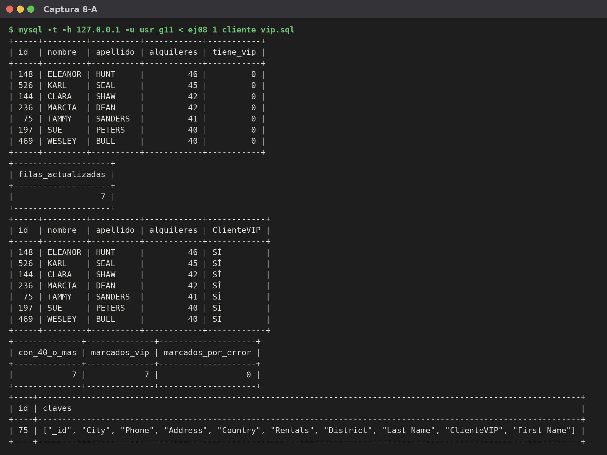

*Captura 8-A: clientes VIP antes y después de JSON_SET.*

Siete clientes tienen 40 o más alquileres, y los siete quedaron marcados (`filas_actualizadas = 7`). Ninguno con menos de 40 fue marcado, y la clave `ClienteVIP` aparece dentro del documento.

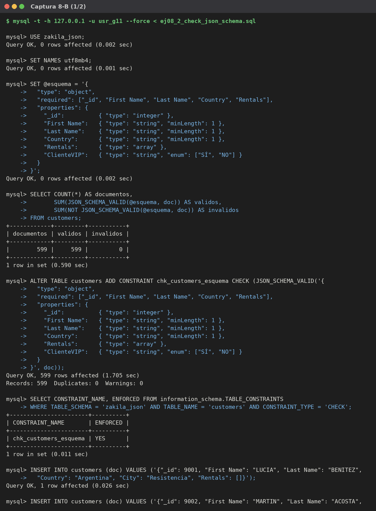

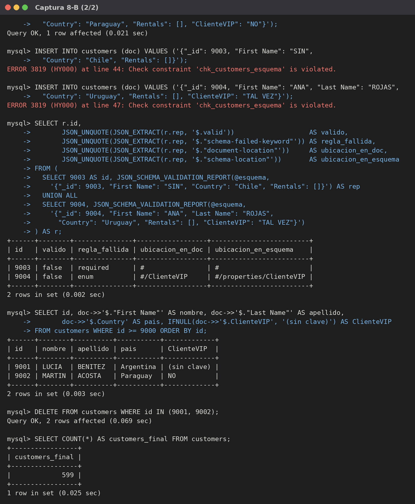

*Captura 8-B: CHECK con JSON_SCHEMA_VALID, 2 inserciones válidas y 2 rechazadas.*

Los 599 documentos cumplían el esquema antes de crear la restricción. Las dos inserciones válidas se aceptan, incluido un cliente sin `ClienteVIP`, porque es opcional. Las dos inválidas se rechazan con `ERROR 3819`:
- 9003 por `required`, porque le falta `Last Name`;
- 9004 por `enum`, porque `"TAL VEZ"` no es un valor permitido.

Al final, las filas de prueba se borran y la tabla vuelve a 599.

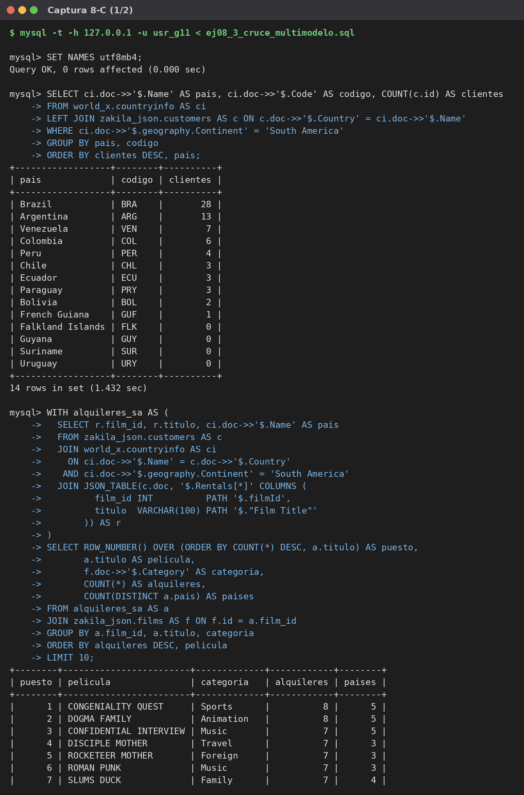

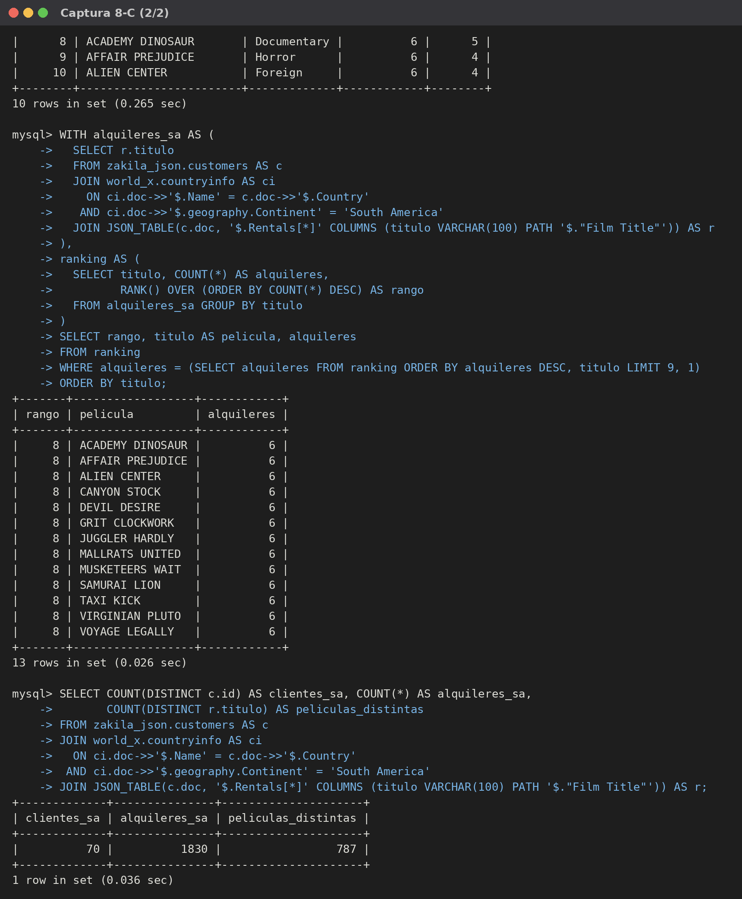

*Captura 8-C: cruce multimodelo y Top 10 de América del Sur.*

De América del Sur hay 70 clientes, con 1830 alquileres de 787 películas distintas. El Top 10 lo encabezan *CONGENIALITY QUEST* y *DOGMA FAMILY*, con 8 alquileres cada una. La tercera consulta muestra el empate en el corte: 13 películas tienen 6 alquileres y quedan en el puesto 8 de `RANK()`.

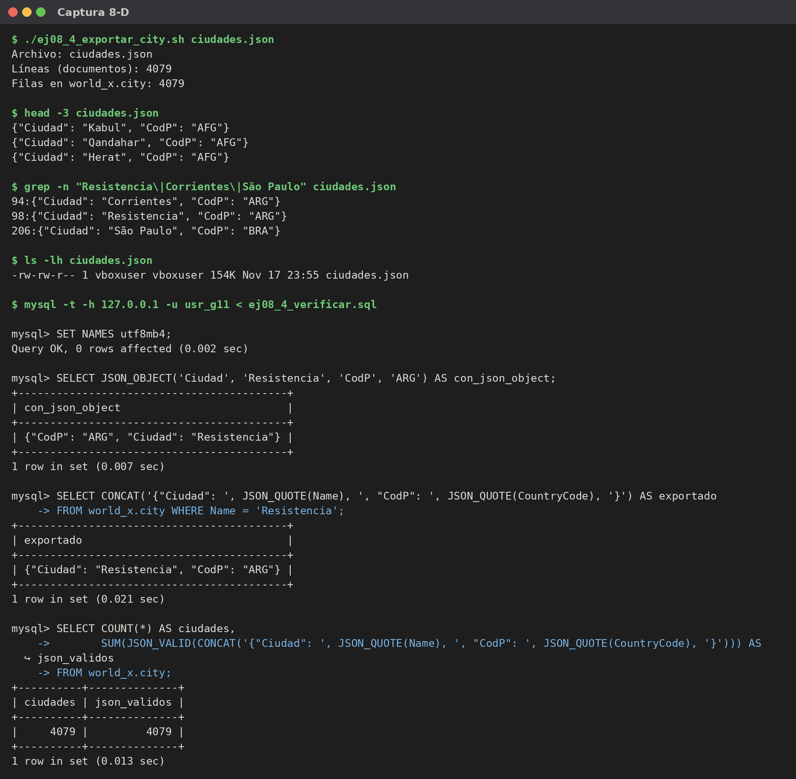

*Captura 8-D: exportación de city a JSON.*

Se exportaron las 4079 ciudades, una por línea, con el formato exacto pedido (`{"Ciudad": "Resistencia", "CodP": "ARG"}`), y todas son JSON válidos. Los nombres con acentos (`São Paulo`) se exportan correctamente.

---

# Bloque 3: Base de datos NoSQL documental (MongoDB 8.0)

## Ejercicio 9: Autenticación e importación documental

**Enunciado**
> **9.1 Gestión de Accesos:** Crear usuario administrador en la base `admin` de MongoDB y autenticarse mediante la consola `mongosh`.
>
> **9.2 Carga Masiva:** Importar con `mongoimport` los archivos `customers.json`, `films.json` y `stores.json` en la base `LabMongoDB`.

### 9.1 Gestión de accesos

**Decisiones técnicas.** Creamos el administrador `adminG11` en la base `admin` con la autorización todavía desactivada. Recién después activamos `security.authorization: enabled` y reiniciamos el servidor. Si se activa antes, solo queda la excepción de *localhost* para crear el primer usuario. En lugar del rol `root` le asignamos los roles que el Bloque 3 necesita:

| Rol | Para qué lo necesita en el laboratorio |
| :--- | :--- |
| `userAdminAnyDatabase` | Crear y administrar usuarios y roles |
| `readWriteAnyDatabase` | Cargar y consultar `LabMongoDB` y `LabMongoDB_Restore` (Ej. 9.2, 10, 11) |
| `dbAdminAnyDatabase` | `collMod` con el validador `$jsonSchema` (Ej. 12.1) |
| `clusterMonitor` | Ver la configuración y el estado del servidor (`getCmdLineOpts`, `serverStatus`) |
| `backup` / `restore` | `mongodump` y `mongorestore` (Ej. 12.2) |

La clave nunca aparece en los comandos ni en las capturas: el script la pide con `passwordPrompt()` o la toma de una variable de entorno.

**Código y comandos**

Configuración del servidor (`mongod.conf`), primero con la autorización comentada:
```yaml
storage:
  dbPath: ~/lab_mongodb_g11/data
systemLog:
  destination: file
  path: ~/lab_mongodb_g11/logs/mongod.log
  logAppend: true
net:
  port: 27017
  bindIp: 127.0.0.1
processManagement:
  fork: true
#security:
#  authorization: enabled
```

Script `ej09_1_crear_admin.js`:
```javascript
// =============================================================================
// LABORATORIO INTEGRADOR SGBD 2026 - GRUPO 11
// Ejercicio 9.1 - Gestión de accesos: usuario administrador en la base admin
// Motor: MongoDB (mongosh). Ejecutar con la autorización TODAVÍA desactivada:
//   mongosh --quiet --file ej09_1_crear_admin.js
// La clave se pide por teclado (passwordPrompt) o se toma de la variable de
// entorno MONGO_ADMIN_PWD: nunca queda escrita en el script ni en el historial.
// =============================================================================

const admin = db.getSiblingDB("admin");
const clave = process.env.MONGO_ADMIN_PWD || passwordPrompt();

if (admin.getUser("adminG11")) {
  print("El usuario adminG11 ya existe: no se vuelve a crear.");
} else {
  admin.createUser({
    user: "adminG11",
    pwd: clave,
    roles: [
      // Crear y administrar usuarios y roles en cualquier base
      { role: "userAdminAnyDatabase", db: "admin" },
      // Leer y escribir datos en todas las bases (LabMongoDB, LabMongoDB_Restore)
      { role: "readWriteAnyDatabase", db: "admin" },
      // collMod / validadores $jsonSchema e índices (Ejercicio 12.1)
      { role: "dbAdminAnyDatabase", db: "admin" },
      // Ver estado del servidor: serverStatus, currentOp, getCmdLineOpts
      { role: "clusterMonitor", db: "admin" },
      // mongodump y mongorestore (Ejercicio 12.2)
      { role: "backup", db: "admin" },
      { role: "restore", db: "admin" }
    ]
  });
  print("Usuario adminG11 creado en la base admin.");
}

printjson(admin.getUser("adminG11", { showPrivileges: false }));
```

Comandos ejecutados:
```bash
mongod --config ~/lab_mongodb_g11/mongod.conf          # sin autorización
mongosh --quiet --file ej09_1_crear_admin.js           # crea adminG11
# activar el control de acceso: descomentar el bloque security en mongod.conf
#   security:
#     authorization: enabled
mongosh --quiet admin --eval 'db.shutdownServer()'
mongod --config ~/lab_mongodb_g11/mongod.conf          # reinicio con autorización
mongosh --quiet --file ej09_1_verificar_auth.js        # prueba sin y con credenciales
# forma interactiva equivalente (pide la clave):
mongosh "mongodb://127.0.0.1:27017" --authenticationDatabase admin -u adminG11
```

Script `ej09_1_verificar_auth.js`:
```javascript
// =============================================================================
// LABORATORIO INTEGRADOR SGBD 2026 - GRUPO 11
// Ejercicio 9.1 - Verificación de la autenticación (con authorization: enabled)
//   mongosh --quiet --file ej09_1_verificar_auth.js
// Forma interactiva equivalente (pide la clave):
//   mongosh "mongodb://127.0.0.1:27017" --authenticationDatabase admin -u adminG11
// =============================================================================

// 1. Sin credenciales: el servidor rechaza los comandos que requieren autorización
print("--- 1. Conexión SIN autenticar ---");
printjson(db.runCommand({ connectionStatus: 1 }).authInfo);
try {
  db.adminCommand({ listDatabases: 1 });
} catch (e) {
  print("listDatabases sin autenticar -> " + e.codeName + ": " + e.message);
}

// 2. Autenticación contra la base admin
print("\n--- 2. Autenticación como adminG11 ---");
const ok = db.getSiblingDB("admin").auth("adminG11", process.env.MONGO_ADMIN_PWD || passwordPrompt());
print("db.auth() -> " + JSON.stringify(ok));

// 3. Identidad y roles de la sesión autenticada
print("\n--- 3. connectionStatus autenticado ---");
printjson(db.runCommand({ connectionStatus: 1 }).authInfo);

print("\n--- 4. Comando administrativo permitido ---");
printjson(db.adminCommand({ listDatabases: 1, nameOnly: true }).databases.map(d => d.name));
```

**Evidencias**

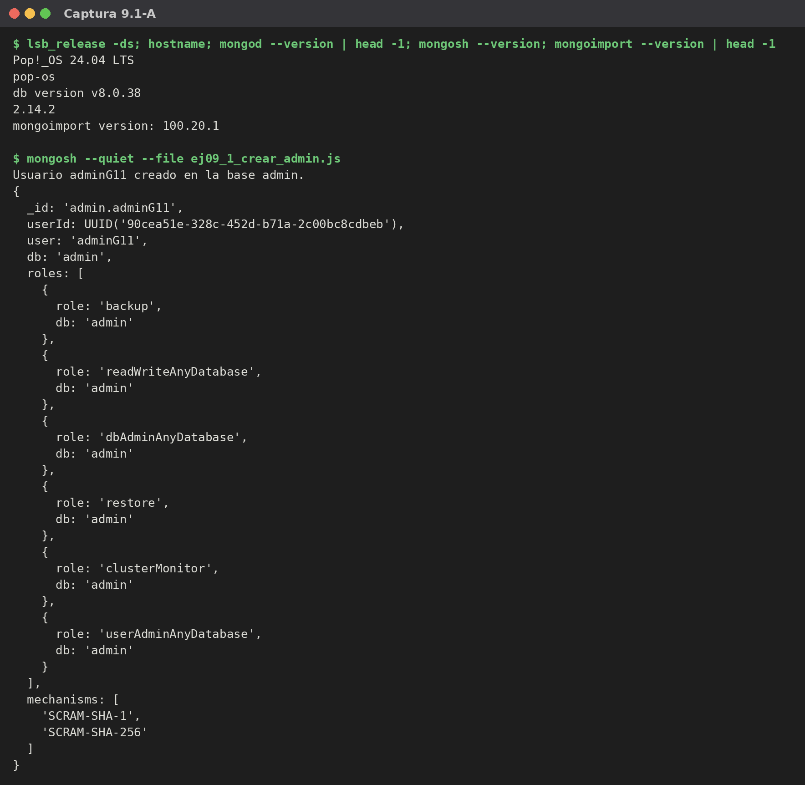

*Captura 9.1-A: entorno y creación de adminG11 con sus 6 roles.*

El usuario queda registrado en la base `admin` con los mecanismos SCRAM. El servidor guarda la clave como *hash*, no en texto plano.

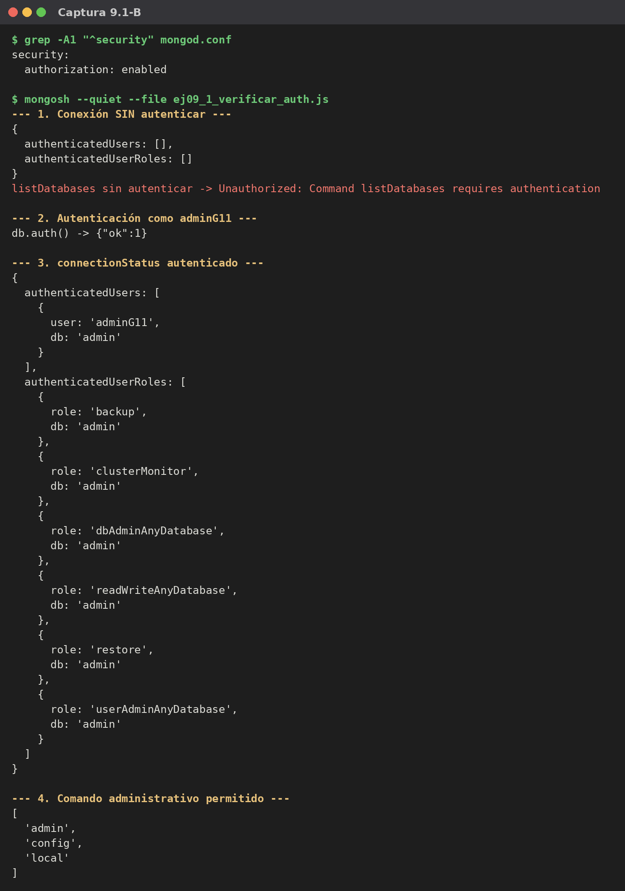

*Captura 9.1-B: rechazo sin credenciales y autenticación de adminG11.*

Con `authorization: enabled`, una conexión anónima ya no puede listar bases (`Unauthorized`). Después de `db.auth()` contra `admin`, la sesión queda identificada como `adminG11` con sus seis roles, y el mismo comando se ejecuta.

### 9.2 Carga masiva

**Decisiones técnicas.**
- Los tres archivos son **JSON Lines** (un documento por línea), así que no usamos `--jsonArray`.
- Importamos a colecciones con los nombres en castellano que usa la guía (`clientes`, `peliculas`, `tiendas`), porque el Ejercicio 11 y el 12.1 se refieren a ellas así.
- `--drop` hace que la carga sea repetible.
- La clave de `adminG11` se lee de un archivo de opciones de las *Database Tools* (`--config`, con permisos `600`). Así no queda en la línea de comandos ni en el historial.

**Código y comandos**

Script `ej09_2_importar.sh`:
```bash
#!/bin/bash
# =============================================================================
# LABORATORIO INTEGRADOR SGBD 2026 - GRUPO 11
# Ejercicio 9.2 - Carga masiva con mongoimport en la base LabMongoDB
# Uso: ./ej09_2_importar.sh <carpeta con customers.json, films.json, stores.json>
#
# - Los archivos son JSON Lines (un documento por línea): no lleva --jsonArray.
# - Colecciones con los nombres en castellano que usa la guía (clientes,
#   peliculas, tiendas), para el $lookup del Ejercicio 11 y el $jsonSchema del 12.1.
# - --drop hace la carga repetible (vacía la colección antes de importar).
# - La clave de adminG11 se lee de un archivo de opciones (--config, YAML con
#   "password: ...") con permisos 600: no queda en la línea de comandos ni en el
#   historial. Sin --config, mongoimport la pide por teclado.
# =============================================================================
set -euo pipefail

DATOS="${1:?Indicar la carpeta con los archivos JSON}"
CONFIG="${MONGO_TOOLS_CONFIG:-$HOME/lab_integrador_g11/tools_admin.yaml}"
DB="LabMongoDB"

importar() {   # $1 = archivo, $2 = colección
  echo "=== $1 -> $DB.$2"
  mongoimport --host 127.0.0.1:27017 \
    --username adminG11 --authenticationDatabase admin --config "$CONFIG" \
    --db "$DB" --collection "$2" --drop \
    --file "$DATOS/$1"
  echo
}

time {
  importar customers.json clientes
  importar films.json     peliculas
  importar stores.json    tiendas
}
```

Script de verificación `ej09_2_verificar_carga.js`:
```javascript
// =============================================================================
// LABORATORIO INTEGRADOR SGBD 2026 - GRUPO 11
// Ejercicio 9.2 - Verificación de la carga en LabMongoDB
//   mongosh "mongodb://127.0.0.1:27017" --authenticationDatabase admin -u adminG11 --quiet --file ej09_2_verificar_carga.js
// =============================================================================

if (!db.runCommand({ connectionStatus: 1 }).authInfo.authenticatedUsers.length) {
  db.getSiblingDB("admin").auth("adminG11", process.env.MONGO_ADMIN_PWD || passwordPrompt());
}
db = db.getSiblingDB("LabMongoDB");   // en un script, "use LabMongoDB" no tiene efecto

print("Base: " + db.getName());
print("Colecciones: " + JSON.stringify(db.getCollectionNames().sort()));

print("\n--- Documentos por colección (esperado: 599 / 1000 / 2) ---");
["clientes", "peliculas", "tiendas"].forEach(c =>
  print(c.padEnd(10) + db.getCollection(c).countDocuments()));

print("\n--- Arreglos anidados (alquileres por cliente, inventario por tienda) ---");
printjson(db.clientes.aggregate([
  { $project: { n: { $size: "$Rentals" } } },
  { $group: { _id: null, clientes: { $sum: 1 }, alquileres: { $sum: "$n" },
              min: { $min: "$n" }, max: { $max: "$n" } } },
  { $project: { _id: 0 } }
]).toArray()[0]);
printjson(db.tiendas.find({}, { _id: 1, City: 1, Country: 1,
  items_inventario: { $size: "$Inventory" }, empleados: { $size: "$Staff" } }).toArray());

print("\n--- Muestra: un cliente (primer alquiler) y una película ---");
printjson(db.clientes.findOne({ _id: 1 },
  { "First Name": 1, "Last Name": 1, City: 1, Country: 1, Rentals: { $slice: 1 } }));
printjson(db.peliculas.findOne({ _id: 1 }, { Actors: 0 }));
```

**Evidencias** (ejecutadas en la VM `LinuxE`, MongoDB 8.0.34)

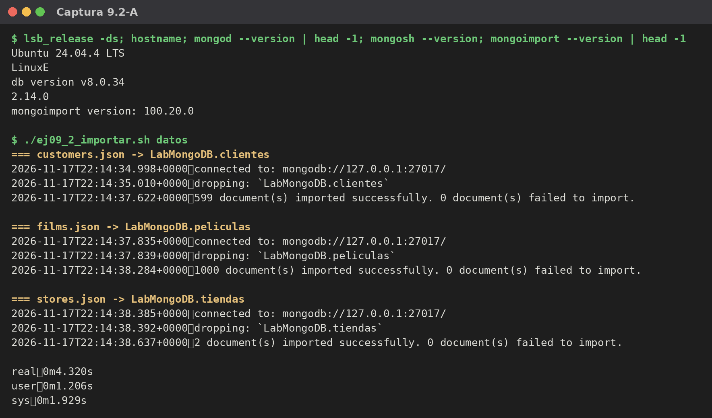

*Captura 9.2-A: salida de mongoimport para las tres colecciones.*

Se importaron los 1601 documentos sin fallas en 4,3 s. `mongoimport` se autenticó como `adminG11` sin que la clave aparezca en el comando.

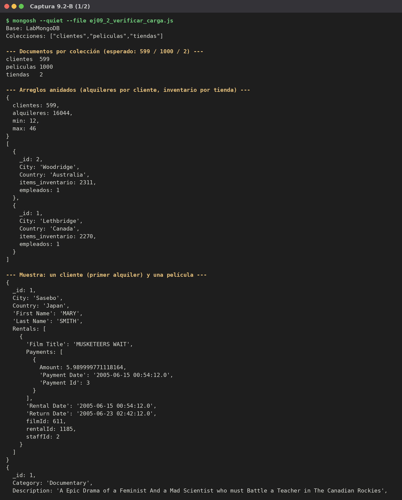

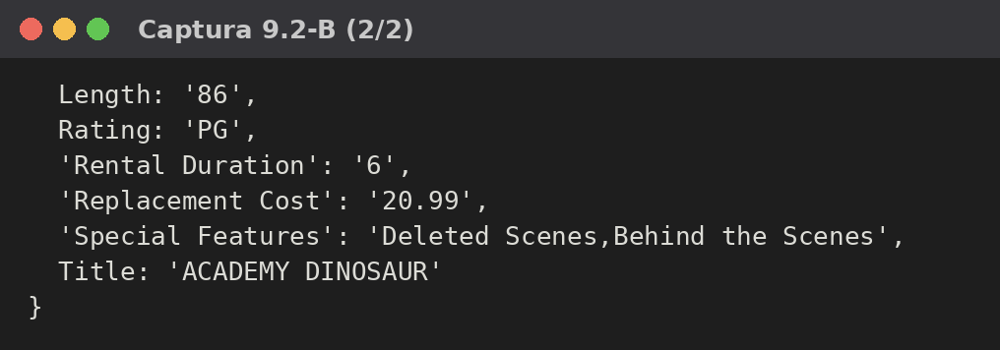

*Captura 9.2-B: verificación de la carga en LabMongoDB.*

Los recuentos coinciden con las líneas de cada archivo (599 / 1000 / 2). Los arreglos anidados también llegaron completos: 16.044 alquileres dentro de los clientes (entre 12 y 46 por cliente) y 2270 / 2311 ítems de inventario por tienda. Es el insumo del modelado del Ejercicio 10.

**Nota aclaratoria.**
- **Entorno:** durante el laboratorio, la VM no fue alcanzable desde la PC donde se resolvió el 9.1 (quedaron en subredes distintas). Por eso el 9.1 se resolvió primero en una instancia local con MongoDB 7.0.14 (macOS), y esas salidas se conservan en `bloque3_mongodb/salidas/`. Las evidencias del 9.1 de este informe son de la ejecución en MongoDB 8.0.38, la versión que pide la guía, con los mismos scripts. La carga del 9.2 se ejecutó en la VM.
- **Archivos:** los nombres de campo tienen espacios (`"First Name"`, `"Film Title"`), así que en las consultas van entre comillas.
- **Tipos de datos:** las fechas, `Length` y `Replacement Cost` se importan como texto, no como fecha o número. Lo tuvimos en cuenta en el `$jsonSchema` del Ejercicio 12.1.

---

## Ejercicio 10: Modelado documental e importación de apoyo

**Enunciado**
> **10.1 Diseño de Esquema:** Modelo documental justificando anidamiento (*embedding*) vs referencias (*referencing*).
>
> **10.2 Colecciones Auxiliares:** Importar JSONs de ciudades y paises a `LabMongoDB`.

### 10.1 Diseño de esquema

Decidimos qué anidar y qué referenciar según **cómo se consultan los datos** y **cuánto crecen**, y lo comprobamos midiendo los documentos reales con `ej10_1_modelo.js`:

| Relación | Decisión | Justificación (con la medición) |
| :--- | :--- | :--- |
| Cliente → alquileres → pagos | **Embebido** (`clientes.Rentals[].Payments[]`) | Se consultan junto con el cliente y crecen acotados: 26,8 alquileres en promedio y 46 como máximo. El documento más grande pesa 11,5 KB, lejos del límite de 16 MB. Hay un solo pago por alquiler |
| Película → actores | **Embebido** (`peliculas.Actors[]`) | Lista corta (5,5 en promedio, 15 como máximo) que siempre se muestra con la película |
| Tienda → inventario | **Embebido** (`tiendas.Inventory[]`) | Solo hay 2 tiendas: el arreglo es grande (2311 ítems, 160 KB), pero no crece sin control. Si las tiendas o el inventario crecieran mucho, convendría pasarlo a su propia colección |
| Alquiler → película | **Referencia** (`Rentals.filmId` → `peliculas._id`) | Cada película se alquila hasta 34 veces: embebida, se repetiría en cada alquiler y habría que actualizar todas las copias. Las 958 referencias apuntan a películas existentes |
| Cliente → país | **Referencia por nombre** (`clientes.Country` → `paises.Name`) | `paises` es un catálogo compartido. Solo 1 de los 108 países no tiene correspondencia ("Runion", con la tilde perdida en el origen) |
| Ciudad → país | **Referencia** (`ciudades.CodP` → `paises.Code`) | 4079 ciudades de 232 países, todas con país existente |

En síntesis: **anidamos** lo que se lee junto con el documento padre y tiene un tamaño acotado, y **referenciamos** lo que es compartido, se repetiría muchas veces o se consulta por separado. Las referencias se resuelven con `$lookup` (Ej. 11), con índices de apoyo en `paises.Name` y `ciudades.CodP`.

Script `ej10_1_modelo.js`:
```javascript
// =============================================================================
// LABORATORIO INTEGRADOR SGBD 2026 - GRUPO 11
// Ejercicio 10.1 - Evidencia para el diseño del esquema (embedding vs referencing)
//   mongosh "mongodb://127.0.0.1:27017/LabMongoDB" --authenticationDatabase admin -u adminG11 --file ej10_1_modelo.js
// Mide el tamaño de los documentos y de los arreglos embebidos, y verifica que
// las referencias entre colecciones apunten a documentos existentes.
// =============================================================================
db = db.getSiblingDB("LabMongoDB");

const medir = (coleccion, arreglo) => db.getCollection(coleccion).aggregate([
  { $project: { b: { $bsonSize: "$$ROOT" }, n: { $size: "$" + arreglo } } },
  { $group: { _id: null, docs: { $sum: 1 }, b_prom: { $avg: "$b" }, b_max: { $max: "$b" },
              n_prom: { $avg: "$n" }, n_max: { $max: "$n" } } }
]).toArray()[0];

print("1. EMBEBIDOS: tamaño de documentos y arreglos (límite de un documento BSON: 16 MB)\n");
print("Colección  Arreglo embebido  Docs  Elem.prom  Elem.max  KB prom  KB max");
[["clientes", "Rentals"], ["peliculas", "Actors"], ["tiendas", "Inventory"]].forEach(([c, a]) => {
  const m = medir(c, a);
  print(c.padEnd(10) + "  " + a.padEnd(16) + String(m.docs).padStart(6) +
        m.n_prom.toFixed(1).padStart(11) + String(m.n_max).padStart(10) +
        (m.b_prom / 1024).toFixed(1).padStart(9) + (m.b_max / 1024).toFixed(1).padStart(8));
});
const pagos = db.clientes.aggregate([{ $unwind: "$Rentals" },
  { $group: { _id: null, max: { $max: { $size: "$Rentals.Payments" } } } }]).toArray()[0].max;
print("Pagos por alquiler (máximo): " + pagos);

print("\n2. REFERENCIAS: ¿apuntan a documentos existentes?\n");
const huerfanos = (desde, campo, unwind, hacia, clave) => db.getCollection(desde).aggregate([
  ...(unwind ? [{ $unwind: "$" + unwind }] : []),
  { $group: { _id: "$" + campo } },
  { $lookup: { from: hacia, localField: "_id", foreignField: clave, as: "x" } },
  { $group: { _id: null, distintos: { $sum: 1 }, sin_destino: { $sum: { $cond: [{ $eq: [{ $size: "$x" }, 0] }, 1, 0] } } } }
]).toArray()[0];
[
  ["clientes.Rentals.filmId -> peliculas._id", "clientes", "Rentals.filmId", "Rentals", "peliculas", "_id"],
  ["tiendas.Inventory.filmId  -> peliculas._id", "tiendas", "Inventory.filmId", "Inventory", "peliculas", "_id"],
  ["clientes.Country         -> paises.Name", "clientes", "Country", null, "paises", "Name"],
  ["ciudades.CodP            -> paises.Code", "ciudades", "CodP", null, "paises", "Code"]
].forEach(([t, ...r]) => { const h = huerfanos(...r); print(t + "   valores distintos: " + h.distintos + "   sin destino: " + h.sin_destino); });

print("\n3. Veces que se repite cada película en los alquileres (si se embebiera completa)");
printjson(db.clientes.aggregate([{ $unwind: "$Rentals" }, { $group: { _id: "$Rentals.filmId", n: { $sum: 1 } } },
  { $group: { _id: null, alquileres: { $sum: "$n" }, peliculas: { $sum: 1 }, max_repeticiones: { $max: "$n" } } },
  { $project: { _id: 0 } }]).toArray()[0]);
```

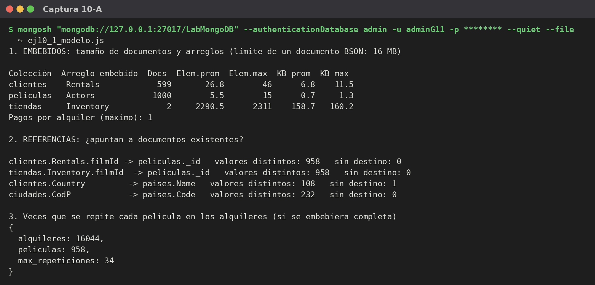

*Captura 10-A: medición de embebidos y referencias.*

### 10.2 Colecciones auxiliares

**Decisiones técnicas.**
- **`ciudades.json`** es la exportación de `world_x.city` del Ejercicio 8.4 (`{"Ciudad", "CodP"}`).
- **`paises.json`** se exportó en la VM desde `world_x.countryinfo`, que ya guarda cada país como documento JSON. Así los dos motores usan los mismos datos de origen.
- Los dos archivos son JSON Lines y se importan con `--drop` para que la carga sea repetible.

Exportación de países (en la VM):
```text
$ mysql -h 127.0.0.1 -u usr_g11 -N -B -r -e "SELECT doc FROM world_x.countryinfo ORDER BY doc->>'$.Code'" > paises.json

$ wc -l paises.json
239 paises.json

$ grep "\"Code\": \"ARG\"" paises.json
{"GNP": 340238, "_id": "00005de917d80000000000000008", "Code": "ARG", "Name": "Argentina", "IndepYear": 1816, "geography": {"Region": "South America", "Continent": "South Amer …
```

Script `ej10_2_importar.sh`:
```bash
#!/bin/bash
# =============================================================================
# LABORATORIO INTEGRADOR SGBD 2026 - GRUPO 11
# Ejercicio 10.2 - Importación de las colecciones auxiliares ciudades y paises
# Uso: ./ej10_2_importar.sh <carpeta con ciudades.json y paises.json>
#   ciudades.json: exportado de world_x.city en el Ejercicio 8.4 ({"Ciudad", "CodP"})
#   paises.json:   exportado de world_x.countryinfo (documentos JSON de MySQL):
#     mysql -h 127.0.0.1 -u usr_g11 -p -N -B -r -e "SELECT doc FROM world_x.countryinfo ORDER BY doc->>'$.Code'" > paises.json
# La clave de adminG11 se lee de un archivo de opciones (YAML "password: ...", chmod 600).
# =============================================================================
set -euo pipefail
DATOS="${1:?Indicar la carpeta con ciudades.json y paises.json}"
CONFIG="${MONGO_TOOLS_CONFIG:-$HOME/lab_mongodb_g11/tools_admin.yaml}"
HOST="${MONGO_HOST:-127.0.0.1:27017}"

importar() {   # $1 = archivo, $2 = colección
  echo "=== $1 -> LabMongoDB.$2"
  mongoimport --host "$HOST" \
    --username adminG11 --authenticationDatabase admin --config "$CONFIG" \
    --db LabMongoDB --collection "$2" --drop \
    --file "$DATOS/$1"
  echo
}

echo "Documentos en los archivos (JSON Lines: uno por línea):"
wc -l "$DATOS/paises.json" "$DATOS/ciudades.json"; echo
importar paises.json   paises
importar ciudades.json ciudades
```

Script `ej10_2_verificar.js`:
```javascript
// =============================================================================
// LABORATORIO INTEGRADOR SGBD 2026 - GRUPO 11
// Ejercicio 10.2 - Verificación de las colecciones auxiliares ciudades y paises
//   mongosh "mongodb://127.0.0.1:27017/LabMongoDB" --authenticationDatabase admin -u adminG11 --file ej10_2_verificar.js
// =============================================================================
db = db.getSiblingDB("LabMongoDB");   // en un script, "use LabMongoDB" no tiene efecto

print("Colecciones: " + JSON.stringify(db.getCollectionNames().sort()));
print("ciudades: " + db.ciudades.countDocuments() + "   (esperado 4079)");
print("paises:   " + db.paises.countDocuments() + "   (esperado 239)");

print("\n--- Una ciudad y su país (referencia CodP -> Code) ---");
printjson(db.ciudades.findOne({ Ciudad: "Resistencia" }, { _id: 0 }));
printjson(db.paises.findOne({ Code: "ARG" }, { _id: 0, Code: 1, Name: 1, geography: 1 }));

print("\n--- Países de América del Sur (filtro del Ejercicio 11) ---");
db.paises.find({ "geography.Continent": "South America" }, { _id: 0, Code: 1, Name: 1 })
  .sort({ Name: 1 }).forEach(p => print("  " + p.Code + "  " + p.Name));

print("\n--- Clientes cuyo Country no tiene país en paises (esperado: solo Runion) ---");
printjson(db.clientes.aggregate([
  { $lookup: { from: "paises", localField: "Country", foreignField: "Name", as: "p" } },
  { $match: { p: { $size: 0 } } },
  { $group: { _id: "$Country", clientes: { $sum: 1 } } }
]).toArray());

// Índices de apoyo para los $lookup del Ejercicio 11 (paises.Name) y para ciudades por país
print("\n--- Índices de apoyo ---");
print(db.paises.createIndex({ Name: 1 }) + " / " + db.ciudades.createIndex({ CodP: 1 }));
```

**Evidencias**

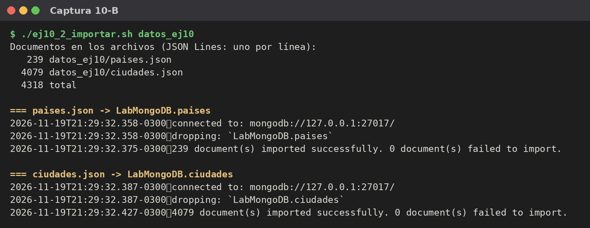

*Captura 10-B: importación de paises y ciudades.*

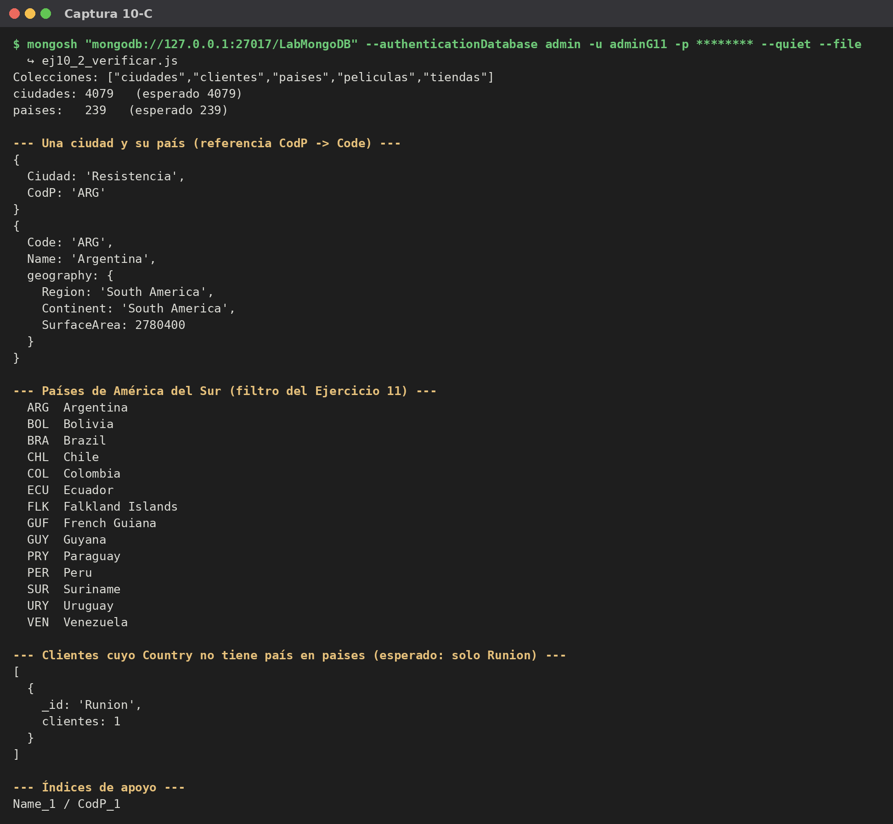

*Captura 10-C: verificación de las colecciones auxiliares.*

Se cargaron 239 países y 4079 ciudades, los mismos que en MySQL. La referencia `CodP` → `Code` funciona (Resistencia → Argentina), y los 14 países con `Continent = "South America"` son el filtro del Ejercicio 11. Un solo cliente ("Runion") no tiene país correspondiente y queda fuera del cruce, igual que en el Ejercicio 8.3.

---

## Ejercicio 11: Pipeline de agregación complejo

**Enunciado**
> Aggregation Pipeline (`$lookup`, `$unwind`, `$match`, `$group`, `$sort`, `$limit`) para el Top 10 de películas más alquiladas en América del Sur vinculando clientes, peliculas y paises.

**Decisiones técnicas.**
1. **`$lookup` + `$unwind` con `paises`:** une cada cliente con su país (`Country` → `Name`). El `$unwind` sin `preserveNullAndEmptyArrays` descarta a los clientes sin país.
2. **`$match`:** se queda solo con América del Sur. Va antes de abrir los alquileres, para trabajar con 70 clientes y no con 599.
3. **`$unwind` de `Rentals`:** un documento por alquiler.
4. **`$group` por `filmId`:** cuenta alquileres y junta los países distintos (`$addToSet`).
5. **`$lookup` + `$unwind` con `peliculas`:** solo sobre las películas agrupadas, para traer título y categoría.
6. **`$sort` + `$limit`:** mayor cantidad primero, con desempate alfabético por título, el mismo criterio del Ejercicio 8.3.

Al final, una variante del mismo pipeline cuenta el empate en el corte.

**Código y comandos**

Script `ej11_pipeline.js`:
```javascript
// =============================================================================
// LABORATORIO INTEGRADOR SGBD 2026 - GRUPO 11
// Ejercicio 11 - Aggregation Pipeline: Top 10 de películas más alquiladas en
// América del Sur, vinculando clientes, peliculas y paises
//   mongosh "mongodb://127.0.0.1:27017/LabMongoDB" --authenticationDatabase admin -u adminG11 --file ej11_pipeline.js
// Resultado esperado = Ejercicio 8.3 (MySQL): mismo orden y desempate por título.
// =============================================================================
db = db.getSiblingDB("LabMongoDB");

const pipeline = [
  // 1. Cliente -> país (referencia por nombre: clientes.Country = paises.Name)
  { $lookup: { from: "paises", localField: "Country", foreignField: "Name", as: "pais" } },
  { $unwind: "$pais" },
  // 2. Solo clientes de América del Sur
  { $match: { "pais.geography.Continent": "South America" } },
  // 3. Un documento por alquiler (el arreglo Rentals está embebido en el cliente)
  { $unwind: "$Rentals" },
  // 4. Alquileres por película y países distintos donde se alquiló
  { $group: { _id: "$Rentals.filmId", alquileres: { $sum: 1 }, paises: { $addToSet: "$pais.Name" } } },
  // 5. Película (referencia filmId -> peliculas._id) para el título y la categoría
  { $lookup: { from: "peliculas", localField: "_id", foreignField: "_id", as: "pelicula" } },
  { $unwind: "$pelicula" },
  { $project: { _id: 0, filmId: "$_id", pelicula: "$pelicula.Title", categoria: "$pelicula.Category",
                alquileres: 1, paises: { $size: "$paises" } } },
  // 6. Mayor cantidad primero; desempate alfabético (13 películas empatan con 6)
  { $sort: { alquileres: -1, pelicula: 1 } },
  { $limit: 10 }
];

const top = db.clientes.aggregate(pipeline).toArray();
print("Top 10 de películas más alquiladas en América del Sur\n");
print("Pos  Película                  Categoría     Alq  Países");
top.forEach((p, i) => print(
  String(i + 1).padStart(3) + "  " + p.pelicula.padEnd(24) + "  " + p.categoria.padEnd(12) +
  "  " + String(p.alquileres).padStart(3) + "  " + String(p.paises).padStart(5)));

// Control del empate en el corte: películas con la misma cantidad que el puesto 10
const corte = top[top.length - 1].alquileres;
const empatadas = db.clientes.aggregate(pipeline.slice(0, 5).concat([
  { $match: { alquileres: corte } }, { $count: "n" }
])).toArray()[0].n;
print("\nPelículas con " + corte + " alquileres (empate en el corte): " + empatadas);
```

**Evidencias**

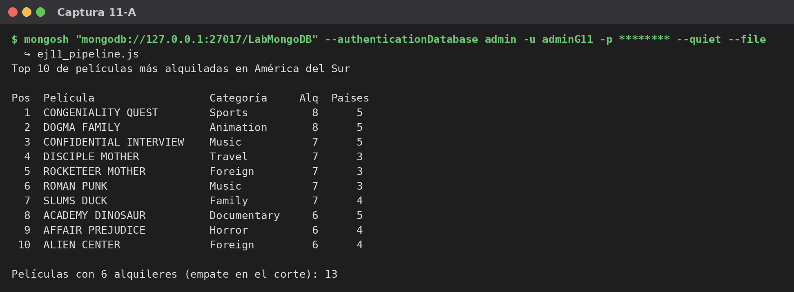

*Captura 11-A: Top 10 de películas más alquiladas en América del Sur.*

El resultado es **idéntico** al del Ejercicio 8.3 en MySQL: las mismas diez películas, en el mismo orden, con los mismos alquileres y países, y el mismo empate de 13 películas con 6 alquileres. Los dos modelos (JSON en MySQL y documentos en MongoDB) llegan a la misma respuesta, cada uno con su propio lenguaje.

---

## Ejercicio 12: Validación de esquemas y backup cloud

**Enunciado**
> **12.1 Esquema de Validación:** Regla de validación `$jsonSchema` sobre tiendas (2 inserciones válidas, 2 rechazadas).
>
> **12.2 Respaldo Cloud:** Respaldo con `mongodump` y restauración con `mongorestore` en MongoDB Atlas o base local `LabMongoDB_Restore`.

**Decisiones técnicas.**
- **12.1:** la regla exige dirección, ciudad, país e inventario. Cada ítem del inventario tiene que tener `filmId` e `inventoryId` enteros y el título. `managerStaffId` viene como texto en el archivo original, así que se valida como texto numérico.
  - **Antes de aplicar la regla comprobamos que las tiendas existentes la cumplieran.** Si no, `mongorestore` (12.2) crearía la colección con la regla y rechazaría los propios datos.
  - La regla se aplica con `collMod`, en `validationLevel: "strict"` y `validationAction: "error"`.
- **12.2:** elegimos la **base local `LabMongoDB_Restore`**, una de las dos opciones de la guía. `--nsFrom`/`--nsTo` restauran con otro nombre y no pisan la original. Después comparamos recuentos, índices y validador, y repetimos el pipeline del Ej. 11 sobre la copia.

**Código y comandos**

Script `ej12_1_validacion.js`:
```javascript
// =============================================================================
// LABORATORIO INTEGRADOR SGBD 2026 - GRUPO 11
// Ejercicio 12.1 - Regla de validación $jsonSchema sobre la colección de tiendas
//   mongosh "mongodb://127.0.0.1:27017/LabMongoDB" --authenticationDatabase admin -u adminG11 --file ej12_1_validacion.js
// =============================================================================
db = db.getSiblingDB("LabMongoDB");

const esquema = {
  bsonType: "object",
  required: ["_id", "Address", "City", "Country", "Inventory"],
  properties: {
    _id:            { bsonType: "int", description: "número de tienda (entero)" },
    Address:        { bsonType: "string", minLength: 1 },
    City:           { bsonType: "string", minLength: 1 },
    Country:        { bsonType: "string", minLength: 1 },
    Phone:          { bsonType: "string" },
    // En stores.json viene como texto ("1"): se valida que sea texto numérico
    managerStaffId: { bsonType: "string", pattern: "^[0-9]+$" },
    Staff:          { bsonType: "array" },
    Inventory: {
      bsonType: "array",
      items: {
        bsonType: "object",
        required: ["filmId", "inventoryId", "Film Title"],
        properties: {
          filmId:       { bsonType: "int" },
          inventoryId:  { bsonType: "int" },
          "Film Title": { bsonType: "string" }
        }
      }
    }
  }
};

// 1. Antes de aplicar la regla: las tiendas existentes deben cumplirla (esperado 0).
//    Si no, mongorestore (12.2) crea la regla antes de cargar los datos y las rechaza.
print("Tiendas que NO cumplen el esquema: " + db.tiendas.countDocuments({ $nor: [{ $jsonSchema: esquema }] }));

// 2. Aplicar la regla a la colección existente
printjson(db.runCommand({ collMod: "tiendas", validator: { $jsonSchema: esquema },
                          validationLevel: "strict", validationAction: "error" }));
printjson(db.getCollectionInfos({ name: "tiendas" })[0].options.validationAction);

const probar = (titulo, doc) => {
  print("\n--- " + titulo + " ---");
  try {
    printjson(db.tiendas.insertOne(doc));
  } catch (e) {
    print(e.name + ": " + e.message);
    const det = e.errInfo && e.errInfo.details && e.errInfo.details.schemaRulesNotSatisfied;
    if (det) printjson(det);
  }
};

// 3. Inserciones VÁLIDAS
probar("VÁLIDA 1: tienda nueva con un ítem de inventario", {
  _id: 3, Address: "Av. 9 de Julio 1100", City: "Resistencia", Country: "Argentina",
  Phone: "3624000000", Staff: [],
  Inventory: [{ filmId: 1, inventoryId: 9001, "Film Title": "ACADEMY DINOSAUR" }] });
probar("VÁLIDA 2: tienda nueva con inventario vacío", {
  _id: 4, Address: "Junín 1500", City: "Corrientes", Country: "Argentina", Inventory: [] });

// 4. Inserciones INVÁLIDAS
probar("INVÁLIDA 1: falta el campo obligatorio City", {
  _id: 5, Address: "Calle sin ciudad 1", Country: "Argentina", Inventory: [] });
probar("INVÁLIDA 2: filmId del inventario como texto", {
  _id: 6, Address: "Calle 2", City: "Formosa", Country: "Argentina",
  Inventory: [{ filmId: "uno", inventoryId: 9002, "Film Title": "ACADEMY DINOSAUR" }] });

// 5. Resultado y limpieza (se borran las de prueba; la regla queda activa)
print("\nTiendas: " + JSON.stringify(db.tiendas.find({}, { _id: 1, City: 1 }).sort({ _id: 1 }).toArray()));
print("Borradas las de prueba: " + db.tiendas.deleteMany({ _id: { $in: [3, 4] } }).deletedCount +
      " | tiendas finales: " + db.tiendas.countDocuments());
```

Script `ej12_2_backup.sh` y verificación `ej12_2_verificar.js`:
```bash
#!/bin/bash
# =============================================================================
# LABORATORIO INTEGRADOR SGBD 2026 - GRUPO 11
# Ejercicio 12.2 - Respaldo con mongodump y restauración con mongorestore en la
#                  base local LabMongoDB_Restore
# Uso: ./ej12_2_backup.sh       (cada herramienta pide la clave de adminG11;
#                                o MONGO_TOOLS_CONFIG=archivo.yaml con "password: ...")
# =============================================================================
set -euo pipefail
AUTH=(--host 127.0.0.1:27017 --username adminG11 --authenticationDatabase admin)
[ -n "${MONGO_TOOLS_CONFIG:-}" ] && AUTH+=(--config "$MONGO_TOOLS_CONFIG")
DESTINO="$HOME/backup_labmongodb"

echo "=== 1. Respaldo de LabMongoDB"
rm -rf "$DESTINO"
mongodump "${AUTH[@]}" --db LabMongoDB --out "$DESTINO"

echo; echo "=== 2. Archivos generados (.bson = datos, .metadata.json = índices y opciones)"
ls -lh "$DESTINO/LabMongoDB/"
echo "documentos en tiendas.bson: $(bsondump --quiet "$DESTINO/LabMongoDB/tiendas.bson" | wc -l)"

echo; echo "=== 3. Restauración en LabMongoDB_Restore (no pisa la base original)"
mongorestore "${AUTH[@]}" --drop \
  --nsInclude 'LabMongoDB.*' --nsFrom 'LabMongoDB.*' --nsTo 'LabMongoDB_Restore.*' \
  "$DESTINO"
```
```javascript
// =============================================================================
// LABORATORIO INTEGRADOR SGBD 2026 - GRUPO 11
// Ejercicio 12.2 - Comparación entre LabMongoDB y LabMongoDB_Restore
//   mongosh "mongodb://127.0.0.1:27017/admin" --authenticationDatabase admin -u adminG11 --file ej12_2_verificar.js
// =============================================================================
const orig = db.getSiblingDB("LabMongoDB"), rest = db.getSiblingDB("LabMongoDB_Restore");

print("Colección     LabMongoDB  LabMongoDB_Restore  Índices(orig/rest)  ¿Igual?");
orig.getCollectionNames().sort().forEach(c => {
  const a = orig.getCollection(c).countDocuments(), b = rest.getCollection(c).countDocuments();
  const ia = orig.getCollection(c).getIndexes().length, ib = rest.getCollection(c).getIndexes().length;
  print(c.padEnd(12) + String(a).padStart(11) + String(b).padStart(20) +
        (ia + "/" + ib).padStart(20) + "  " + (a === b && ia === ib ? "SÍ" : "NO"));
});

// La regla $jsonSchema del 12.1 viaja en el .metadata.json y queda activa en la copia
const v = rest.getCollectionInfos({ name: "tiendas" })[0].options;
print("\nValidador en LabMongoDB_Restore.tiendas: " + (v.validator ? "presente (" + v.validationAction + ")" : "NO"));

// El mismo pipeline del Ejercicio 11 sobre la copia da el mismo primer puesto
printjson(rest.clientes.aggregate([
  { $lookup: { from: "paises", localField: "Country", foreignField: "Name", as: "pais" } },
  { $unwind: "$pais" }, { $match: { "pais.geography.Continent": "South America" } },
  { $unwind: "$Rentals" }, { $group: { _id: "$Rentals.Film Title", alquileres: { $sum: 1 } } },
  { $sort: { alquileres: -1, _id: 1 } }, { $limit: 1 }
]).toArray());
```

**Evidencias**

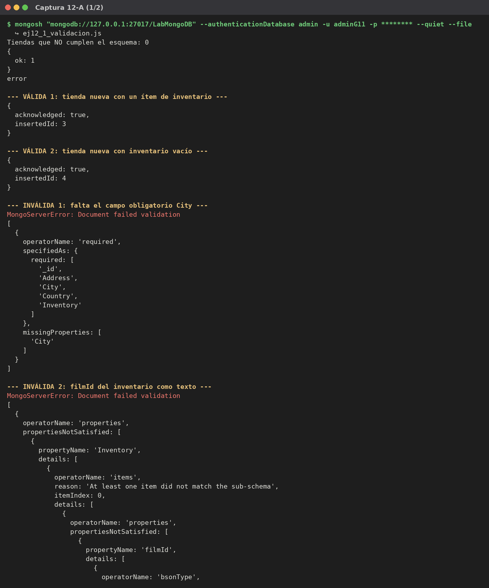

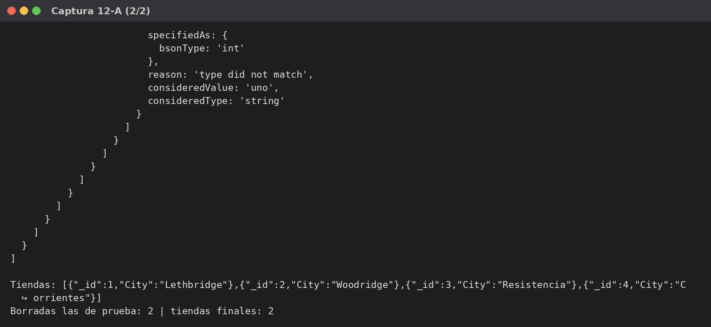

*Captura 12-A: regla $jsonSchema, 2 inserciones válidas y 2 rechazadas.*

Las dos tiendas existentes cumplían la regla, así que `collMod` se aplicó sin problemas. Las dos válidas se aceptaron, incluida una con inventario vacío. Las dos inválidas se rechazaron con `Document failed validation`, y el detalle indica la causa exacta:
- en la primera falta `City` (`required`);
- en la segunda, el `filmId` del primer ítem es texto y no entero (`bsonType`).

Las tiendas de prueba se borran al final y la regla queda activa.

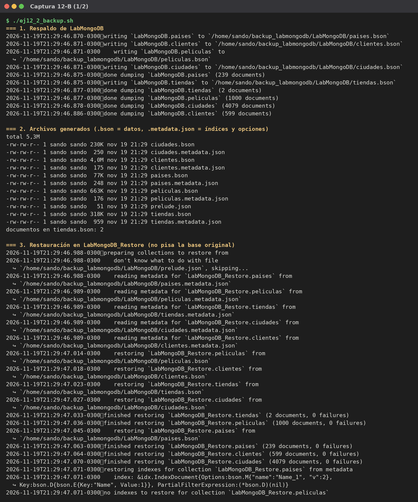

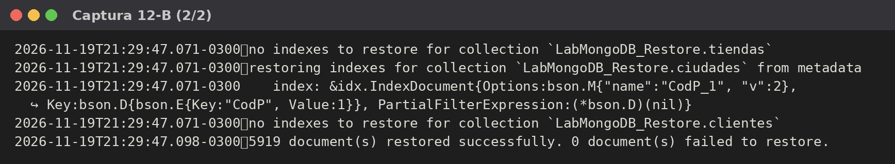

*Captura 12-B: mongodump, archivos generados y mongorestore.*

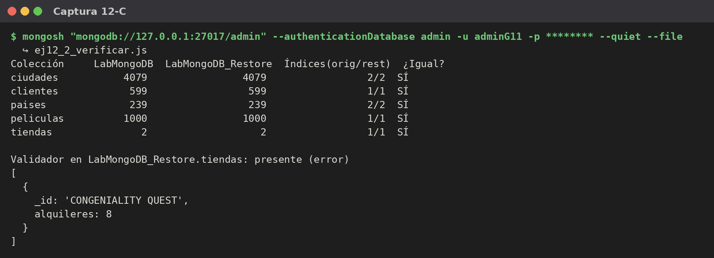

*Captura 12-C: comparación entre LabMongoDB y LabMongoDB_Restore.*

Se respaldaron y restauraron los 5919 documentos de las cinco colecciones sin fallas. La copia tiene los mismos recuentos e índices. El validador de `tiendas` viajó en el `.metadata.json` y sigue activo, y el pipeline del Ej. 11 sobre la copia da el mismo primer puesto (*CONGENIALITY QUEST*, 8 alquileres).

**Nota aclaratoria.** La guía ofrecía Atlas o la base local. Elegimos la base local para no depender de la red del aula. El mismo procedimiento contra Atlas solo cambia el destino (`--uri "mongodb+srv://<cluster>/"`) y requiere un usuario con rol `atlasAdmin`. Ya lo practicamos en la Unidad 10.

---

# Bloque 4: Competencias CGSPA y transparencia tecnológica

## 4.1 Matriz de distribución de roles y coevaluación (Capacidad 5.1)

**Enunciado**
> Completar la matriz indicando qué integrante lideró o colaboró en cada función clave durante las 4 horas de trabajo. Incluir un breve texto (máx. 5 líneas) explicando cómo el grupo resolvió eventuales desacuerdos técnicos.

| Función / dimensión técnica | Integrante que lanza / lidera | Integrante colaborador | Evidencia / entregable |
| :--- | :--- | :--- | :--- |
| Navegación de fuentes oficiales | Bloque 1: Aguirre Egea, Emiliano y Ghione, Lucas · Bloques 2 y 3: Pagno, Agustin y Sandoval, Lautaro Emanuel | Dentro de cada dupla, el otro integrante | Comandos y sintaxis verificada |
| Operación técnica en VM Ubuntu | Bloque 1: Aguirre Egea, Emiliano y Ghione, Lucas · Bloques 2 y 3: Pagno, Agustin y Sandoval, Lautaro Emanuel | Dentro de cada dupla, el otro integrante | Capturas de terminal y scripts SQL/Bash |
| Verificación y análisis de métricas | Bloque 1: Aguirre Egea, Emiliano y Ghione, Lucas · Bloques 2 y 3: Pagno, Agustin y Sandoval, Lautaro Emanuel | Dentro de cada dupla, el otro integrante | Planes `EXPLAIN` y logs de auditoría |
| Documentación y redacción final | Bloque 1: Aguirre Egea, Emiliano y Ghione, Lucas · Bloques 2 y 3: Pagno, Agustin y Sandoval, Lautaro Emanuel | Dentro de cada dupla, el otro integrante | Consolidación del PDF `Grupo11.pdf` |

**Resolución de desacuerdos técnicos (máx. 5 líneas):**  
Nos dividimos en dos duplas por bloque, y cada dupla se ocupó de todas las funciones de sus ejercicios: buscar en el manual, ejecutar, verificar y documentar. Cuando había dos formas de resolver algo, la dupla probaba las dos sobre el motor y se quedaba con la que respaldaban la evidencia y el manual oficial. Por ejemplo, en el Ej. 8.4 descartamos `JSON_OBJECT()` porque reordena las claves. Al final integramos los tres bloques en un solo informe y revisamos que los resultados coincidieran entre motores (Ej. 8.3 y 11).

---

## 4.2 Notas de diagnóstico para el equipo de Operaciones / DBA (Capacidad 6.1)

**Enunciado**
> Redactar en formato de nota técnica profesional la incidencia producida en el Ejercicio 5 (Bloqueos) y en el Ejercicio 6 (Restauración PITR): a) Causa raíz, b) Solución técnica aplicada, c) Recomendaciones de prevención.

### Nota 1: Incidencia de bloqueo (Ejercicio 5)

**Para:** Equipo de Operaciones / DBA · **De:** Grupo 11 · **Asunto:** Sesión detenida por espera de bloqueo en `employees.salaries`

- **a) Causa raíz:**
  - Una transacción (Sesión 1, hilo 49) actualizó los sueldos de los empleados 10001 a 10010 y **quedó abierta sin confirmar**.
  - En `REPEATABLE READ`, InnoDB mantiene hasta el `COMMIT` o `ROLLBACK` los bloqueos exclusivos (`X`) de todos los registros que recorrió: 113, según `innodb_trx`.
  - Una segunda transacción (hilo 50) intentó modificar el sueldo de 10005, uno de esos registros, y quedó en `LOCK WAIT`.
  - No fue una consulta lenta: fue una **espera por un recurso retenido**. `data_locks` muestra el bloqueo concedido a la Sesión 1 y el mismo bloqueo en `WAITING` para la Sesión 2, y `data_lock_waits` relaciona las dos transacciones (3134 espera a 3133).
- **b) Solución técnica aplicada:**
  - Identificamos la sesión bloqueada con `information_schema.innodb_trx` (`trx_state = 'LOCK WAIT'`) y la interrumpimos con `KILL 50`. Después verificamos que no quedaran transacciones esperando.
  - La transacción que retenía los bloqueos terminó con `ROLLBACK`, y comprobamos que el sueldo de 10005 no cambió (94.692).
- **c) Recomendaciones de prevención:**
  1. **Transacciones cortas:** confirmar o revertir apenas termina la operación, sin esperar al usuario con la transacción abierta.
  2. **Acotar lo que se bloquea:** filtrar por la clave completa e indexar las columnas del `WHERE`, para no recorrer (y bloquear) filas de más.
  3. **Limitar la espera:** ajustar `innodb_lock_wait_timeout` por sesión en procesos interactivos y reintentar ante `ERROR 1205` o `1213`.
  4. **Monitorear:** alertar cuando `innodb_trx` muestre transacciones abiertas por más de N segundos o en `LOCK WAIT` (`sys.innodb_lock_waits`).

### Nota 2: Restauración PITR (Ejercicio 6)

**Para:** Equipo de Operaciones / DBA · **De:** Grupo 11 · **Asunto:** Recuperación de la tabla `employees.titles` eliminada por error

- **a) Causa raíz:**
  - Se ejecutó `DROP TABLE titles` en producción por error humano, con un usuario que tenía privilegios de DDL sobre la base.
  - La replicación o un respaldo simple no alcanzan:
    - restaurar solo el backup perdería las 5 operaciones válidas posteriores;
    - reaplicar todo el binlog volvería a ejecutar el `DROP`.
  - Además, con `gtid_mode = ON` el procedimiento clásico **falla en silencio**: al reaplicar el binlog sin `--skip-gtids`, el servidor descarta las transacciones ya ejecutadas, porque reconoce sus GTID.
- **b) Solución técnica aplicada:**
  1. Restauramos el backup base (`mysqldump --single-transaction --flush-logs --source-data=2 --set-gtid-purged=OFF`).
  2. Ubicamos con `SHOW BINLOG EVENTS` el inicio de la transacción del `DROP`: el evento `Gtid` de la posición 1795 de `binlog.000010`.
  3. Reaplicamos con `mysqlbinlog --skip-gtids --start-position=198 --stop-position=1795`.
  4. Validamos contra el estado objetivo registrado antes del incidente: 10 departamentos, 300.025 empleados, 443.310 cargos, el sueldo de 10001 en 90.069 y el empleado 500001 con su cargo. La recuperación fue exacta.
- **c) Recomendaciones de prevención:**
  1. **Mínimo privilegio:** las cuentas de aplicación no deben tener `DROP`. El DDL se hace con una cuenta separada y bajo un procedimiento de cambios.
  2. **Copias de los binlogs fuera del servidor:** el evento `ev_rotar_binlog` cierra un binlog cada 10 minutos, así que se pueden copiar a otro almacenamiento y la pérdida máxima ante una falla de disco queda acotada a ese intervalo (RPO). Hay que verificar que `binlog_expire_logs_seconds` (30 días) cubra el período entre backups.
  3. **Backups completos periódicos con `usr_backup`**, guardados fuera del servidor y con la opción GTID adecuada (`--set-gtid-purged=OFF` si se restaura en el mismo servidor).
  4. **Ensayar la restauración** de forma periódica y medir cuánto tarda (RTO): el backup de `employees` ocupa 161 MB y su restauración es el paso más lento del procedimiento.

---

## 4.3 Declaración de transparencia de herramientas de apoyo e IA

**Enunciado**
> - **Tareas en las que se utilizó asistencia tecnológica:** (ej. depuración de sintaxis SQL, optimización de comandos bash, estructuración del informe).
> - **Caso de Verificación y Corrección:** Describa al menos un caso donde una sugerencia técnica o comando requirió corrección respecto a la versión oficial del motor, explicando cómo se detectó y validó con la documentación.

**Tareas con asistencia tecnológica.** Usamos un asistente de IA para:
- estructurar el informe y los scripts de los tres bloques;
- depurar la sintaxis SQL, `mongosh` y Bash;
- automatizar la sesión de bloqueos (Ej. 5) y la búsqueda del punto de corte en el binlog (Ej. 6);
- revisar el manual oficial de MySQL 9.7 y de MongoDB 8.0 para cada opción usada.

Ejecutamos y verificamos cada comando sobre el motor. Las salidas del informe son las de esas ejecuciones.

**Casos de verificación y corrección.**

| Sugerencia inicial | Qué pasó en MySQL 9.7 | Cómo lo detectamos y validamos | Corrección |
| :--- | :--- | :--- | :--- |
| PITR "clásico": `mysqldump --source-data=2` y `mysqlbinlog --start/--stop-position \| mysql` | Con `gtid_mode = ON` (valor por defecto en este servidor), restaurar el dump dio `ERROR 3546`. Sin `--skip-gtids`, la reaplicación **no aplicó ninguna transacción y no dio error** | La validación contra el estado objetivo no coincidía (quedaba el estado del backup). El manual de MySQL 9.7 (`mysqldump --set-gtid-purged` y `mysqlbinlog --skip-gtids`) explica que el servidor ignora las transacciones con GTID ya ejecutados | `--set-gtid-purged=OFF` y `--skip-gtids`. Probado con GTID activado y desactivado |
| Cargar `employees` con `mysql < employees.sql` y usar `DELIMITER` en scripts | `ERROR 1064 near 'source load_departments.dump'` y errores en `DELIMITER` | `mysql --help` muestra la opción `--commands` en `FALSE`: el cliente 9.7 no procesa sus comandos internos (`source`, `DELIMITER`, `\G`) al leer un script | Ejecutar con `mysql --commands` |
| Crear el trigger del Ej. 4 con `usr_g11` | `ERROR 1419`: con el binlog activo se requiere `SUPER` | El mensaje de error y el manual (*Stored Program Binary Logging*) | `log_bin_trust_function_creators = ON` como administrador, en lugar de `SUPER` |
| Ver la posición del binlog con `SHOW MASTER STATUS` | Error de sintaxis: el comando fue eliminado | Manual de MySQL 9.7 | `SHOW BINARY LOG STATUS` |
| Verificar la carga con el script oficial `test_employees_md5.sql` | `FUNCTION employees.MD5 does not exist` | La función no está disponible en el servidor de laboratorio | Verificamos con recuentos (Ej. 2) |

---

## Referencias

- MySQL 9.7 Reference Manual (Oracle): `mysqldump`, `mysqlbinlog`, `LOAD DATA`, `EXPLAIN ANALYZE`, `JSON_SCHEMA_VALID`, `JSON_TABLE`, InnoDB Locking, Performance Schema `data_locks`.
- MySQL Shell 9.7 User Guide: JSON Import Utility (`util.importJson`).
- MongoDB 8.0 Manual: Authentication, `mongoimport`, Aggregation Pipeline (`$lookup`, `$unwind`, `$group`), Schema Validation (`$jsonSchema`), `mongodump`/`mongorestore`.
- Coronel, C., & Morris, S. (2023). *Database Systems: Design, Implementation, & Management* (14th ed.). Cengage Learning.
- Kleppmann, M. (2017). *Designing Data-Intensive Applications*. O'Reilly Media.
