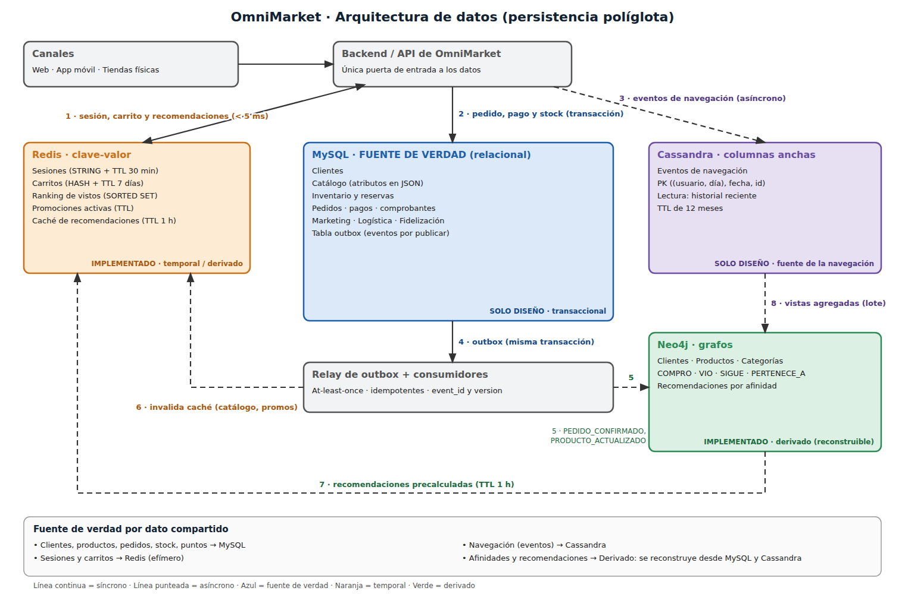
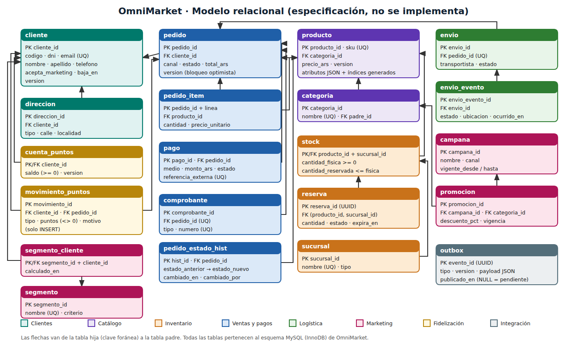

# Informe de Arquitectura Multimodelo - Unidad 9 (Actividad 2)
## Batalla de arquitecturas: OmniMarket

**Grupo:** 11
**Escenario:** OmniMarket, plataforma omnicanal (web, app móvil, tiendas físicas, depósitos y fidelización)
**Entorno:** Ubuntu 24.04 LTS, instalación nativa (sin Docker). Se utilizó únicamente la documentación oficial de cada motor.
**Integrantes:**
- [Nombre Integrante 1]
- [Nombre Integrante 2]
- [Nombre Integrante N...]

**Pregunta guía:** ¿Cómo justificar una arquitectura de datos cuando distintas áreas del negocio exigen propiedades diferentes?

| Entregable de la consigna | Dónde está |
| :--- | :--- |
| Informe: matriz de requisitos, matriz de decisión de los cinco modelos y alternativas descartadas | Secciones 1 y 2 de este documento |
| Diagrama de arquitectura | `diagrama_arquitectura.png` (y `.svg` editable); sección 2.5 |
| Modelos NoSQL: diseños, scripts, capturas y resultados | Sección 3.2 a 3.5; scripts `redis-omnimarket.txt` y `neo4j-omnimarket.cypher` |
| Diseño relacional (sin implementación) | Sección 3.1, `diagrama_relacional.png` y Anexo A |
| Presentación para defensa y registro de objeciones | Guion de la exposición, objeciones anticipadas con respuesta y tabla de objeciones recibidas en la sección 5 (las diapositivas se arman a partir de ese guion) |
| Estrategia de integración | Sección 4 |

---

## Resumen de la decisión

Diseñamos una arquitectura de **cuatro motores con un núcleo relacional**:

| Motor | Modelo | Qué resuelve | Estado en esta entrega |
| :--- | :--- | :--- | :--- |
| **MySQL** | Relacional | Clientes, catálogo (con atributos en una columna `JSON`), inventario, ventas y pagos, marketing, logística y fidelización. **Fuente de verdad** de los datos compartidos. | Modelado y justificado, **no implementado** (como pide la consigna) |
| **Redis** | Clave-valor | Sesiones y carritos con expiración, ranking de vistos, promociones activas y caché de recomendaciones | **Implementado** |
| **Neo4j** | Grafos | Recomendaciones y afinidades | **Implementado** |
| **Cassandra** | Columnas anchas | Eventos masivos de navegación | Diseñado, **no implementado** |

**MongoDB (documental) fue evaluado y descartado.** Los atributos heterogéneos del catálogo quedan cubiertos por una columna `JSON` con índices en MySQL (la factibilidad se verificó con 150.000 productos; sección 3.1), y sumar un quinto motor no se justifica (secciones 2.2 y 2.6).

**¿Por qué MySQL como motor relacional?** La consigna admite MySQL o PostgreSQL. Elegimos MySQL porque es el motor que usamos en todas las unidades anteriores: el equipo ya domina su administración, seguridad, respaldo y consultas, y eso es una de las preferencias declaradas en la sección 1.2. El costo de la elección es concreto y lo evaluamos: MySQL no tiene un índice general sobre columnas `JSON` como el `GIN` de PostgreSQL, así que cada atributo que se filtre con frecuencia debe tener su propio índice (sección 3.1).

Implementamos **Redis y Neo4j** porque entre ellos existe un intercambio de datos real y demostrable: el carrito confirmado en Redis se convierte en compras dentro del grafo, y las recomendaciones calculadas en Neo4j se sirven desde Redis. Cassandra se modeló pero no se implementó porque un nodo único con factor de replicación 1 no demuestra su ventaja distintiva (distribución y tolerancia a fallas); afirmar esas propiedades sin un clúster real no tendría respaldo.

---

## Fase 1. Diagnóstico

### 1.1 Matriz de requisitos

**Requisitos funcionales por dominio**

| Dominio | Datos principales | Operaciones y consultas prioritarias | Patrón de acceso |
| :--- | :--- | :--- | :--- |
| **Clientes** | Perfil (identidad, contacto, consentimientos) y direcciones | Alta y actualización; búsqueda por identidad (DNI, email, código); baja lógica | Lectura y escritura por clave única; escritura poco frecuente |
| **Catálogo** | Productos, categorías, atributos propios de cada categoría, precios | Alta y cambio de producto y atributos; listados y filtros por categoría y atributo; ficha de producto | Lectura intensiva con filtros; escritura moderada |
| **Inventario** | Stock por producto y sucursal; reservas | Consultar disponible; reservar; confirmar o liberar; descontar al vender | Lectura y escritura por clave compuesta, con alta concurrencia |
| **Ventas y pagos** | Pedidos, ítems, pagos, comprobantes, historial de estados | Crear pedido; registrar pago; cambiar estado; emitir comprobante; consultar por pedido o por cliente | Transaccional sobre varias tablas; consultas por cliente y fecha |
| **Sesiones y carritos** | Sesión y carrito de cada usuario | Crear y renovar sesión; agregar y quitar ítems; expirar sesiones inactivas | Lectura y escritura por clave; frecuencia altísima; datos temporales |
| **Navegación** | Eventos (vista, agregado al carrito, compra) | Registrar evento; historial reciente por usuario; vistas por producto | Escritura masiva de eventos que nunca se modifican (solo se agregan); lectura por usuario y rango de fechas |
| **Recomendaciones** | Relaciones entre clientes, productos y categorías | "Quienes compraron lo mismo también compraron"; productos relacionados; segmento que vio y no compró | Recorridos de 2 o 3 saltos sobre relaciones |
| **Marketing** | Campañas, segmentos, promociones con vigencia | Crear campaña; calcular segmento; ver promociones activas; vencimiento automático | Consulta por vigencia combinada con clientes |
| **Logística** | Envío y eventos de seguimiento | Registrar cambios de estado; consultar seguimiento por pedido | Lectura por pedido; escritura de estados por agregado |
| **Fidelización** | Cuenta de puntos y movimientos | Acreditar y canjear; consultar saldo; auditar movimientos | Transaccional; libro mayor auditable |

**Requisitos no funcionales (supuestos del grupo)**

La consigna no fija volúmenes, por lo que los explicitamos como supuestos propios. Todo el análisis posterior depende de ellos.

| Dominio | Volumen | Frecuencia y picos | Crecimiento | Integridad | Latencia objetivo | Disponibilidad |
| :--- | :--- | :--- | :--- | :--- | :--- | :--- |
| Clientes | 2 M de clientes | 5.000 altas por día; 50 búsquedas por segundo en pico | Moderado | **Fuerte** (unicidad de DNI y email) | < 100 ms | 99,9 % |
| Catálogo | 150.000 productos; 60 categorías | 20.000 cambios por día; 500 lecturas por segundo en pico | Moderado | Media | < 100 ms con filtros | 99,9 % |
| Inventario | 6 M de filas (producto por sucursal) | 300 reservas por segundo en campañas | Moderado | **Fuerte** (no sobrevender) | < 50 ms | 99,95 % |
| Ventas y pagos | 100.000 pedidos por día; retención de 10 años | ≈ 1,2 por segundo promedio; 40 por segundo en pico | Alto | **Fuerte** y trazable | < 300 ms | 99,95 % |
| Sesiones y carritos | 400.000 sesiones concurrentes en pico | Decenas de miles de operaciones por segundo | Estacional | Baja (dato temporal) | **< 5 ms** | 99,9 % |
| Navegación | **30 M de eventos por día** (≈ 350 por segundo promedio, ≈ 2.800 en pico); retención de 12 meses ≈ 11.000 M de eventos | Escritura constante | **Alto** | Baja | Lectura de historial < 100 ms | 99,9 % |
| Recomendaciones | 2 M de clientes, 150.000 productos, ≈ 50 M de relaciones | Consultas bajo demanda; actualización en minutos | Alto | Media | < 200 ms | Degradable |
| Marketing | 500 campañas por año; 100 promociones activas | Segmentos recalculados cada noche | Bajo | Media | < 500 ms | 99,5 % |
| Logística | 100.000 envíos por día; ≈ 600.000 eventos por día (≈ 7 por segundo) | Escritura de estados | Moderado | Media y trazable | < 300 ms por pedido | 99,9 % |
| Fidelización | 1,5 M de cuentas; 300.000 movimientos por día | ≈ 3,5 por segundo | Moderado | **Fuerte** y auditable | < 300 ms | 99,9 % |

Cálculos de referencia: 30.000.000 de eventos por día ÷ 86.400 s ≈ 347 eventos por segundo; × 365 días ≈ 10.950 M de eventos por año; con ≈ 200 bytes por evento, ≈ 2,2 TB por año sin replicar. En cambio, 400.000 sesiones y carritos de ≈ 1 KB ocupan ≈ 800 MB: caben cómodamente en memoria.

### 1.2 Requisitos obligatorios y preferencias

| Tipo | Requisito | Origen |
| :--- | :--- | :--- |
| **Obligatorio** | No vender por encima del stock disponible | Consigna (Inventario) |
| **Obligatorio** | Integridad y trazabilidad de pedidos y pagos | Consigna (Ventas y pagos) |
| **Obligatorio** | Protección de datos personales | Consigna (Clientes) |
| **Obligatorio** | Expiración de sesiones inactivas y baja latencia | Consigna (Sesiones y carritos) |
| **Obligatorio** | Historial reciente por usuario y fecha sobre eventos masivos | Consigna (Navegación) |
| **Obligatorio** | Movimientos de puntos auditables | Consigna (Fidelización) |
| **Obligatorio** | Atributos heterogéneos por categoría con filtros | Consigna (Catálogo) |
| **Obligatorio** | Relaciones entre clientes, productos y categorías | Consigna (Recomendaciones) |
| Preferencia | Recomendaciones actualizadas en minutos | Grupo |
| Preferencia | Minimizar la cantidad de motores | Consigna: "no gana quien usa más tecnologías" |
| Preferencia | Aprovechar el conocimiento del equipo (MySQL de las unidades anteriores, y Redis y Neo4j de esta unidad) | Grupo |
| Preferencia | Costo de licencias nulo (motores de código abierto) | Grupo |
| Fuera de alcance | Búsqueda de texto libre, pasarelas de pago reales, interfaz web | No pedido |

---

## Fase 2. Selección y arquitectura

### 2.1 Método de decisión

Para no decidir por popularidad, definimos el método antes de mirar el resultado:

1. **Ocho criterios**, cada uno con una aptitud de 0 a 3 por modelo (según la documentación oficial y el material de la materia): **I** integridad transaccional, **F** flexibilidad de esquema, **L** latencia por clave, **E** escala de escritura sostenida en disco, **R** relaciones y recorridos de varios saltos, **T** expiración nativa, **Q** consultas ad hoc y filtros, **S** lectura por rango ordenado dentro de una clave (historial).
2. **Peso de 0 a 3 por dominio**, derivado de sus requisitos de la sección 1.
3. **Puntaje del modelo en el dominio** = suma de (peso × aptitud).
4. **Regla de adopción de un motor NoSQL:** se suma solo si (a) el dominio tiene un criterio de peso 3 que el motor base (relacional) cubre con aptitud 1 o menos, (b) el candidato lo cubre con aptitud 3 y (c) su puntaje total supera al relacional. Si no, el dominio queda en el motor ya presente.

Las aptitudes y los pesos son una **valoración cualitativa del grupo**, no una medición: sirven para hacer explícitos los criterios y discutirlos, no para reemplazar una prueba de carga.

**Aptitud de cada modelo por criterio (0 a 3)**

| Modelo | I | F | L | E | R | T | Q | S |
| :--- | :-: | :-: | :-: | :-: | :-: | :-: | :-: | :-: |
| Relacional (MySQL) | 3 | 2 (`JSON` e índices generados) | 2 | 1 | 1 | 0 | 3 | 2 |
| Documental (MongoDB) | 2 | 3 | 2 | 2 | 1 | 2 | 2 | 2 |
| Clave-valor (Redis) | 1 | 2 | 3 | 1 (RAM) | 0 | 3 | 0 | 1 |
| Columnas anchas (Cassandra) | 1 | 1 | 2 | 3 | 0 | 2 | 1 | 3 |
| Grafos (Neo4j) | 3 | 2 | 2 | 1 | 3 | 0 | 2 | 0 |

**Peso de cada criterio por dominio (0 a 3)**

| Dominio | I | F | L | E | R | T | Q | S |
| :--- | :-: | :-: | :-: | :-: | :-: | :-: | :-: | :-: |
| Clientes | 3 | 1 | 2 | 1 | 0 | 0 | 2 | 0 |
| Catálogo | 1 | 3 | 2 | 1 | 0 | 0 | 3 | 0 |
| Inventario | 3 | 0 | 2 | 1 | 0 | 1 | 1 | 0 |
| Ventas y pagos | 3 | 1 | 1 | 1 | 0 | 0 | 3 | 1 |
| Sesiones y carritos | 1 | 1 | 3 | 2 | 0 | 3 | 0 | 0 |
| Navegación | 0 | 1 | 2 | 3 | 0 | 1 | 1 | 3 |
| Recomendaciones | 1 | 2 | 2 | 1 | 3 | 0 | 2 | 0 |
| Marketing | 2 | 2 | 1 | 1 | 1 | 2 | 3 | 0 |
| Logística | 2 | 1 | 1 | 2 | 0 | 0 | 2 | 2 |
| Fidelización | 3 | 0 | 1 | 1 | 0 | 0 | 2 | 2 |

### 2.2 Matriz de decisión de los cinco modelos

| Dominio | Relacional | Documental | Clave-valor | Col. anchas | Grafos | Máximo | Mayor puntaje | ¿Cumple la regla para sumar un NoSQL? |
| :--- | :-: | :-: | :-: | :-: | :-: | :-: | :--- | :--- |
| Clientes | **22** | 19 | 12 | 13 | 20 | 27 | Relacional | No: queda en MySQL |
| Catálogo | **23** | **23** | 14 | 14 | 20 | 30 | Empate relacional y documental | No (la flexibilidad la cubre `JSON` con índices): queda en MySQL |
| Inventario | **17** | 16 | 13 | 13 | 16 | 24 | Relacional | No |
| Ventas y pagos | **25** | 21 | 10 | 15 | 20 | 30 | Relacional | No |
| Sesiones y carritos | 13 | 21 | **23** | 20 | 13 | 30 | Clave-valor | **Sí** (criterio T) |
| Navegación | 18 | 23 | 17 | **26** | 11 | 33 | Columnas anchas | **Sí** (criterio E) |
| Recomendaciones | 21 | 21 | 12 | 12 | **25** | 33 | Grafos | **Sí** (criterio R) |
| Marketing | 23 | **25** | 16 | 16 | 22 | 36 | Documental | No: la ventaja es de 2 puntos y no cumple la regla |
| Logística | **22** | 21 | 11 | 19 | 16 | 30 | Relacional | No |
| Fidelización | **22** | 18 | 9 | 16 | 16 | 27 | Relacional | No |

Dos casos muestran por qué usamos una regla y no solo el puntaje:
- **Catálogo:** relacional y documental empatan en 23. Como una columna `JSON` con índices (columnas generadas e índices funcionales) cubre la necesidad crítica de flexibilidad, no hay una razón suficiente para sumar un motor. Es un caso donde la decisión **depende del motor relacional elegido**: con MySQL hay que declarar un índice por cada atributo que se filtra, mientras que con PostgreSQL un único índice `GIN` cubriría todos. Por eso lo verificamos con datos (sección 3.1).
- **Marketing:** el modelo documental suma 25 contra 23 del relacional, pero la diferencia es pequeña y el criterio crítico (consultas con filtros) ya lo cubre el relacional. No justifica un quinto motor.

### 2.3 Selección por dominio, alternativa descartada y condición de revisión

| Dominio | Elegido | Alternativa descartada y por qué | Cuándo revisaríamos la decisión |
| :--- | :--- | :--- | :--- |
| **Clientes** | MySQL | **Documental:** la unicidad de DNI y email, la baja con consentimiento y la relación con pedidos exigen integridad referencial; un documento por cliente obligaría a duplicar datos en los pedidos | Si el perfil pasara a ser casi sin estructura (muchos campos opcionales por canal) |
| **Catálogo** | MySQL con columna `JSON` | **Documental (MongoDB):** empata en puntaje, pero sumaría un quinto motor. El catálogo además se une con inventario y precios, que están en MySQL | Si hubiera que filtrar libremente por cualquier atributo, sin indexarlo antes, con latencia menor a 100 ms (en MySQL cada atributo filtrado necesita su índice), o si el catálogo requiriera fragmentación horizontal propia |
| **Inventario** | MySQL | **Clave-valor y columnas anchas:** la consistencia eventual o la volatilidad permiten dos reservas simultáneas sobre la última unidad (sobreventa, prohibida por la consigna) | Si el pico de reservas superara lo que soporta un único primario (se fragmentaría por sucursal, cada una en su propia base) |
| **Ventas y pagos** | MySQL | **Documental:** admite transacciones, pero la integridad entre pedido, pago y comprobante y la trazabilidad contable se expresan mejor con claves foráneas y restricciones. **Columnas anchas:** sin transacciones sobre varias filas | Si el volumen de pedidos superara lo que soporta un primario: réplicas de lectura y archivado de pedidos históricos (las tablas con claves foráneas no admiten particionado en InnoDB) |
| **Sesiones y carritos** | Redis | **Relacional:** la expiración exige un proceso que borre y cada acceso paga disco y transacción. **Documental con índice TTL:** funciona, pero con latencia mayor y un motor adicional | Si las sesiones concurrentes bajaran de ≈ 5.000: podrían vivir en una tabla de MySQL |
| **Navegación** | Cassandra | **Relacional particionado:** soporta la carga con ajustes, pero ≈ 11.000 M de filas por año presionan escritura, mantenimiento y espacio. **Documental con colecciones de series temporales:** alternativa válida; Cassandra la supera en el criterio de escritura sostenida | Si los eventos bajaran de ≈ 2 M por día: una tabla particionada de MySQL alcanza |
| **Recomendaciones** | Neo4j | **Relacional con consultas recursivas:** el costo crece con la profundidad y el volumen de las uniones. **Clave-valor:** solo sirve resultados ya calculados, no los calcula | Si bastara una tabla de co-ocurrencias recalculada por lote (sin exploración ad hoc) |
| **Marketing** | MySQL | **Documental:** gana 2 puntos pero no cumple la regla. Las campañas y promociones son datos estructurados con vigencia y se combinan con clientes y categorías | Si las campañas pasaran a tener estructuras muy variables por canal |
| **Logística** | MySQL | **Columnas anchas:** la consulta por pedido encajaría, pero ≈ 7 eventos por segundo no justifica otro motor | Si se agregara seguimiento por GPS con frecuencia alta |
| **Fidelización** | MySQL | **Contadores de Redis o Cassandra:** sin transacciones ni auditoría confiable del libro mayor de puntos | Sin condición prevista: es un dominio contable |

### 2.4 Justificación de la arquitectura de conjunto

- **Un núcleo relacional con siete de los diez dominios.** Los dominios donde la integridad es obligatoria (inventario, ventas, pagos, clientes, puntos) comparten transacciones: un pedido descuenta stock, registra el pago y acredita puntos. Mantenerlos en un mismo motor permite hacerlo en **una sola transacción ACID** y evita transacciones distribuidas.
- **Tres motores especializados solo donde el relacional falla en un criterio crítico** (expiración, escritura masiva, recorridos), según la regla de adopción.
- **Los motores NoSQL guardan datos temporales o derivados, nunca el único registro de un dato crítico.** Si Redis o Neo4j se perdieran, se reconstruirían desde MySQL y Cassandra.

### 2.5 Diagrama de arquitectura



*[INSERTAR el diagrama `diagrama_arquitectura.png` en el informe PDF]*

| N.º | Flujo | Tipo | Dato que circula | Garantía |
| :--: | :--- | :--- | :--- | :--- |
| 1 | API ↔ Redis | Síncrono | Sesión, carrito, recomendaciones precalculadas | Baja latencia; datos temporales |
| 2 | API → MySQL | Síncrono | Pedido, pago, stock | Transacción ACID |
| 3 | API → Cassandra | Asíncrono | Eventos de navegación | Escritura con consistencia configurable; no bloquea la compra |
| 4 | MySQL → Relay | Asíncrono | Fila de la tabla `outbox` | Se inserta en la misma transacción del pedido |
| 5 | Relay → Neo4j | Asíncrono | `PEDIDO_CONFIRMADO`, `PRODUCTO_ACTUALIZADO` | Entrega al menos una vez; aplicación idempotente |
| 6 | Relay → Redis | Asíncrono | Invalidación de caché de catálogo y promociones | Basta con reintentar |
| 7 | Neo4j → Redis | Asíncrono | Recomendaciones de cada cliente | Caché con vencimiento de 1 hora |
| 8 | Cassandra → Neo4j | Asíncrono (lote) | Vistas agregadas por cliente y producto | Reconstruible |

**Fuente de verdad y sincronización**

| Dato compartido | Fuente de verdad | Copias o proyecciones | Estrategia de sincronización |
| :--- | :--- | :--- | :--- |
| Clientes | MySQL | Identificador en Neo4j | Evento `CLIENTE_CREADO` o `CLIENTE_ELIMINADO` por outbox; **solo identificadores**, nunca datos personales |
| Productos (nombre, precio) | MySQL | Nodo `Producto` en Neo4j; caché en Redis | Evento `PRODUCTO_ACTUALIZADO` con `version`; se descartan eventos viejos |
| Pedidos y compras | MySQL | Relaciones `COMPRO` en Neo4j | Evento `PEDIDO_CONFIRMADO`; clave `linea_id` evita duplicados |
| Stock | MySQL | Ninguna (Redis no guarda stock) | Se consulta siempre en la fuente |
| Navegación | Cassandra | Relaciones `VIO` en Neo4j | Carga por lote de agregados |
| Sesiones y carritos | Redis | Ninguna | Al confirmar el pedido pasa a MySQL |
| Recomendaciones | Neo4j (derivado) | Caché en Redis | Se recalculan tras cada compra; vencen a la hora |

### 2.6 Costo de sumar motores

Cada motor adicional no es gratis: agrega instalación y parches, respaldo y recuperación propios, monitoreo, un modelo de seguridad distinto, conocimiento específico y **un camino más de sincronización con sus modos de falla**. Por eso la regla de adopción exige una razón técnica concreta, y definimos para cada motor cuándo lo daríamos de baja (los umbrales son supuestos del grupo).

| Motor | Qué aporta | Costo que introduce | Lo mantenemos mientras… | Lo daríamos de baja si… |
| :--- | :--- | :--- | :--- | :--- |
| MySQL | Integridad, transacciones y consultas; hospeda 7 dominios | Mantenerlo disponible (replicación y conmutación, por ejemplo con InnoDB Cluster); archivar o fragmentar el crecimiento | Es el motor base | — |
| Redis | Expiración nativa y latencia de milisegundos | Memoria, persistencia y conmutación a configurar; un consumidor de invalidación | Haya cientos de miles de sesiones y se exija < 5 ms | Las sesiones concurrentes bajen de ≈ 5.000 |
| Cassandra | Escritura sostenida sobre ≈ 11.000 M de eventos al año | Clúster de al menos 3 nodos, modelado por consulta, reparación y *tombstones*, conocimiento específico | Los eventos superen ≈ 2 M por día de forma sostenida | Bajen de ≈ 2 M por día: tabla particionada en MySQL |
| Neo4j | Recorridos de varias relaciones en milisegundos | Community no tiene clúster, roles ni respaldo en caliente; proyección que hay que mantener y poder reconstruir | Se necesiten recomendaciones con 2 o más saltos sobre decenas de millones de relaciones | Alcance con una tabla de co-ocurrencias por lote |
| MongoDB (descartado) | Flexibilidad de esquema | Un quinto motor, otro modelo de seguridad y otro camino de sincronización | — | No se incorpora: la columna `JSON` con índices cubre la necesidad |

**Conclusión del costo:** con cuatro motores, el flujo de datos es un esquema en estrella con MySQL al centro (tres proyecciones). Una malla entre cinco motores exigiría hasta diez caminos de sincronización. Esa es la razón de fondo para no sumar MongoDB.

---

## Fase 3. Modelado e implementación

### 3.1 Diseño relacional (conceptual y lógico, sin implementación)



*[INSERTAR el diagrama `diagrama_relacional.png` en el informe PDF]*

**Modelo conceptual.** Un **cliente** realiza **pedidos**; cada pedido tiene **ítems** (de un **producto** de una **categoría**), uno o más **pagos**, un **comprobante**, un historial de **estados** y, eventualmente, un **envío** con sus **eventos de seguimiento**. El **stock** relaciona cada producto con cada **sucursal** y admite **reservas** con vencimiento. Cada cliente tiene una **cuenta de puntos** cuyos **movimientos** forman un libro mayor. Las **campañas** agrupan **promociones** con vigencia, y los **segmentos** se calculan sobre los clientes. La tabla **outbox** registra los eventos que deben publicarse a los otros motores.

**Decisiones del modelo lógico**

| Decisión | Motivo |
| :--- | :--- |
| Motor de almacenamiento `InnoDB` | Transacciones ACID, claves foráneas y bloqueo por fila |
| Claves sustitutas (`AUTO_INCREMENT`) más claves naturales con `UNIQUE` (`codigo`, `dni`, `email`, `sku`) | Búsqueda por identidad sin exponer claves internas; integridad de unicidad |
| `CHECK (cantidad_reservada <= cantidad_fisica)` y cantidades no negativas en `stock` | La base garantiza que no se reserve más de lo disponible, aunque la aplicación falle |
| `precio_unitario` copiado en `pedido_item` | Congela el precio al momento de la compra; un cambio posterior no altera pedidos pasados |
| `atributos JSON` en `producto`, con columnas generadas indexadas (`marca`, `pantalla_pulgadas`), índice multivalor para las etiquetas e índices funcionales a pedido | Atributos heterogéneos por categoría sin una columna por atributo; los filtros frecuentes se resuelven por índice |
| Columna `version` en `cliente`, `producto`, `pedido` y `cuenta_puntos` | Bloqueo optimista para actualizaciones concurrentes |
| `movimiento_puntos` y `pedido_estado_hist` de solo inserción (solo se otorga `SELECT` e `INSERT` y disparadores rechazan `UPDATE` y `DELETE`) | Auditoría: el historial no puede modificarse |
| `referencia_externa` única en `pago` | Idempotencia ante reintentos de la pasarela de pagos |
| Baja lógica (`baja_en`) en `cliente` | Cumple el derecho de supresión sin romper el historial de pedidos |
| Tabla `outbox` en el mismo motor | Publicar eventos en la misma transacción del negocio |

**Transacciones críticas** (detalle en el Anexo B)
- **Reserva de stock atómica:** `UPDATE stock SET cantidad_reservada = cantidad_reservada + n WHERE ... AND cantidad_fisica - cantidad_reservada >= n`. Si afecta 0 filas, no hay disponible. Dos clientes que compiten por la última unidad no pueden ganar ambos.
- **Cambio de estado con bloqueo optimista:** `UPDATE pedido SET estado = ..., version = version + 1 WHERE pedido_id = ... AND version = <leída>`. Si afecta 0 filas, otro proceso lo modificó antes.
- **Acreditar puntos:** el movimiento y el saldo se escriben en la misma transacción.
- **Relay del outbox:** toma los eventos pendientes con `SELECT ... FOR UPDATE SKIP LOCKED`, de modo que varios procesos relay no se bloquean entre sí ni toman el mismo evento.

**Protección de datos personales.** Los datos personales (DNI, email, teléfono, dirección) viven **únicamente en MySQL**. Redis y Neo4j almacenan identificadores (`U01`), no datos personales. La baja de un cliente se propaga con un evento `CLIENTE_ELIMINADO` para que los otros motores eliminen su identificador y sus relaciones. MySQL no tiene seguridad por filas ni el rol `PUBLIC` de otros motores: el acceso se limita con roles y privilegios por tabla y por columna.

### 3.1.1 Verificación de factibilidad del catálogo en MySQL

Como la decisión de no sumar MongoDB depende de que una columna `JSON` alcance para el catálogo, la comprobamos con datos y no solo con argumentos. **No es la implementación del componente relacional** (que la consigna no pide), sino una prueba de factibilidad sobre una tabla de productos generada para el informe: 150.000 productos en 60 categorías, en donde el tipo de atributos depende de la categoría (por ejemplo `pantalla_pulgadas`, `ram_gb` y `marca` para tecnología; `talle` y `color` para indumentaria; `autor` y `paginas` para libros) y cada producto tiene un arreglo de etiquetas.

| Filtro | Estrategia | Plan de ejecución | Tiempo |
| :--- | :--- | :--- | :---: |
| Productos de tecnología de 15,1" (≈ 500 coincidencias) | Columna generada indexada (`pantalla_pulgadas`) | Búsqueda por índice | ≈ 0,3 ms |
| Productos de una categoría con `ram_gb = 16` (≈ 830 coincidencias) | Sin índice propio; el índice de categoría acota la búsqueda | Recorre solo las ≈ 2.500 filas de la categoría | ≈ 10 ms |
| Productos con la etiqueta `outlet` (≈ 12.500 coincidencias) | Índice multivalor sobre el arreglo de etiquetas | Búsqueda por índice | ≈ 48 ms |
| Libros de un autor (100 coincidencias), **sin índice** y sin categoría | Peor caso | Recorre las 150.000 filas | ≈ 88 ms |
| El mismo filtro con un **índice funcional creado a pedido** | `CREATE INDEX ... ((CAST(atributos->>'$.autor' AS CHAR(40)) ...))` | Búsqueda por índice (100 filas) | ≈ 0,3 ms |

**Lectura de los resultados.** El peor caso (recorrer todo el catálogo) ronda los 90 ms, dentro del objetivo de 100 ms para una consulta aislada; pero con 500 lecturas por segundo en pico consumiría ≈ 44 segundos de procesador por cada segundo reloj, lo que no es sostenible. Por eso **los filtros frecuentes se indexan**, y un atributo que no se había previsto se indexa a pedido con una sola sentencia (de ≈ 88 ms a ≈ 0,3 ms). La limitación real frente a PostgreSQL es que **hay que prever el índice de cada atributo** que se filtra; si el negocio exigiera filtrar libremente por cualquier atributo sin planificarlo, esa condición activaría la revisión de la decisión (sección 2.3).

*[INSERTAR CAPTURA: planes de consulta y tiempos de la prueba de factibilidad (guía, sección 7)]*

### 3.2 Diseño de los modelos NoSQL

**Redis (implementado)**

| Clave | Estructura | Contenido | Vencimiento |
| :--- | :--- | :--- | :--- |
| `sesion:<cliente>` | `STRING` | Datos de la sesión (cliente y canal) | 30 minutos de inactividad |
| `carrito:<cliente>` | `HASH` | Producto → cantidad | 7 días |
| `ranking:vistos` | `SORTED SET` | Producto con su cantidad de vistas | Sin vencimiento |
| `promo:<código>` | `STRING` | Descripción de la promoción activa | Hasta el fin de la promoción |
| `reco:<cliente>` | `SORTED SET` | Producto recomendado con su afinidad | 1 hora |

Elegimos estructuras según el uso: `HASH` para el carrito porque permite modificar la cantidad de un producto sin reescribir todo; `SORTED SET` para rankings porque mantiene el orden por puntaje; vencimiento en cada clave temporal para que los datos inactivos desaparezcan solos.

**Neo4j (implementado)**

```
(:Cliente {id, nombre}) -[:COMPRO {linea_id, pedido_id, cantidad, fecha}]-> (:Producto {id, nombre, precio, version})
(:Cliente) -[:VIO]-> (:Producto)          (:Cliente) -[:SIGUE]-> (:Cliente)
(:Producto) -[:PERTENECE_A]-> (:Categoria {nombre})
```

- Restricciones de unicidad en `Cliente.id`, `Producto.id`, `Categoria.nombre` y en la propiedad `linea_id` de la relación `COMPRO`: esta última hace que **aplicar dos veces la misma línea de un pedido no pueda duplicarla**.
- `Producto.version` permite descartar actualizaciones que llegan fuera de orden.

**Cassandra (diseñado, no implementado)**

```sql
CREATE TABLE eventos_por_usuario_dia (
  usuario_id text, dia date, fecha_evento timestamp, evento_id uuid,
  tipo_evento text, producto_id text, canal text,
  PRIMARY KEY ((usuario_id, dia), fecha_evento, evento_id)
) WITH CLUSTERING ORDER BY (fecha_evento DESC, evento_id ASC)
  AND default_time_to_live = 31536000;            -- 12 meses

CREATE TABLE vistas_por_producto_dia (
  producto_id text, dia date, vistas counter,
  PRIMARY KEY ((producto_id), dia)
) WITH CLUSTERING ORDER BY (dia DESC);
```

- La **clave de partición es `(usuario_id, dia)`** y no solo `usuario_id`: un usuario muy activo no genera una partición que crece sin límite. El historial reciente se lee con una consulta por día (o `IN` sobre los últimos días).
- El orden descendente por fecha hace que `LIMIT 50` devuelva los eventos más recientes.
- El `TTL` de 12 meses aplica la retención sin procesos de borrado.
- Consultas previstas: historial de un usuario en un día (`WHERE usuario_id = ? AND dia = ? LIMIT 50`) y vistas recientes de un producto.

### 3.3 Implementación del componente Redis

**Entorno.** Redis de laboratorio aislado en el puerto 6381 (no se usa el servicio de la Actividad 1). Datos de prueba coherentes con el escenario: clientes `U01` a `U05` y productos `P101` a `P108` de los archivos de la cátedra.

```bash
redis-server --version | cut -c1-40 && redis-cli -p 6381 ping
```

*[INSERTAR CAPTURA 1: versión, `PONG` y puertos del entorno de la Actividad 2]*

**Modelo y carga**

```text
SET sesion:U01 '{"cliente":"U01","canal":"web"}' EX 1800        (y U02 canal app, U03 canal tienda)
HSET carrito:U01 P103 1 P107 1                                  (y carritos de U02 y U03)
EXPIRE carrito:U01 604800
ZADD ranking:vistos 120 P101 95 P102 88 P105 70 P103 55 P104 40 P106 30 P107 25 P108
SET promo:ENVIOGRATIS "Envío gratis en compras de más de $50.000" EX 3600
SET promo:CIBERLUNES "10% en Tecnologia" EX 7200
```

Verificamos los tipos con `TYPE`: `sesion:U01` es `string`, `carrito:U01` es `hash`, `ranking:vistos` es `zset`; en total 9 claves.

*[INSERTAR CAPTURAS 3 a 6: carga y verificación del modelo]*

**CRUD**

| Operación | Comandos y resultado |
| :--- | :--- |
| **Alta** | `SET sesion:U04 ... EX 1800` → `OK`; `HSET carrito:U04 P106 1 P102 2` → `2`; `ZINCRBY ranking:vistos 1 P106` → `"41"` |
| **Lectura** | `GET sesion:U04` → la sesión; `TTL sesion:U04` → `1800`; `HGETALL carrito:U04` → `P106 1`, `P102 2`; `HLEN carrito:U04` → `2` |
| **Modificación** | `EXPIRE sesion:U04 1800` → `1` (se renueva la sesión por actividad); `HINCRBY carrito:U04 P102 1` → `3`; `HSET carrito:U04 P106 2` → `0` (el campo existía; solo se actualizó) |
| **Baja** | `HDEL carrito:U04 P106` → `1`; `DEL carrito:U04` → `1`; `DEL sesion:U04` → `1`; `EXISTS` de ambas → `0` |
| **Expiración** | `SET sesion:inactiva ... EX 3`; `TTL` → `3`; tras 4 segundos `GET` → `(nil)` y `EXISTS` → `0` |

*[INSERTAR CAPTURAS 7 a 11: altas, lecturas, modificaciones, bajas y expiración]*

**Consultas de negocio**

| Consulta | Comando | Resultado |
| :--- | :--- | :--- |
| **1. Top 3 de productos más vistos** | `ZREVRANGE ranking:vistos 0 2 WITHSCORES` | P101 (120), P102 (95), P105 (88) |
| **2. Unidades totales en el carrito de U02** | `EVAL "local t=0 for _,v in ipairs(redis.call('HVALS',KEYS[1])) do t=t+tonumber(v) end return t" 1 carrito:U02` | `3` (1 notebook + 2 libros) |
| **3. ¿La sesión de U01 sigue vigente y cuánto le queda?** | `GET sesion:U01` y `TTL sesion:U01` | La sesión existe; el `TTL` resta unos 1.800 segundos |
| **4. Promociones activas** | `SCAN 0 MATCH promo:* COUNT 100` | `promo:ENVIOGRATIS` y `promo:CIBERLUNES` (las vencidas desaparecen solas) |

La consulta 2 se resuelve con un *script* Lua porque Redis lo ejecuta de forma atómica: nadie puede modificar el carrito entre la lectura de las cantidades y la suma.

*[INSERTAR CAPTURAS 12 a 15: consultas de negocio]*

### 3.4 Implementación del componente Neo4j

**Entorno.** Neo4j Community de laboratorio aislado (Bolt 7690), también separado de la Actividad 1. Los datos reutilizan los identificadores de la cátedra.

*[INSERTAR CAPTURA 16: versión y edición `community`]*

**Modelo y carga**

```cypher
CREATE CONSTRAINT cliente_id IF NOT EXISTS FOR (c:Cliente) REQUIRE c.id IS UNIQUE;
CREATE CONSTRAINT compro_linea IF NOT EXISTS FOR ()-[r:COMPRO]-() REQUIRE r.linea_id IS UNIQUE;
UNWIND [...] AS f MERGE (c:Cliente {id: f.id}) SET c.nombre = f.nombre;            -- 5 clientes
UNWIND [...] AS f MERGE (p:Producto {id: f.id}) SET ... p.version = 1               -- 8 productos y 3 categorías
```

La carga completa está en `neo4j-omnimarket.cypher`. Resultado verificado: **16 nodos** (3 categorías, 5 clientes, 8 productos) y **34 relaciones** (13 `COMPRO`, 8 `PERTENECE_A`, 5 `SIGUE`, 8 `VIO`).

*[INSERTAR CAPTURAS 17 a 20: restricciones, carga y conteos]*

**CRUD**

| Operación | Sentencia | Resultado |
| :--- | :--- | :--- |
| **Alta** | `CREATE (c:Cliente {id:'U06', nombre:'Fiorella'})`; `SIGUE` hacia U01; `COMPRO` de P102 | 1 nodo y 2 relaciones creadas |
| **Lectura** | `MATCH (c:Cliente {id:'U06'}) OPTIONAL MATCH (c)-[r]->(x) RETURN ...` | `COMPRO → P102` y `SIGUE → U01` |
| **Modificación** | `SET c.nombre = 'Fiorella Gómez'`; `SET r.cantidad = 2` | Propiedades actualizadas |
| **Baja** | `DELETE r` y luego `DETACH DELETE c`; `count(c)` | 1 relación y 1 nodo eliminados; `u06_restantes = 0` |

*[INSERTAR CAPTURAS 21 a 24: altas, lectura, modificación y bajas]*

**Consultas de negocio**

| Consulta | Resultado |
| :--- | :--- |
| **1. Recomendar a U01 lo que compraron quienes compraron lo mismo** | P103 Teclado (afinidad 2), P101 Notebook (1), P107 Libro SQL (1), P108 Libro NoSQL (1) |
| **2. Productos que se compran junto con P102 (Mouse)** | P103 Teclado (2 clientes en común), P101, P105, P107 y P108 (1 cada uno) |
| **3. Segmento de remarketing: vieron y no compraron** | U01: Notebook, Teclado, Libro SQL · U02: Monitor · U03: Campera, Zapatillas |

```cypher
MATCH (u:Cliente {id:'U01'})-[:COMPRO]->(:Producto)<-[:COMPRO]-(otro:Cliente)-[:COMPRO]->(rec:Producto)
WHERE otro <> u AND NOT (u)-[:COMPRO]->(rec)
RETURN rec.id AS id, rec.nombre AS recomendado, count(DISTINCT otro) AS afinidad
ORDER BY afinidad DESC, id;
```

La afinidad cuenta cuántos clientes distintos compraron ese producto y además compraron algo que U01 ya tiene. `WHERE NOT (u)-[:COMPRO]->(rec)` excluye lo que U01 ya compró. La consulta 3 es útil para Marketing: devuelve exactamente a quién conviene mostrarle un producto que miró y no compró.

*[INSERTAR CAPTURAS 25 a 27: consultas de negocio]*

### 3.5 Interacción entre componentes: de un carrito a una recomendación

Demostramos el intercambio de datos con un flujo completo entre Redis y Neo4j. En la arquitectura real, el paso 2 ocurre en MySQL; en el laboratorio, como el componente relacional no se implementa, el mensaje se genera a mano y lo aplica el consumidor.

| Paso | Qué ocurre | Resultado verificado |
| :--: | :--- | :--- |
| 1 | El carrito de **U01** en Redis tiene dos productos | `HGETALL carrito:U01` → `P103 1`, `P107 1` |
| 2 | Se confirma el pedido y se genera el **evento** (mensaje de la tabla `outbox`) | `{"evento_id":"<uuid>","tipo":"PEDIDO_CONFIRMADO","pedido_id":"PED-0002","cliente":"U01","items":[{"sku":"P103","cant":1},{"sku":"P107","cant":1}]}` |
| 3 | El **consumidor aplica el evento en Neo4j** con `MERGE` sobre `linea_id` | Compras de U01: de **2** a **4** (`PED-0002-P103`, `PED-0002-P107`) |
| 4 | El mismo evento se **entrega otra vez** (entrega "al menos una vez") | Las compras de U01 siguen en **4**: no se duplicó nada |
| 5 | Neo4j **recalcula las recomendaciones** de U01 y se publican en Redis con vencimiento | `ZREVRANGE reco:U01 0 -1 WITHSCORES` → P101 (2), P108 (1), P106 (1), P104 (1); `TTL` → `3600` |
| 6 | El carrito se **vacía solo después** de aplicar el pedido | `DEL carrito:U01` → `1`; `EXISTS` → `0` |

Observación: tras comprar Teclado y Libro SQL, esos productos desaparecen de las recomendaciones de U01, y ahora se priorizan los que compraron otros clientes con sus mismos gustos (Notebook con afinidad 2).

*[INSERTAR CAPTURAS 31 a 36: flujo de integración]*

### 3.6 Duplicación de datos y actualizaciones concurrentes

**Duplicación.** En esta arquitectura hay duplicación **deliberada** (el nombre y el precio de un producto existen en MySQL, en Neo4j y en la caché de Redis) y duplicación **accidental** (el mismo evento entregado dos veces). Para controlarlas definimos:

| Situación | Riesgo | Qué haríamos | Evidencia |
| :--- | :--- | :--- | :--- |
| Dato copiado en varios motores | Las copias divergen | Una **fuente de verdad** por dato; las demás son proyecciones que se reconstruyen. Los cambios viajan por eventos, no por escrituras directas a cada motor | Tabla de fuente de verdad (sección 2.5) |
| Evento entregado dos veces | Compras duplicadas | Consumidor **idempotente**: la clave `linea_id` es única; la restricción de Neo4j rechaza un duplicado | Paso 4 de la sección 3.5; sentencia con `linea_id` repetida rechazada con *property uniqueness constraint violated* |
| Eventos fuera de orden | Un valor viejo pisa uno nuevo | Cada evento lleva `version`; solo se aplica si es mayor que la almacenada | `P102` recibe `version 2` (precio 19.500) y el evento con `version 1` posterior se descarta (0 filas) |
| Caché desactualizada | Se muestra un precio viejo | Vencimiento corto y eliminación de la clave al llegar `PRODUCTO_ACTUALIZADO` | `TTL` en recomendaciones y promociones |
| Escritura directa a dos motores | Si falla la segunda, quedan inconsistentes | **No** hacer escritura doble: usar el patrón outbox (sección 4) | — |

*[INSERTAR CAPTURAS 28 a 30: versión, idempotencia y restricción de unicidad en Neo4j]*

**Actualizaciones concurrentes**

| Situación | Mecanismo | Dónde |
| :--- | :--- | :--- |
| Dos clientes reservan la última unidad | `UPDATE` atómico con condición sobre lo disponible; la base rechaza la segunda reserva | MySQL (Anexo B) |
| Dos procesos cambian el estado de un pedido | Bloqueo optimista con `version` | MySQL (Anexo B) |
| Muchos clientes modifican el mismo contador | Operación atómica del motor (`HINCRBY`) | Redis (experimento siguiente) |
| Eventos que llegan desordenados | Comparación de `version` | Neo4j (3.6, tabla anterior) |

**Experimento de concurrencia en Redis.** Lanzamos 200 procesos que suman 1 al mismo campo a la vez, de dos maneras:

| Método | Comando | Resultado esperado | Resultado obtenido |
| :--- | :--- | :-: | :-: |
| **Atómico** | `HINCRBY carrito:prueba P101 1` (200 veces en paralelo) | 200 | **200** |
| **Leer y luego escribir** | `HGET` y después `HSET valor+1` (200 veces en paralelo) | 200 | *[completar: valor muy inferior a 200]* |

El método de leer y luego escribir **pierde actualizaciones**: varios procesos leen el mismo valor y escriben el mismo resultado, y el motor no puede saber que debía sumarlas. Lo mismo ocurriría con el stock si la aplicación leyera el disponible y luego escribiera el nuevo valor. Por eso las operaciones críticas se delegan al motor (una sola operación atómica) y no se arman en la aplicación.

*[INSERTAR CAPTURAS 37 y 38: concurrencia]*

---

## 4. Estrategia de integración

### 4.1 Patrón elegido: outbox transaccional con consumidores idempotentes

Cada vez que una transacción de MySQL cambia un dato que otros motores necesitan, **escribe también un evento en la tabla `outbox` dentro de la misma transacción**. Un proceso *relay* lee los eventos pendientes y los entrega a los consumidores (Neo4j, Redis). Si el relay o un consumidor fallan, el evento queda pendiente y se reintenta: **no se pierde ninguna compra**.

| Alternativa | Por qué no la elegimos |
| :--- | :--- |
| **Escritura doble** (la aplicación escribe en MySQL y luego en Neo4j) | Si falla la segunda escritura, los datos quedan inconsistentes y no hay forma automática de detectarlo ni repararlo |
| **Transacción distribuida (2PC)** entre motores | Los motores NoSQL elegidos no participan de transacciones distribuidas; además bloquea y reduce la disponibilidad |
| **Captura de cambios (CDC)**, por ejemplo Debezium | Es la evolución natural del outbox para volúmenes mayores (lee el registro de transacciones sin consultar la tabla), pero agrega un componente más. Es el siguiente paso si el relay se vuelve un cuello de botella |
| **Carga por lote nocturna** | Las recomendaciones tardarían un día en reflejar una compra, contra el objetivo de minutos |

### 4.2 Contrato del evento

```json
{ "evento_id": "<uuid>", "tipo": "PEDIDO_CONFIRMADO", "agregado": "pedido", "agregado_id": "PED-0002",
  "version": 1, "cliente": "U01", "items": [ {"sku": "P103", "cant": 1}, {"sku": "P107", "cant": 1} ] }
```

- `evento_id`: identifica el evento; permite descartar reentregas.
- `agregado` y `agregado_id`: a qué entidad se refiere.
- `version`: orden por entidad; el consumidor ignora eventos con versión menor o igual a la ya aplicada.
- **Solo identificadores**: nunca DNI, email ni dirección.

### 4.3 Garantías y manejo de fallas

| Aspecto | Decisión |
| :--- | :--- |
| **Entrega** | Al menos una vez; la **idempotencia** del consumidor la convierte en efecto único (`MERGE` con restricción de unicidad, `version`) |
| **Orden** | Garantizado por entidad mediante `version`; no se exige orden global |
| **Reintentos** | Con espera creciente; tras varios fallos, el evento pasa a una cola de eventos fallidos para revisión |
| **Consistencia** | Fuerte dentro de MySQL; **eventual** hacia Neo4j y Redis (segundos a minutos). Es aceptable porque la recomendación no es un dato crítico |
| **Reconciliación** | Tarea diaria que compara conteos y sumas de control entre MySQL y las proyecciones, y corrige las diferencias |
| **Reconstrucción** | Neo4j y Redis se reconstruyen reaplicando el historial de MySQL y de Cassandra (carga idempotente con `MERGE`) |
| **Supresión de datos** | El evento `CLIENTE_ELIMINADO` elimina el identificador y las relaciones del cliente en Neo4j y las claves en Redis |
| **Seguridad** | Cada motor con usuarios propios de mínimo privilegio; credenciales fuera de los scripts; conexión cifrada entre componentes |
| **Observabilidad** | Se monitorea el **retraso del outbox** (edad del evento pendiente más antiguo) y la tasa de eventos fallidos |

### 4.4 Qué pasa cuando algo falla

| Falla | Efecto | Respuesta |
| :--- | :--- | :--- |
| Cae **Redis** | Se pierden sesiones y carritos no persistidos | Persistencia y réplica configuradas; el cliente vuelve a iniciar sesión; no se pierden pedidos |
| Cae **Neo4j** | No se actualizan ni calculan recomendaciones | **Degradación elegante:** la API muestra los productos más vistos desde Redis; los eventos se acumulan en el outbox y se aplican al volver |
| Cae el **relay** | Los eventos esperan | Se reinicia; retoma desde los pendientes |
| Cae **MySQL** | No se pueden confirmar pedidos | Conmutación a la réplica; es el único componente crítico para vender |
| Cae **Cassandra** | No se registran eventos de navegación | Se almacenan en una cola local y se reintenta; la compra no se bloquea |

---

## 5. Fase 4. Batalla entre grupos

### 5.1 Guion de la presentación de arquitectura (8 minutos)

| Tiempo | Contenido | Apoyo visual |
| :--- | :--- | :--- |
| 0:00 a 1:00 | Problema y pregunta guía: ¿una única arquitectura correcta? Respuesta: no; depende de los requisitos | Escenario y 10 dominios |
| 1:00 a 2:30 | Diagnóstico: obligatorios frente a preferencias y supuestos de volumen | Matriz de requisitos |
| 2:30 a 4:30 | Método de decisión y resultado: criterios con peso, regla de adopción, por qué `JSON` con índices y no MongoDB | Matriz de los cinco modelos |
| 4:30 a 6:00 | Arquitectura: fuente de verdad, outbox, flujos síncronos y asíncronos | Diagrama de arquitectura |
| 6:00 a 7:15 | Evidencia: carrito → evento → Neo4j → recomendación en Redis; idempotencia; experimento de concurrencia | Capturas de la sección 3 |
| 7:15 a 8:00 | Costo de cada motor y cuándo lo daríamos de baja; cierre | Tabla de costos |

### 5.2 Objeciones anticipadas y respuestas

| N.º | Objeción esperable | Respuesta |
| :--: | :--- | :--- |
| 1 | "El catálogo con atributos heterogéneos es el caso típico de MongoDB." | Lo evaluamos: empata con el relacional (23 a 23). Una columna `JSON` con índices cubre atributos distintos por categoría y filtros (lo verificamos con 150.000 productos: de ≈ 88 ms sin índice a menos de 1 ms con índice), y el catálogo se une con inventario y precios que ya están en MySQL. Sumar MongoDB agrega un quinto motor y otro camino de sincronización sin una ventaja técnica concreta |
| 2 | "MySQL concentra siete dominios: es un punto único de falla." | Es un primario con réplicas y conmutación automática (por ejemplo, InnoDB Cluster). La carga transaccional es moderada (≈ 1 a 40 pedidos por segundo). Lo crítico para vender está allí a propósito, para usar una sola transacción. Lo de latencia extrema (sesiones y recomendaciones) no depende de él |
| 3 | "Diseñaron Cassandra pero no la implementaron." | Es lo que exige la consigna (implementar al menos dos). Con un nodo y factor de replicación 1 no se observa lo que justifica a Cassandra (distribución y tolerancia a fallas); preferimos no afirmar propiedades sin un clúster real. El diseño está completo y se justifica por el volumen supuesto |
| 4 | "Eso se resuelve con SQL, ¿para qué Neo4j?" | Con pocos datos, sí. Con decenas de millones de relaciones y 2 o 3 saltos, las uniones recursivas degradan, mientras el recorrido de un grafo depende de lo que se explora. Fijamos un criterio de baja: si bastara una tabla de co-ocurrencias por lote, lo eliminaríamos |
| 5 | "¿Y si Redis se cae y se pierden los carritos?" | Es un dato temporal. Se configura persistencia y réplica. Lo irrecuperable (pedidos y pagos) nunca vive solo en Redis: al confirmar, pasa a MySQL |
| 6 | "¿Por qué no escribir directo en Neo4j desde la aplicación?" | Si la segunda escritura falla, los datos divergen sin aviso (problema de la escritura doble). El outbox hace que el evento se registre en la misma transacción del pedido y se reintente hasta aplicarse |
| 7 | "Consistencia eventual: ¿pueden recomendar algo sin stock?" | Sí es posible; se acepta un desfase de minutos. Por eso la API consulta el stock en la fuente de verdad al mostrar y al comprar. El stock jamás se guarda en una caché |
| 8 | "¿Cómo evitan la sobreventa?" | Reserva atómica en MySQL: `UPDATE ... WHERE disponible >= n`; la restricción `CHECK` impide reservar más que el stock físico aunque falle la aplicación |
| 9 | "¿Dónde ubican cada motor en CAP?" | No se asigna una etiqueta fija: depende de la configuración. MySQL con un único primario prioriza consistencia en escrituras; Redis con réplica asíncrona privilegia disponibilidad y puede perder las últimas escrituras; Cassandra depende del nivel de consistencia elegido por operación; Neo4j depende de si es una instancia única o un clúster |
| 10 | "Cuatro motores es mucho para un equipo chico." | Por eso la regla de adopción y los criterios de baja: cada motor tiene un umbral de uso por debajo del cual desaparece. Además, el flujo es una estrella con MySQL al centro (tres proyecciones) y no una malla |
| 11 | "Datos personales en cuatro lugares es un riesgo legal." | Los datos personales están solo en MySQL. Los demás motores guardan identificadores. La baja de un cliente se propaga con un evento |
| 12 | "¿Qué hacen si se corrompe Neo4j?" | Es una proyección: se reconstruye reaplicando compras y vistas con carga idempotente. Se mide el tiempo de reconstrucción como parte del plan de recuperación |
| 13 | "¿Y los eventos desordenados?" | Cada evento lleva `version`; el consumidor descarta los viejos. Lo probamos: el evento con versión menor no modifica el dato |
| 14 | "¿Por qué eligieron implementar Redis y Neo4j y no Cassandra?" | Entre Redis y Neo4j hay un intercambio real (carrito → compra → recomendación → caché), que es lo que pide demostrar la consigna. Cassandra no aporta un intercambio distinto con un solo nodo |
| 15 | "¿Por qué no usar una sola base relacional para todo?" | Sería la opción más simple y la usaríamos si los volúmenes fueran bajos. Con las cifras supuestas, falla la expiración de sesiones con latencia de milisegundos, la escritura de 11.000 M de eventos al año y los recorridos sobre decenas de millones de relaciones. Dejamos documentado en qué umbral volvemos a ella |
| 16 | "¿Por qué MySQL y no PostgreSQL? Su `JSONB` con índice `GIN` sería ideal para el catálogo." | La consigna admite ambos. Elegimos MySQL porque es el motor de todas las unidades anteriores y el equipo lo domina. Reconocemos la diferencia: en MySQL hay que declarar un índice por cada atributo filtrado. Lo verificamos con 150.000 productos (de ≈ 88 ms sin índice a menos de 1 ms con índice) y dejamos escrito el criterio de revisión: si hiciera falta filtrar libremente por cualquier atributo, evaluaríamos PostgreSQL o MongoDB |

### 5.3 Preguntas para la propuesta rival (5 minutos)

1. ¿Cuál es la **fuente de verdad** de cada dato que viaja entre motores y cómo se sincroniza?
2. ¿Qué ocurre si la segunda de dos escrituras a motores distintos falla?
3. ¿Cómo evitan **vender por encima del stock** y en qué motor está ese dato?
4. ¿Cuántos motores usan y **qué dejarían de poder hacer** si eliminaran uno?
5. ¿Qué evidencia ejecutada respalda cada decisión (capturas, resultados)?
6. ¿Dónde guardan los **datos personales** y cómo cumplen una solicitud de baja?
7. ¿Qué pasa con el sistema si **cae el motor más importante**?
8. ¿Qué valores de volumen supusieron y **cambiaría su decisión** si fueran diez veces menores?

### 5.4 Registro de objeciones recibidas en el debate

*[A completar durante la batalla. Una fila por objeción del grupo rival y la respuesta dada.]*

| N.º | Objeción recibida | Respuesta del grupo | ¿Quedó resuelta? |
| :--: | :--- | :--- | :--- |
| 1 | *[A completar]* | *[A completar]* | *[Sí / Parcial / No]* |
| 2 | *[A completar]* | *[A completar]* | *[Sí / Parcial / No]* |
| 3 | *[A completar]* | *[A completar]* | *[Sí / Parcial / No]* |

---

## Errores y diagnóstico

**Falla 1:** La primera versión de la matriz de decisión, con siete criterios, dejaba a Navegación **empatada entre tres motores** y no distinguía bien el caso de las recomendaciones.
**Detección:** Al calcular los puntajes aparecieron empates (documental, clave-valor y columnas anchas con 17 puntos en Navegación), lo que no refleja el requisito de escritura masiva sobre disco.
**Corrección:** Agregamos el criterio **S** (lectura por rango ordenado dentro de una clave) y separamos la escala de escritura **en disco** de la latencia (Redis escala en memoria). Además fijamos **antes de mirar el resultado** la regla de adopción de un motor, para que el criterio de decisión no se ajustara a la conclusión deseada.

**Falla 2:** En la primera corrida de la consulta de recomendaciones, **todos los productos salían con afinidad 1**: el resultado no permitía ver que el orden por afinidad funcionaba.
**Detección:** Al revisar los datos de prueba comprobamos que ningún producto recomendable lo habían comprado dos clientes en común con U01.
**Corrección:** Agregamos una compra histórica coherente con el escenario (U03 compró también P103) y repetimos la carga. Ahora Teclado aparece con afinidad 2 y encabeza la lista, lo que demuestra el ordenamiento.

**Falla 3:** Al llevar el diseño relacional a **MySQL** (el motor de las unidades anteriores), el argumento contra MongoDB para el catálogo perdía su apoyo: la columna `JSONB` con índice `GIN` de PostgreSQL no existe en MySQL.
**Detección:** Al revisar qué ofrece MySQL para indexar JSON comprobamos que no hay un índice general sobre toda la columna, sino índices sobre columnas generadas, funcionales y multivalor, que hay que declarar uno por uno.
**Corrección:** Rediseñamos `producto` con columnas generadas indexadas para los atributos más filtrados y un índice multivalor para las etiquetas, y **medimos** la alternativa con 150.000 productos (sección 3.1.1). El resultado sostiene la decisión, pero ahora queda escrita su condición de revisión: si hubiera que filtrar libremente por cualquier atributo sin indexarlo antes, se reevaluaría.

## Conclusión

La pregunta guía no tiene una única respuesta correcta: la arquitectura depende de qué propiedad exige cada área. Resolvimos el conflicto con un **método explícito**: criterios ponderados por dominio y una regla que solo admite un motor adicional si el relacional falla en un criterio crítico. El resultado es un núcleo MySQL con tres motores especializados (Redis, Cassandra y Neo4j) y un motor evaluado y descartado (MongoDB). La arquitectura se sostiene en dos ideas: **una fuente de verdad por dato** y **sincronización por eventos idempotentes** (outbox), con degradación controlada cuando un motor secundario falla. Comprobamos con evidencia ejecutada que el intercambio entre Redis y Neo4j funciona, que reentregar un evento no duplica datos, que un evento viejo no pisa uno nuevo y que las operaciones atómicas del motor evitan la pérdida de actualizaciones concurrentes. Las cifras de volumen son supuestos nuestros: si cambiaran, la regla indica qué motores se sumarían o se darían de baja.

## Uso de IA

Se utilizó una IA (Claude) como asistente para estructurar el análisis, calcular la matriz ponderada y preparar los scripts de Redis y Neo4j y la sesión guiada de capturas.
- **Qué se validó:** ejecutamos los scripts en la terminal sobre instancias aisladas de Redis y Neo4j y comprobamos los resultados (conteos, consultas, idempotencia, versión y concurrencia). El DDL relacional se ejecutó en un MySQL de laboratorio (21 tablas, 22 restricciones `CHECK` y 4 disparadores) y se probaron la reserva atómica (5 reservas aceptadas de 20 simultáneas sobre 5 unidades), el rechazo de una reserva excesiva por el `CHECK`, el bloqueo optimista, los disparadores de solo inserción, `SKIP LOCKED` en el relay y la factibilidad del catálogo. El diseño de Cassandra se validó ejecutándolo en un nodo de laboratorio.
- **Qué se descartó:** sumar MongoDB (cuya necesidad cubre la columna `JSON` con índices), implementar Cassandra con un solo nodo (no demostraría su ventaja) y afirmar tolerancia a fallas sin un clúster real. Los volúmenes de la sección 1 son supuestos del grupo y no mediciones.

---

## Anexo A. DDL del componente relacional (especificación para MySQL 8.0, no se implementa)

El DDL se ejecutó en una instancia de laboratorio solo para comprobar que no tuviera errores.

```sql
CREATE DATABASE IF NOT EXISTS omnimarket CHARACTER SET utf8mb4 COLLATE utf8mb4_0900_ai_ci;
USE omnimarket;

-- ---------------------------------------------------------------- Clientes
CREATE TABLE cliente (
  cliente_id       BIGINT UNSIGNED NOT NULL AUTO_INCREMENT PRIMARY KEY,
  codigo           VARCHAR(20)  NOT NULL UNIQUE,                 -- U01, U02...
  dni              VARCHAR(15)  NOT NULL UNIQUE,
  email            VARCHAR(254) NOT NULL UNIQUE,
  nombre           VARCHAR(80)  NOT NULL,
  apellido         VARCHAR(80)  NOT NULL,
  telefono         VARCHAR(30),
  acepta_marketing BOOLEAN      NOT NULL DEFAULT FALSE,          -- consentimiento (Ley 25.326)
  creado_en        DATETIME(3)  NOT NULL DEFAULT CURRENT_TIMESTAMP(3),
  actualizado_en   DATETIME(3)  NOT NULL DEFAULT CURRENT_TIMESTAMP(3) ON UPDATE CURRENT_TIMESTAMP(3),
  baja_en          DATETIME(3)  NULL,                            -- baja lógica (derecho de supresión)
  version          INT UNSIGNED NOT NULL DEFAULT 1               -- bloqueo optimista
) ENGINE=InnoDB;

CREATE TABLE direccion (
  direccion_id  BIGINT UNSIGNED NOT NULL AUTO_INCREMENT PRIMARY KEY,
  cliente_id    BIGINT UNSIGNED NOT NULL,
  tipo          VARCHAR(12)  NOT NULL CHECK (tipo IN ('envio', 'facturacion')),
  calle         VARCHAR(150) NOT NULL,
  localidad     VARCHAR(80)  NOT NULL,
  provincia     VARCHAR(60)  NOT NULL,
  codigo_postal VARCHAR(10)  NOT NULL,
  FOREIGN KEY (cliente_id) REFERENCES cliente (cliente_id)
) ENGINE=InnoDB;

-- ---------------------------------------------------------------- Catálogo
CREATE TABLE categoria (
  categoria_id INT UNSIGNED NOT NULL AUTO_INCREMENT PRIMARY KEY,
  nombre       VARCHAR(80)  NOT NULL UNIQUE,
  padre_id     INT UNSIGNED NULL,
  FOREIGN KEY (padre_id) REFERENCES categoria (categoria_id)
) ENGINE=InnoDB;

CREATE TABLE producto (
  producto_id    BIGINT UNSIGNED NOT NULL AUTO_INCREMENT PRIMARY KEY,
  sku            VARCHAR(30)   NOT NULL UNIQUE,                  -- P101, P102...
  nombre         VARCHAR(150)  NOT NULL,
  categoria_id   INT UNSIGNED  NOT NULL,
  precio_ars     DECIMAL(12,2) NOT NULL CHECK (precio_ars >= 0),
  atributos      JSON          NOT NULL DEFAULT (JSON_OBJECT()), -- atributos heterogéneos por categoría
  -- columnas generadas: exponen los atributos más filtrados para poder indexarlos
  pantalla_pulgadas DECIMAL(4,1) GENERATED ALWAYS AS (CAST(JSON_UNQUOTE(JSON_EXTRACT(atributos, '$.pantalla_pulgadas')) AS DECIMAL(4,1))) VIRTUAL,
  marca          VARCHAR(40)   GENERATED ALWAYS AS (JSON_UNQUOTE(JSON_EXTRACT(atributos, '$.marca'))) VIRTUAL,
  activo         BOOLEAN       NOT NULL DEFAULT TRUE,
  actualizado_en DATETIME(3)   NOT NULL DEFAULT CURRENT_TIMESTAMP(3) ON UPDATE CURRENT_TIMESTAMP(3),
  version        INT UNSIGNED  NOT NULL DEFAULT 1,
  FOREIGN KEY (categoria_id) REFERENCES categoria (categoria_id),
  KEY idx_producto_pantalla (categoria_id, pantalla_pulgadas),
  KEY idx_producto_marca (marca),
  KEY idx_producto_etiquetas ((CAST(atributos -> '$.etiquetas' AS CHAR(30) ARRAY)))   -- índice multivalor (8.0.17+)
) ENGINE=InnoDB;

-- ---------------------------------------------------------------- Inventario
CREATE TABLE sucursal (
  sucursal_id INT UNSIGNED NOT NULL AUTO_INCREMENT PRIMARY KEY,
  nombre      VARCHAR(80)  NOT NULL UNIQUE,
  tipo        VARCHAR(10)  NOT NULL CHECK (tipo IN ('tienda', 'deposito'))
) ENGINE=InnoDB;

CREATE TABLE stock (
  producto_id        BIGINT UNSIGNED NOT NULL,
  sucursal_id        INT UNSIGNED    NOT NULL,
  cantidad_fisica    INT UNSIGNED    NOT NULL,
  cantidad_reservada INT UNSIGNED    NOT NULL DEFAULT 0,
  PRIMARY KEY (producto_id, sucursal_id),
  FOREIGN KEY (producto_id) REFERENCES producto (producto_id),
  FOREIGN KEY (sucursal_id) REFERENCES sucursal (sucursal_id),
  CHECK (cantidad_reservada <= cantidad_fisica)                  -- nunca se reserva más de lo disponible
) ENGINE=InnoDB;

CREATE TABLE reserva (
  reserva_id  BINARY(16)      NOT NULL DEFAULT (UUID_TO_BIN(UUID())) PRIMARY KEY,
  producto_id BIGINT UNSIGNED NOT NULL,
  sucursal_id INT UNSIGNED    NOT NULL,
  cantidad    INT UNSIGNED    NOT NULL CHECK (cantidad > 0),
  estado      VARCHAR(12)     NOT NULL DEFAULT 'activa' CHECK (estado IN ('activa', 'confirmada', 'expirada', 'cancelada')),
  expira_en   DATETIME(3)     NOT NULL,
  creada_en   DATETIME(3)     NOT NULL DEFAULT CURRENT_TIMESTAMP(3),
  FOREIGN KEY (producto_id, sucursal_id) REFERENCES stock (producto_id, sucursal_id)
) ENGINE=InnoDB;

-- ---------------------------------------------------------------- Ventas y pagos
CREATE TABLE pedido (
  pedido_id  BIGINT UNSIGNED NOT NULL AUTO_INCREMENT PRIMARY KEY,
  cliente_id BIGINT UNSIGNED NOT NULL,
  canal      VARCHAR(10)     NOT NULL CHECK (canal IN ('web', 'app', 'tienda')),
  estado     VARCHAR(12)     NOT NULL DEFAULT 'creado'
             CHECK (estado IN ('creado', 'pagado', 'preparado', 'enviado', 'entregado', 'cancelado')),
  total_ars  DECIMAL(14,2)   NOT NULL CHECK (total_ars >= 0),
  creado_en  DATETIME(3)     NOT NULL DEFAULT CURRENT_TIMESTAMP(3),
  version    INT UNSIGNED    NOT NULL DEFAULT 1,
  FOREIGN KEY (cliente_id) REFERENCES cliente (cliente_id),
  KEY idx_pedido_cliente (cliente_id, creado_en DESC)
) ENGINE=InnoDB;

CREATE TABLE pedido_item (
  pedido_id       BIGINT UNSIGNED NOT NULL,
  linea           INT UNSIGNED    NOT NULL,
  producto_id     BIGINT UNSIGNED NOT NULL,
  cantidad        INT UNSIGNED    NOT NULL CHECK (cantidad > 0),
  precio_unitario DECIMAL(12,2)   NOT NULL CHECK (precio_unitario >= 0),   -- precio congelado al comprar
  PRIMARY KEY (pedido_id, linea),
  FOREIGN KEY (pedido_id)   REFERENCES pedido (pedido_id),
  FOREIGN KEY (producto_id) REFERENCES producto (producto_id)
) ENGINE=InnoDB;

CREATE TABLE pago (
  pago_id            BIGINT UNSIGNED NOT NULL AUTO_INCREMENT PRIMARY KEY,
  pedido_id          BIGINT UNSIGNED NOT NULL,
  medio              VARCHAR(15)     NOT NULL CHECK (medio IN ('tarjeta', 'transferencia', 'billetera', 'efectivo')),
  monto_ars          DECIMAL(14,2)   NOT NULL CHECK (monto_ars > 0),
  estado             VARCHAR(12)     NOT NULL CHECK (estado IN ('pendiente', 'aprobado', 'rechazado', 'reintegrado')),
  referencia_externa VARCHAR(80)     NULL UNIQUE,                  -- idempotencia frente a la pasarela de pagos
  creado_en          DATETIME(3)     NOT NULL DEFAULT CURRENT_TIMESTAMP(3),
  FOREIGN KEY (pedido_id) REFERENCES pedido (pedido_id)
) ENGINE=InnoDB;

CREATE TABLE comprobante (
  comprobante_id BIGINT UNSIGNED NOT NULL AUTO_INCREMENT PRIMARY KEY,
  pedido_id      BIGINT UNSIGNED NOT NULL UNIQUE,
  tipo           CHAR(1)         NOT NULL CHECK (tipo IN ('A', 'B', 'C')),
  numero         VARCHAR(30)     NOT NULL UNIQUE,
  emitido_en     DATETIME(3)     NOT NULL DEFAULT CURRENT_TIMESTAMP(3),
  FOREIGN KEY (pedido_id) REFERENCES pedido (pedido_id)
) ENGINE=InnoDB;

CREATE TABLE pedido_estado_hist (                                -- trazabilidad: solo se inserta
  hist_id         BIGINT UNSIGNED NOT NULL AUTO_INCREMENT PRIMARY KEY,
  pedido_id       BIGINT UNSIGNED NOT NULL,
  estado_anterior VARCHAR(12),
  estado_nuevo    VARCHAR(12)     NOT NULL,
  cambiado_en     DATETIME(3)     NOT NULL DEFAULT CURRENT_TIMESTAMP(3),
  cambiado_por    VARCHAR(60)     NOT NULL,
  FOREIGN KEY (pedido_id) REFERENCES pedido (pedido_id)
) ENGINE=InnoDB;

-- ---------------------------------------------------------------- Logística
CREATE TABLE envio (
  envio_id       BIGINT UNSIGNED NOT NULL AUTO_INCREMENT PRIMARY KEY,
  pedido_id      BIGINT UNSIGNED NOT NULL UNIQUE,
  transportista  VARCHAR(60)     NOT NULL,
  estado         VARCHAR(12)     NOT NULL CHECK (estado IN ('preparando', 'despachado', 'en_transito', 'en_sucursal', 'entregado', 'devuelto')),
  actualizado_en DATETIME(3)     NOT NULL DEFAULT CURRENT_TIMESTAMP(3) ON UPDATE CURRENT_TIMESTAMP(3),
  FOREIGN KEY (pedido_id) REFERENCES pedido (pedido_id)
) ENGINE=InnoDB;

CREATE TABLE envio_evento (                                      -- seguimiento: historial por pedido
  envio_evento_id BIGINT UNSIGNED NOT NULL AUTO_INCREMENT PRIMARY KEY,
  envio_id        BIGINT UNSIGNED NOT NULL,
  estado          VARCHAR(12)     NOT NULL,
  ubicacion       VARCHAR(120),
  ocurrido_en     DATETIME(3)     NOT NULL DEFAULT CURRENT_TIMESTAMP(3),
  FOREIGN KEY (envio_id) REFERENCES envio (envio_id),
  KEY idx_envio_evento (envio_id, ocurrido_en DESC)
) ENGINE=InnoDB;

-- ---------------------------------------------------------------- Marketing
CREATE TABLE campana (
  campana_id    INT UNSIGNED NOT NULL AUTO_INCREMENT PRIMARY KEY,
  nombre        VARCHAR(100) NOT NULL,
  canal         VARCHAR(10)  NOT NULL CHECK (canal IN ('email', 'push', 'sms', 'tienda')),
  vigente_desde DATETIME(3)  NOT NULL,
  vigente_hasta DATETIME(3)  NOT NULL,
  CHECK (vigente_hasta > vigente_desde)
) ENGINE=InnoDB;

CREATE TABLE promocion (
  promocion_id  INT UNSIGNED  NOT NULL AUTO_INCREMENT PRIMARY KEY,
  campana_id    INT UNSIGNED  NOT NULL,
  descripcion   VARCHAR(200)  NOT NULL,
  descuento_pct DECIMAL(5,2)  NOT NULL CHECK (descuento_pct > 0 AND descuento_pct <= 100),
  categoria_id  INT UNSIGNED  NULL,
  vigente_desde DATETIME(3)   NOT NULL,
  vigente_hasta DATETIME(3)   NOT NULL,
  CHECK (vigente_hasta > vigente_desde),
  FOREIGN KEY (campana_id)   REFERENCES campana (campana_id),
  FOREIGN KEY (categoria_id) REFERENCES categoria (categoria_id)
) ENGINE=InnoDB;

CREATE TABLE segmento (
  segmento_id INT UNSIGNED NOT NULL AUTO_INCREMENT PRIMARY KEY,
  nombre      VARCHAR(80)  NOT NULL UNIQUE,
  criterio    VARCHAR(255) NOT NULL
) ENGINE=InnoDB;

CREATE TABLE segmento_cliente (
  segmento_id  INT UNSIGNED    NOT NULL,
  cliente_id   BIGINT UNSIGNED NOT NULL,
  calculado_en DATETIME(3)     NOT NULL DEFAULT CURRENT_TIMESTAMP(3),
  PRIMARY KEY (segmento_id, cliente_id),
  FOREIGN KEY (segmento_id) REFERENCES segmento (segmento_id),
  FOREIGN KEY (cliente_id)  REFERENCES cliente (cliente_id)
) ENGINE=InnoDB;

-- ---------------------------------------------------------------- Fidelización
CREATE TABLE cuenta_puntos (
  cliente_id BIGINT UNSIGNED NOT NULL PRIMARY KEY,
  saldo      INT UNSIGNED    NOT NULL DEFAULT 0,
  version    INT UNSIGNED    NOT NULL DEFAULT 1,
  FOREIGN KEY (cliente_id) REFERENCES cliente (cliente_id)
) ENGINE=InnoDB;

CREATE TABLE movimiento_puntos (                                 -- libro mayor: solo se inserta
  movimiento_id BIGINT UNSIGNED NOT NULL AUTO_INCREMENT PRIMARY KEY,
  cliente_id    BIGINT UNSIGNED NOT NULL,
  tipo          VARCHAR(10)     NOT NULL CHECK (tipo IN ('acredita', 'canjea', 'ajusta', 'expira')),
  puntos        INT             NOT NULL CHECK (puntos <> 0),
  pedido_id     BIGINT UNSIGNED NULL,
  motivo        VARCHAR(120)    NOT NULL,
  creado_en     DATETIME(3)     NOT NULL DEFAULT CURRENT_TIMESTAMP(3),
  FOREIGN KEY (cliente_id) REFERENCES cliente (cliente_id),
  FOREIGN KEY (pedido_id)  REFERENCES pedido (pedido_id),
  KEY idx_mov_puntos_cliente (cliente_id, creado_en DESC)
) ENGINE=InnoDB;

-- ---------------------------------------------------------------- Integración (patrón outbox)
CREATE TABLE outbox (
  evento_id    BINARY(16)   NOT NULL DEFAULT (UUID_TO_BIN(UUID())) PRIMARY KEY,
  agregado     VARCHAR(30)  NOT NULL,                            -- 'pedido', 'producto', 'cliente'
  agregado_id  VARCHAR(60)  NOT NULL,
  tipo         VARCHAR(40)  NOT NULL,                            -- 'PEDIDO_CONFIRMADO', 'PRODUCTO_ACTUALIZADO'
  version      INT UNSIGNED NOT NULL,                            -- orden por agregado (descarta eventos viejos)
  payload      JSON         NOT NULL,
  creado_en    DATETIME(3)  NOT NULL DEFAULT CURRENT_TIMESTAMP(3),
  publicado_en DATETIME(3)  NULL,
  KEY idx_outbox_pendientes (publicado_en, creado_en)            -- los pendientes tienen publicado_en NULL
) ENGINE=InnoDB;

-- ---------------------------------------------------------------- Seguridad
-- MySQL no tiene PUBLIC ni RLS: se otorga solo lo necesario y se bloquea UPDATE/DELETE con disparadores
CREATE ROLE IF NOT EXISTS app_ventas;
GRANT SELECT, INSERT ON omnimarket.pedido             TO app_ventas;
GRANT SELECT, INSERT ON omnimarket.pedido_item        TO app_ventas;
GRANT SELECT, INSERT ON omnimarket.pago               TO app_ventas;
GRANT SELECT, INSERT ON omnimarket.comprobante        TO app_ventas;
GRANT SELECT, INSERT ON omnimarket.pedido_estado_hist TO app_ventas;
GRANT UPDATE (estado, version) ON omnimarket.pedido   TO app_ventas;

DELIMITER //
CREATE TRIGGER trg_mov_puntos_bu BEFORE UPDATE ON movimiento_puntos FOR EACH ROW
  SIGNAL SQLSTATE '45000' SET MESSAGE_TEXT = 'movimiento_puntos es de solo inserción'//
CREATE TRIGGER trg_mov_puntos_bd BEFORE DELETE ON movimiento_puntos FOR EACH ROW
  SIGNAL SQLSTATE '45000' SET MESSAGE_TEXT = 'movimiento_puntos es de solo inserción'//
CREATE TRIGGER trg_pedido_hist_bu BEFORE UPDATE ON pedido_estado_hist FOR EACH ROW
  SIGNAL SQLSTATE '45000' SET MESSAGE_TEXT = 'pedido_estado_hist es de solo inserción'//
CREATE TRIGGER trg_pedido_hist_bd BEFORE DELETE ON pedido_estado_hist FOR EACH ROW
  SIGNAL SQLSTATE '45000' SET MESSAGE_TEXT = 'pedido_estado_hist es de solo inserción'//
DELIMITER ;
```

## Anexo B. Operaciones críticas del componente relacional

```sql
-- Reserva atómica de stock: ROW_COUNT() = 0 significa que no hay disponible (evita la sobreventa)
UPDATE stock SET cantidad_reservada = cantidad_reservada + ?
 WHERE producto_id = ? AND sucursal_id = ? AND cantidad_fisica - cantidad_reservada >= ?;
SELECT ROW_COUNT();

-- Cambio de estado con bloqueo optimista: 0 filas = otro proceso lo modificó antes
UPDATE pedido SET estado = ?, version = version + 1 WHERE pedido_id = ? AND version = ?;

-- Acreditar puntos: movimiento (libro mayor) y saldo en la misma transacción
START TRANSACTION;
INSERT INTO movimiento_puntos (cliente_id, tipo, puntos, pedido_id, motivo) VALUES (?, 'acredita', ?, ?, 'compra');
UPDATE cuenta_puntos SET saldo = saldo + ?, version = version + 1 WHERE cliente_id = ?;
COMMIT;

-- Filtro por un atributo del catálogo con columna generada indexada
SELECT sku, nombre, precio_ars FROM producto WHERE categoria_id = ? AND pantalla_pulgadas = ?;

-- Atributo no previsto: se crea un índice funcional a pedido y se filtra con la misma expresión
CREATE INDEX idx_color ON producto ((CAST(atributos->>'$.color' AS CHAR(20)) COLLATE utf8mb4_bin));
SELECT sku FROM producto WHERE CAST(atributos->>'$.color' AS CHAR(20)) COLLATE utf8mb4_bin = 'rojo';

-- Relay del outbox: toma pendientes sin bloquear a otros relays
START TRANSACTION;
SELECT evento_id, tipo, payload FROM outbox WHERE publicado_en IS NULL ORDER BY creado_en LIMIT 100 FOR UPDATE SKIP LOCKED;
UPDATE outbox SET publicado_en = CURRENT_TIMESTAMP(3) WHERE evento_id IN (?);
COMMIT;
```
